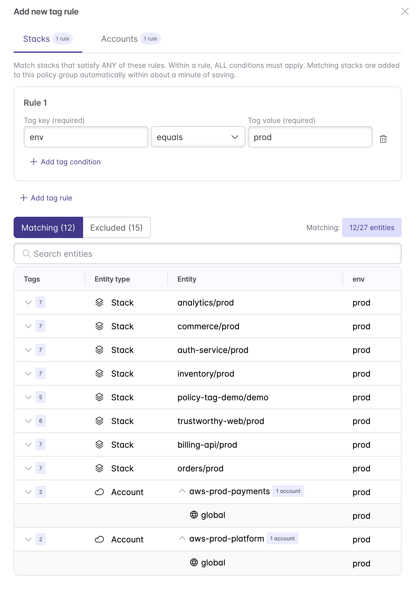

[Policy groups](/docs/discovery-governance/concepts/policy-as-code/policy-groups/) decide which [policy packs](/docs/discovery-governance/concepts/policy-as-code/policy-packs/) apply to which stacks and cloud accounts. Until now, stacks and accounts were added to policy groups individually, so every new stack required opting into their correct group by hand. Policy groups membership can now be managed by tags, so new infrastructure gets the right policy coverage automatically as it's created.

<!--more-->

## What's new

Policy groups now support tag matching conditions. Every stack or cloud account whose tags match the condition joins the group, and membership stays current as tags change. Tag rules work alongside the stacks and accounts you add individually, so you can adopt them without restructuring your existing groups.

To add one, open a policy group in Pulumi Cloud and select **Match by tags**.



Or define it in code with the [Pulumi Service Provider](/registry/packages/pulumiservice/):

```typescript
import * as pulumiservice from "@pulumi/pulumiservice";

new pulumiservice.api.PolicyGroup("payments-production", {
    orgName: "my-org",
    name: "payments-production",
    mode: "preventative",
    stackMatchRule: pulumiservice.buildStackMatchRuleOutput({
        rules: [{ conditions: [{ key: "env", value: "prod" }, { key: "team", value: "payments" }] }],
    }).matchRule,
});

new pulumiservice.api.PolicyGroup("pci-accounts", {
    orgName: "my-org",
    name: "pci-accounts",
    mode: "audit",
    accountMatchRule: pulumiservice.buildAccountMatchRuleOutput({
        rules: [{ conditions: [{ key: "env", value: "prod" }, { key: "compliance", value: "pci" }] }],
    }).matchRule,
});
```

## Example: enforcement by environment

A common pattern is one policy group per environment tier, with stricter enforcement in production:

- A **production** preventative group with a rule matching `env: prod`, where critical policies are `mandatory`.
- A **development** preventative group with a rule matching `env: dev`, where the same packs are `advisory`.

A new stack tagged `env: prod` joins your production policy group automatically, with no one editing the group. The same approach works for audit groups and cloud accounts, for example matching accounts tagged `compliance: pci` to an audit group running a [PCI DSS policy pack](/docs/discovery-governance/guides/pre-built-policy-packs/).

## Get started

Tag rules are available now in Pulumi Cloud. To learn more, see [policy groups](/docs/discovery-governance/concepts/policy-as-code/policy-groups/#tag-rules).
