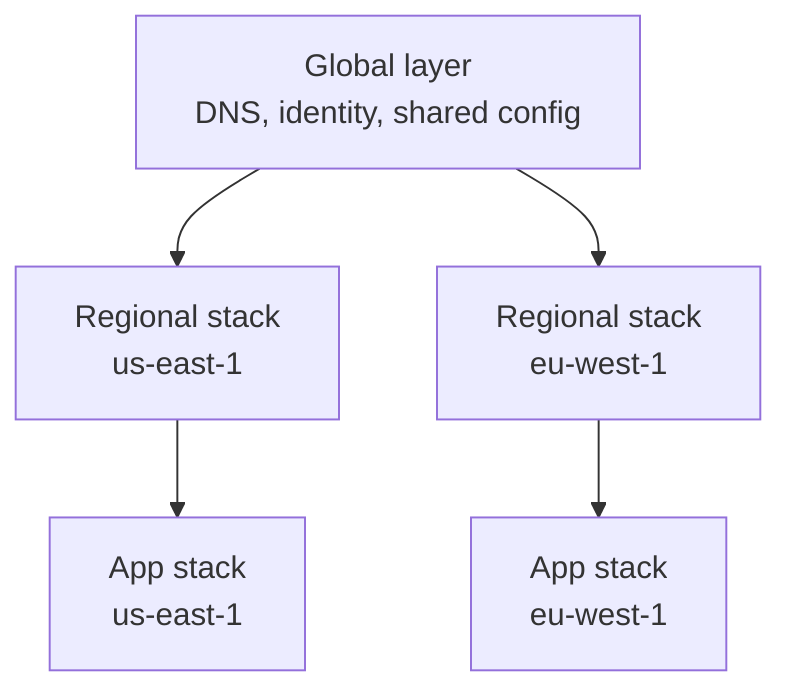

Blast radius is how much of your system fails when one component, region, provider, or change fails. It is a design property, set by where you draw boundaries in your infrastructure, and it differs from uptime, which measures how often a system is available. Two systems with identical uptime can have very different blast radii.

<!--more-->

## Why uptime hides the question that matters

Uptime is an average over time. A system that is up 99.9% of the time looks the same on a dashboard whether each failure takes down 5% of users or all of them. The number tells you how often you were unavailable. It says nothing about how much of the system was involved when you were.

Recent years have brought a steady run of large cloud incidents, and the engineering analysis that follows each one keeps returning to the same design question: when one region, one provider, or one shared dependency fails, how much of everything else goes with it? That question has an answer you can work out before an incident, and it is the subject of the rest of this post.

AWS makes the same point with a concrete example in its guidance on [cell-based architecture](https://docs.aws.amazon.com/wellarchitected/latest/reducing-scope-of-impact-with-cell-based-architecture/what-is-a-cell-based-architecture.html). If you split a workload into 10 cells to service 100 requests, "when a failure occurs in one cell, 90% of the overall requests would be unaffected." The design decides how far a failure spreads.

## What is blast radius in cloud infrastructure?

Blast radius in cloud infrastructure is the set of resources, users, and services affected when a single thing goes wrong. AWS's guidance on cell-based architecture [defines it](https://github.com/aws-solutions-library-samples/guidance-for-cell-based-architecture-on-aws) this way: "Blast radius is defined as the maximum impact that might be sustained in the event of a system failure." AWS also calls the same idea the scope of impact.

There are two kinds worth separating, because they need different defenses:

* **Failure blast radius** is what breaks when infrastructure fails: an Availability Zone, a region, a provider, a database, a shared service.
* **Change blast radius** is what breaks when you change something: a refactor, a version upgrade, a config edit, a policy update. Changes are under your control, which makes this the half you can do the most about.

Both are bounded by the boundaries in your design. The AWS whitepaper on [fault isolation boundaries](https://docs.aws.amazon.com/whitepapers/latest/aws-fault-isolation-boundaries/abstract-and-introduction.html) describes how AWS uses Availability Zones, Regions, control planes, and data planes to contain the scope of impact when failures occur. Your own boundaries sit on top of those: accounts, regions, stacks, and the dependencies that cross them. The AWS Well-Architected Framework summarizes the principle: ["Fault isolation limits the impact of a component or system failure to a defined boundary."](https://docs.aws.amazon.com/wellarchitected/latest/reliability-pillar/use-fault-isolation-to-protect-your-workload.html)

## Design stacks around failure boundaries

In Pulumi, the stack is the unit of state and the unit of update. That makes it a natural place to put a boundary: if two environments or two regions share a stack, a bad update can reach both. If they live in separate stacks, an update touches one at a time. The [organizing projects and stacks guide](/docs/iac/guides/basics/organizing-projects-stacks/) covers the tradeoffs between a few large stacks and many small ones. For blast radius, smaller stacks aligned with failure boundaries win.

A practical layout for a multi-region service has three layers:



The global layer is the hardest to isolate, because every region depends on it. Keep it small, change it rarely, and treat each cross-layer dependency as something you can name and count. [Stack references](/docs/iac/concepts/stacks/#stackreferences) help here, because they turn a dependency into an explicit, reviewable line of code.

In each regional stack, use an explicit provider so the target region is visible in the code. The [providers documentation](/docs/iac/concepts/providers/) explains the difference between default and explicit providers. Version 7 of the AWS provider also added a per-resource `region` property, described in the [AWS provider 7.0 announcement](/blog/announcing-7-0-of-the-pulumi-aws-provider/), which is a lighter option when one program must reach several regions. The example below keeps one explicit provider per region so every target is visible at a glance.

Here is a program that deploys the same component into each region with its own provider. Each region becomes a separate cell in the same codebase:

```typescript
import * as aws from "@pulumi/aws";
import * as pulumi from "@pulumi/pulumi";
import { ServiceDatabase } from "./service-database";

const config = new pulumi.Config();
const regions = config.requireObject<string[]>("regions");

for (const region of regions) {
    const provider = new aws.Provider(`aws-${region}`, { region: region as aws.Region });

    new ServiceDatabase(`db-${region}`, { instanceClass: "db.r6g.large" }, { provider });
}
```

If you run one stack per region, each stack's config holds a single region and the loop runs once. If one stack holds several regions, you gain convenience and give up isolation. Decide on purpose.

A cell-based layout takes the same idea further. Each cell is a complete, independent copy of the service that handles a slice of traffic, so a failure in one cell leaves the others untouched. With even partitioning, the share of traffic per cell, 1/N, is your failure blast radius for anything contained inside the cell.

## A worked example: the small change with a large blast radius

Consider a platform team that owns a `ServiceDatabase` component. Thirty product teams consume it across regions. A developer tidies the component and renames the logical name of the database resource inside it from `db` to `primary`. The diff is one line. It looks like a no-op.

Pulumi identifies each resource by its [URN](/docs/iac/concepts/resources/names/#urns), which encodes the stack, the project, the resource's type qualified by its parents' types, and its name. Changing the name changes the URN, so Pulumi sees the old resource as gone and a new one as wanted. The [aliases documentation](/docs/iac/concepts/resources/options/aliases/) describes the behavior: by default, a renamed resource is replaced by a new one, and the old one is deleted.

The preview shows it plainly. This output is illustrative:

```text
Previewing update (prod-us-east-1):

     Type                             Name                    Plan
     pulumi:pulumi:Stack              orders-prod-us-east-1
     └─ acme:index:ServiceDatabase    db-us-east-1
 +      ├─ aws:rds/instance:Instance  primary                 create
 -      └─ aws:rds/instance:Instance  db                      delete

Resources:
    + 1 to create
    - 1 to delete
    2 unchanged
```

Nothing has happened yet. That is the point of a preview. But the same component version is consumed everywhere, so the same plan appears in every consuming stack the moment each team upgrades. The change blast radius is the number of consumers multiplied by the stateful resources each one owns. A one-line rename becomes a database deletion in thirty stacks.

Four mechanisms keep this from reaching production:

1. **Read the preview in the pull request.** `pulumi preview --diff` shows the change as a rich diff. The [GitHub app](/docs/integrations/version-control/github-app/) can post preview results as a pull request comment, so a reviewer sees "1 to delete" next to the one-line code change.
2. **Gate on destructive operations.** `pulumi preview --json` produces machine-readable output. A CI step can count delete and replace operations and fail the build when stateful resources appear in that count:

    ```bash
    pulumi preview --json > preview.json
    jq -e '[(.steps // [])[]
            | select(.op == "delete" or .op == "replace" or .op == "delete-replaced")
            | select(.urn | test("aws:rds/|aws:dynamodb/"))] | length == 0' preview.json
    ```

    With `-e`, jq exits non-zero when the result is false, so the step fails. Adjust the list of stateful resource types to match your estate.

3. **Protect stateful resources.** A resource with `protect: true` cannot be deleted. In the [protect documentation](/docs/iac/concepts/resources/options/protect/) words, "it will be an error to do a Pulumi deployment which tries to delete a protected resource for any reason." The delete of the old database is refused instead of going through. Pulumi creates replacements before it deletes the old resource, so an update can still create the new instance first. Catch the problem in the preview, or avoid it with an alias.
4. **Fix the refactor with an alias.** Adding `aliases: [{ name: "db" }]` to the renamed resource tells Pulumi the old and new URNs are the same resource, and the preview shows an unchanged resource instead of a delete and a create. The [refactoring with aliases guide](/docs/iac/operations/stack-management/refactoring-with-aliases/) walks through renames, type changes, and re-parenting.

For changes where you want an exact commitment, update plans go one step further. You save the preview with `pulumi preview --save-plan=plan.json` and apply it with `pulumi up --plan=plan.json`, which constrains the update to only the operations that were planned. [Update plans](/docs/iac/operations/stack-management/update-plans/) are experimental, so check the documentation before you rely on them.

## How do you measure blast radius before an incident?

You measure it by counting what shares a fate. Before an incident, the answer comes from your infrastructure code and its state, because both describe exactly what depends on what. Track a short list of numbers and review them whenever the architecture changes:

| Measure | What it tells you | Where to get it |
| --- | --- | --- |
| Share of traffic or users per cell or region | Failure blast radius of one cell (1/N) | Load balancer or routing config |
| Resources and stacks per region | How much one regional failure touches | `pulumi stack ls`, stack outputs |
| Shared dependencies every region needs | The part of the system with no isolation | Stack references, DNS, identity config |
| Cross-stack reference fan-out | How many stacks one upstream change reaches | Stack reference usage |
| Replace and delete counts on stateful resources, per preview | Change blast radius of one update | `pulumi preview --json` |
| Resources with drift | Places where reality differs from the design | Drift detection runs |

### How do you understand the blast radius of a change before approving it?

Read the preview to see every create, update, replace, and delete. Check how many stacks consume the changed component or reference the changed outputs. Run policy checks against the proposed state so that violations surface before approval. Then require the same review for every author, human or automated.

## Catch drift before it widens the blast radius

Isolation boundaries only hold while the infrastructure matches the design. Someone opens a security group during an incident and forgets to close it. A teammate adds a console-created dependency from one region to a service in another. Neither change appears in code, so neither shows up in review, and your cells quietly become coupled.

The CLI gives you two basic checks. `pulumi refresh --preview-only` compares state against the real cloud without changing anything, and adding `--expect-no-changes` makes `pulumi refresh --preview-only --expect-no-changes` exit with an error when drift exists, which makes it a good CI assertion for stacks that should be stable. Plain `pulumi preview --expect-no-changes` compares your code with state, so it catches unreviewed code changes.

To run the check continuously, [Pulumi Cloud drift detection](/docs/deployments/concepts/drift/) runs detection on a schedule, lists drifted resources in a Drift tab, sends webhook notifications, and can auto-remediate by running `pulumi up --refresh` after a detection run finds drift. Treat each reported drift as a boundary violation to investigate, because the unexplained change is often the one that couples two things you meant to keep apart.

## Encode isolation boundaries as policy

Tribal knowledge does not scale past the people who hold it. If "never open this port" and "production databases are always multi-AZ" live in someone's head, they will be broken the first time that person is on vacation. Policy as code turns those rules into checks that run on every change.

[Pulumi Policies](/docs/discovery-governance/concepts/policy-as-code/) run during `pulumi preview` and `pulumi up`, before anything changes in your cloud provider. Each policy has an enforcement level of advisory, mandatory, remediate, or disabled, and a violation of a mandatory policy stops the deployment. Policy groups apply packs to specific stacks or cloud accounts, so production can carry stricter rules than a sandbox.

This policy blocks the kind of change that expands blast radius, a production database with a single point of failure:

```typescript
import * as aws from "@pulumi/aws";
import { PolicyPack, validateResourceOfType } from "@pulumi/policy";

new PolicyPack("isolation-boundaries", {
    enforcementLevel: "advisory",
    policies: [{
        name: "rds-multi-az",
        description: "RDS instances must run in more than one Availability Zone.",
        enforcementLevel: "mandatory",
        validateResource: validateResourceOfType(aws.rds.Instance, (instance, args, reportViolation) => {
            if (!instance.multiAz) {
                reportViolation("RDS instances must enable multiAz so a single zone failure stays contained.");
            }
        }),
    }],
});
```

This policy covers `aws.rds.Instance`; Aurora uses `aws.rds.Cluster`, which needs its own rule. The same pattern works for rules like denying ingress from `0.0.0.0/0`, or allowing resources only in the regions a stack is meant to use.

## Where agents fit

AI agents raise the volume of infrastructure changes, which makes the review path matter more. Pulumi Neo can propose infrastructure changes, and for code changes it opens a pull request for your team to review and deploy. The preview, the policy checks, and the protect flags described above apply to that pull request exactly as they do to a human one. The boundaries do the work, whoever writes the change.

## A blast radius checklist

Use this list in design reviews and when you inherit an existing system:

1. List every failure boundary you rely on: Availability Zone, region, account, provider, stack.
2. Give each region or environment its own stack, with an explicit provider and its own config.
3. Name every shared dependency that all cells need, and keep that layer small and slow to change.
4. Make cross-stack dependencies explicit with stack references, and count how many stacks each one reaches.
5. Mark stateful resources `protect: true`, and use aliases when you refactor names, types, or parents.
6. Run `pulumi preview` on every pull request and fail the build when stateful resources are deleted or replaced.
7. Schedule drift detection, and treat unexplained drift as a boundary violation.
8. Encode your isolation rules as mandatory policies, and apply stricter policy groups to production.
9. Deploy one cell or region stack at a time, and stop the rollout when a stack fails.

## Frequently asked questions

### What is blast radius in software?

Blast radius is the amount of a system affected when one component, change, or dependency fails. A small blast radius means a failure stays contained to a single cell, region, or stack. A large one means the same failure spreads to many users or services.

### How is blast radius different from uptime?

Uptime measures how often a system is available, averaged over time. Blast radius measures how much of the system fails during a single incident. Two systems can share the same uptime figure while one loses 5% of its users per failure and the other loses all of them.

### What is cell-based architecture?

Cell-based architecture splits a workload into independent, identical copies called cells, each serving a slice of traffic. A failure in one cell leaves the rest running. With 10 cells, a single cell failure leaves about 90% of requests unaffected.

### How does Pulumi show the blast radius of a change?

`pulumi preview` lists every resource a change would create, update, replace, or delete before anything is applied. Reviewing that list, or counting delete and replace operations in `pulumi preview --json`, shows how far a change reaches. Policies and protected resources can then block the dangerous parts.

### Does multi-region deployment eliminate blast radius?

No. Multi-region deployment shrinks the failure blast radius for regional failures, but shared dependencies such as DNS, identity, and a common deployment pipeline still span every region. A change that ships to all regions at once also has a large change blast radius, so deploy one region at a time and stop when a stack fails.
