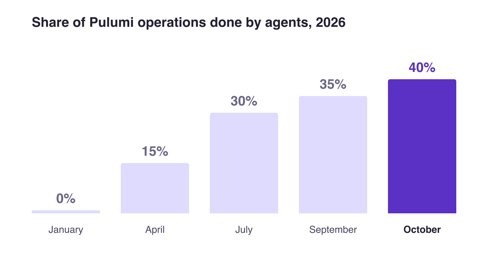
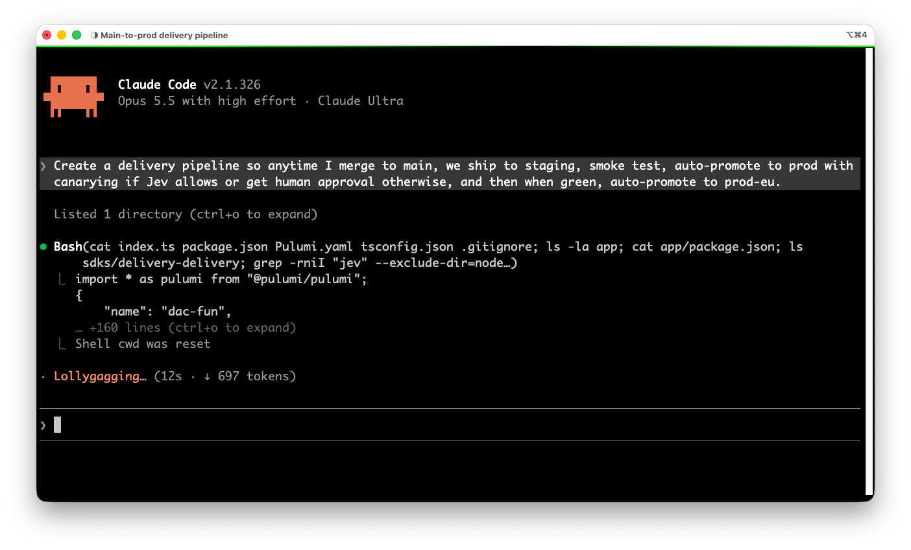
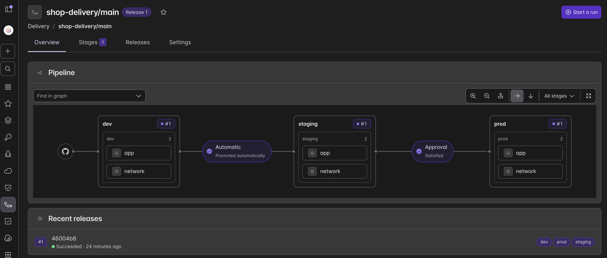
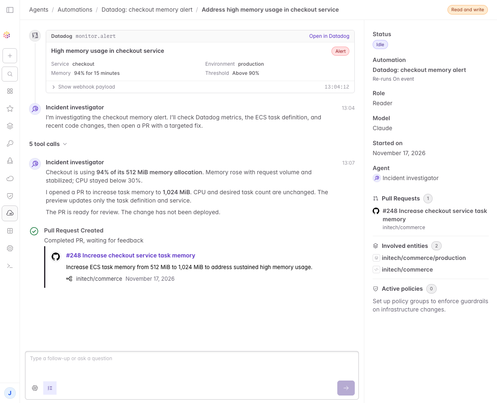

*Introducing Pulumi Delivery and Pulumi Agents: agentic code to production, and back again.*

At Pulumi, we like code. A lot. And we aren't the only ones: agents like it too. This year, the share of infrastructure operations on Pulumi done by agents went from zero in January to over 40% in October. Anything expressed as code (infrastructure, policy, configuration) is something an agent can work on. [Today we're extending that](/releases/pulumi-agents-and-delivery/) to everything after the merge with two launches: [Pulumi Delivery](/product/delivery/), which lets you and your agents write delivery pipelines as code, and [Pulumi Agents](/product/agents/), customizable agents that watch your running systems and act when something goes wrong. Together, they take agentic code to production, and back again. I honestly can't remember a launch since Pulumi 1.0 that our customers and team have been this excited about.

<!--more-->




[TypeSafe AI](https://typesafe.ai) bet on Pulumi to scale Jev, their decision model, to over a trillion tokens per day using the engineering practices they already had.


## What happens after the merge

Frontier labs have made huge advances in agentic coding, code review, and everything up to the merge. Claude Code, Codex, and friends now write and test a growing share of the code we ship, and the labs felt it first. [Anthropic's monorepo](https://www.anthropic.com/research/redesigning-source-control) went from about 2,500 merges a day in May to over 30,000 by September. At OpenAI, where one engineer now has several changes ready for CI at once, [Git reliability at times fell below 90%](https://openai.com/index/scaling-git-at-openai/) under the load. Both rebuilt source control to keep up. And then it all stops at the pull request. Everything after the merge (provisioning, configuration, secrets, policy, and delivery) still runs on scripts, tickets, and waiting. Today's SDLC was designed for human hands working at human speed, and it has become the bottleneck. An agentic SDLC needs agentic delivery, too.

We set out to answer a few questions. How does code get to production, and which gates does it pass through? Which of those gates need a human, and which can an agent handle? When something breaks in production, who responds, and how does the fix get back into the code? Pulumi Delivery and Pulumi Agents are our answers.


Today's SDLC was designed for human hands working at human speed, and it has become the bottleneck. An agentic SDLC needs agentic delivery, too.


## Built on infrastructure as code

These capabilities take the Pulumi platform beyond infrastructure, but they're built on what we've learned there. Since 2017, our open source infrastructure as code has let you express infrastructure in whatever language your team already knows, and today thousands of teams use Pulumi every month to turn the cloud into a competitive edge. [TypeSafe AI](https://typesafe.ai) bet on Pulumi to scale Jev, their decision model, to over a trillion tokens per day using the engineering practices they already had.

That bet turned out to be as good for agents as it is for people. Models have learned from billions of lines of TypeScript, Python, HCL, and Go, and from almost nothing about cloud consoles and tickets, and every frontier lab benchmarks them relentlessly on code. When you put infrastructure in a language the model already knows, it becomes a coding problem, which agents are good at, and Pulumi carries out the resulting intent. [Research backs this up](https://arxiv.org/abs/2402.01030): across 17 models, agents succeeded up to 20% more often when they acted by writing code than by emitting JSON or text.

We've watched this play out on our own platform, where the share of infrastructure operations done by agents climbed from 15% in April to 30% in July and over 40% in October. Agents are about to do the majority of infrastructure updates, and they can do so safely thanks to platform guardrails. IaC is itself a guardrail: every change is a code diff with a deterministic plan that you can review before anything happens. On top of that, agents get scoped credentials and secrets, and we continuously enforce policy across any cloud or compliance framework. We run this way ourselves: 85% of the changes to Pulumi's own core service are now written or reviewed by our engineering agents. We are [driving hard toward 100%](/blog/the-agentic-infrastructure-era/).

Working with customers, we've also seen where everything around IaC falls short. Delivery pipelines are still hodgepodges of scripts, manual configurations and approvals, YAML files, and homegrown systems. These approaches are agent-hostile, because we as an industry built them assuming humans clicking and copy-pasting on the critical path was okay. And once code is live, operations still runs on pages, dashboards, and manual toil.

## Pulumi Delivery: agentic delivery as code

[Pulumi Delivery](/product/delivery/) puts your entire release process in code: stages, promotion and rollout policies, gates, jobs, and everything else between merge and production. As with infrastructure as code, you write it in TypeScript, Python, HCL, Go, C#, Java, or YAML, which is great for humans as well as agents. Software engineering suddenly applies, so you can test, share, and reuse pipeline definitions.

Because Delivery extends Pulumi's core model, pipelines share its type system, policy engine, stack and resource dependencies, secrets, and state. And it runs what you already have, including Pulumi, Terraform, OpenTofu, Ansible, and open-ended jobs. It works alongside the CI you already use for build and test, picking up at the merge.

Tell your agent to ship every merge through staging and into production, letting Jev decide when a human needs to approve, and watch it go:



Here's the pipeline the agent wrote, minus the canary and prod-eu stages, in your language of choice:



{}

```typescript
import * as delivery from "@pulumi/delivery";

// Run the pipeline on every push to main.
const repo = new delivery.GitHubSource("repo", {
    repository: "acme/shop",
    branch: "main",
    trigger: true,
});

const pipeline = new delivery.Pipeline("shop");

// Jev answers one question about each release headed to prod.
const jev = {
    kind: "decision",
    questions: {
        risky: {
            instructions: "Is this deployment too risky to promote on its own?",
            maximumRisk: 0.1,
        },
    },
};

const dev = new delivery.Stage("dev", { pipeline });
const staging = new delivery.Stage("staging", { pipeline, from: [dev] });
const prod = new delivery.Stage("prod", {
    pipeline,
    from: [staging],
    // Promote when Jev clears the release or a person approves it.
    when: { kind: "any", rules: [jev, { kind: "approval" }] },
});

for (const [env, stage] of Object.entries({ dev, staging, prod })) {
    new delivery.Stacks(env, {
        stage,
        stacks: {
            network: {
                stack: `shop-network/${env}`,
                source: repo,
                directory: "network",
            },
            app: {
                stack: `shop-app/${env}`,
                source: repo,
                directory: "app",
            },
        },
    });
}
```

{}
{}

```python
import pulumi_delivery as delivery

# Run the pipeline on every push to main.
repo = delivery.GitHubSource("repo",
    repository="acme/shop",
    branch="main",
    trigger=True)

pipeline = delivery.Pipeline("shop")

# Jev answers one question about each release headed to prod.
jev = {
    "kind": "decision",
    "questions": {
        "risky": {
            "instructions": "Is this deployment too risky to promote on its own?",
            "maximum_risk": 0.1,
        },
    },
}

dev = delivery.Stage("dev", pipeline=pipeline)
staging = delivery.Stage("staging", pipeline=pipeline, from_=[dev])
prod = delivery.Stage("prod",
    pipeline=pipeline,
    from_=[staging],
    # Promote when Jev clears the release or a person approves it.
    when={"kind": "any", "rules": [jev, {"kind": "approval"}]})

for env, stage in {"dev": dev, "staging": staging, "prod": prod}.items():
    delivery.Stacks(env,
        stage=stage,
        stacks={
            "network": {
                "stack": f"shop-network/{env}",
                "source": repo,
                "directory": "network",
            },
            "app": {
                "stack": f"shop-app/{env}",
                "source": repo,
                "directory": "app",
            },
        })
```

{}
{}

```hcl
# Run the pipeline on every push to main.
resource "delivery_git_hub_source" "repo" {
  repository = "acme/shop"
  branch     = "main"
  trigger    = true
}

resource "delivery_pipeline" "shop" {}

resource "delivery_stage" "dev" {
  pipeline = delivery_pipeline.shop
}

resource "delivery_stage" "staging" {
  pipeline = delivery_pipeline.shop
  from     = [delivery_stage.dev]
}

resource "delivery_stage" "prod" {
  pipeline = delivery_pipeline.shop
  from     = [delivery_stage.staging]

  # Promote when Jev clears the release or a person approves it.
  when = {
    kind = "any"
    rules = [
      {
        kind = "decision"
        questions = {
          risky = {
            instructions = "Is this deployment too risky to promote on its own?"
            maximum_risk = 0.1
          }
        }
      },
      { kind = "approval" },
    ]
  }
}

resource "delivery_stacks" "env" {
  for_each = {
    dev     = delivery_stage.dev
    staging = delivery_stage.staging
    prod    = delivery_stage.prod
  }

  stage = each.value
  stacks = {
    network = {
      stack     = "shop-network/${each.key}"
      source    = delivery_git_hub_source.repo
      directory = "network"
    }
    app = {
      stack     = "shop-app/${each.key}"
      source    = delivery_git_hub_source.repo
      directory = "app"
    }
  }
}
```

{}
{}

```go
package main

import (
	"github.com/pulumi/pulumi-delivery/sdk/go/delivery"
	"github.com/pulumi/pulumi/sdk/v3/go/pulumi"
)

// Jev answers one question about each release headed to prod.
const risky = "Is this deployment too risky to promote on its own?"

func main() {
	pulumi.Run(func(ctx *pulumi.Context) error {
		// Run the pipeline on every push to main.
		repo, err := delivery.NewGitHubSource(ctx, "repo",
			&delivery.GitHubSourceArgs{
				Repository: pulumi.String("acme/shop"),
				Branch:     pulumi.String("main"),
				Trigger:    pulumi.Any(true),
			})
		if err != nil {
			return err
		}

		pipeline, err := delivery.NewPipeline(ctx, "shop", nil)
		if err != nil {
			return err
		}

		dev, err := delivery.NewStage(ctx, "dev", &delivery.StageArgs{
			Pipeline: pipeline,
		})
		if err != nil {
			return err
		}
		staging, err := delivery.NewStage(ctx, "staging", &delivery.StageArgs{
			Pipeline: pipeline,
			From:     delivery.StageArray{dev},
		})
		if err != nil {
			return err
		}
		prod, err := delivery.NewStage(ctx, "prod", &delivery.StageArgs{
			Pipeline: pipeline,
			From:     delivery.StageArray{staging},
			// Promote when Jev clears the release or a person approves it.
			When: &delivery.RuleArgs{
				Kind: pulumi.String("any"),
				Rules: delivery.RuleArray{
					&delivery.RuleArgs{
						Kind: pulumi.String("decision"),
						Questions: delivery.DecisionQuestionMap{
							"risky": &delivery.DecisionQuestionArgs{
								Instructions: pulumi.String(risky),
								MaximumRisk:  pulumi.Float64(0.1),
							},
						},
					},
					&delivery.RuleArgs{Kind: pulumi.String("approval")},
				},
			},
		})
		if err != nil {
			return err
		}

		for _, s := range []struct {
			env   string
			stage *delivery.Stage
		}{{"dev", dev}, {"staging", staging}, {"prod", prod}} {
			_, err := delivery.NewStacks(ctx, s.env, &delivery.StacksArgs{
				Stage: s.stage,
				Stacks: delivery.StacksEntryMap{
					"network": &delivery.StacksEntryArgs{
						Stack:     pulumi.String("shop-network/" + s.env),
						Source:    repo,
						Directory: pulumi.String("network"),
					},
					"app": &delivery.StacksEntryArgs{
						Stack:     pulumi.String("shop-app/" + s.env),
						Source:    repo,
						Directory: pulumi.String("app"),
					},
				},
			})
			if err != nil {
				return err
			}
		}
		return nil
	})
}
```

{}
{}

```csharp
using System.Collections.Generic;
using Pulumi;
using Pulumi.Delivery.Delivery.Inputs;
using Delivery = Pulumi.Delivery.Delivery;

return await Deployment.RunAsync(() =>
{
    // Run the pipeline on every push to main.
    var repo = new Delivery.GitHubSource("repo", new()
    {
        Repository = "acme/shop",
        Branch = "main",
        Trigger = true,
    });

    var pipeline = new Delivery.Pipeline("shop");

    // Jev answers one question about each release headed to prod.
    const string risky = "Is this deployment too risky to promote on its own?";
    var jev = new RuleArgs
    {
        Kind = "decision",
        Questions =
        {
            { "risky", new DecisionQuestionArgs
            {
                Instructions = risky,
                MaximumRisk = 0.1,
            } },
        },
    };

    var dev = new Delivery.Stage("dev", new() { Pipeline = pipeline });
    var staging = new Delivery.Stage("staging", new()
    {
        Pipeline = pipeline,
        From = { dev },
    });
    var prod = new Delivery.Stage("prod", new()
    {
        Pipeline = pipeline,
        From = { staging },
        // Promote when Jev clears the release or a person approves it.
        When = new RuleArgs
        {
            Kind = "any",
            Rules = { jev, new RuleArgs { Kind = "approval" } },
        },
    });

    var stages = new Dictionary<string, Delivery.Stage>
    {
        ["dev"] = dev,
        ["staging"] = staging,
        ["prod"] = prod,
    };
    foreach (var (env, stage) in stages)
    {
        new Delivery.Stacks(env, new()
        {
            Stage = stage,
            Stacks =
            {
                { "network", new StacksEntryArgs
                {
                    Stack = $"shop-network/{env}",
                    Source = repo,
                    Directory = "network",
                } },
                { "app", new StacksEntryArgs
                {
                    Stack = $"shop-app/{env}",
                    Source = repo,
                    Directory = "app",
                } },
            },
        });
    }
});
```

{}
{}

```java
package myproject;

import com.pulumi.Pulumi;
import com.pulumi.delivery.delivery.*;
import com.pulumi.delivery.delivery.inputs.*;
import java.util.List;
import java.util.Map;

public class App {
    // Jev answers one question about each release headed to prod.
    static final String RISKY =
        "Is this deployment too risky to promote on its own?";

    public static void main(String[] args) {
        Pulumi.run(ctx -> {
            // Run the pipeline on every push to main.
            var repo = new GitHubSource("repo", GitHubSourceArgs.builder()
                .repository("acme/shop")
                .branch("main")
                .trigger(true)
                .build());

            var pipeline = new Pipeline("shop");

            var jev = RuleArgs.builder()
                .kind("decision")
                .questions(Map.of("risky", DecisionQuestionArgs.builder()
                    .instructions(RISKY)
                    .maximumRisk(0.1)
                    .build()))
                .build();

            var dev = new Stage("dev", StageArgs.builder()
                .pipeline(pipeline)
                .build());
            var staging = new Stage("staging", StageArgs.builder()
                .pipeline(pipeline)
                .from(dev)
                .build());
            var prod = new Stage("prod", StageArgs.builder()
                .pipeline(pipeline)
                .from(staging)
                // Promote when Jev clears the release or a person approves it.
                .when(RuleArgs.builder()
                    .kind("any")
                    .rules(jev, RuleArgs.builder().kind("approval").build())
                    .build())
                .build());

            var stages = List.of(
                Map.entry("dev", dev),
                Map.entry("staging", staging),
                Map.entry("prod", prod));
            for (var s : stages) {
                var env = s.getKey();
                new Stacks(env, StacksArgs.builder()
                    .stage(s.getValue())
                    .stacks(Map.of(
                        "network", StacksEntryArgs.builder()
                            .stack("shop-network/" + env)
                            .source(repo)
                            .directory("network")
                            .build(),
                        "app", StacksEntryArgs.builder()
                            .stack("shop-app/" + env)
                            .source(repo)
                            .directory("app")
                            .build()))
                    .build());
            }
        });
    }
}
```

{}
{}

```yaml
name: shop-delivery
runtime: yaml
resources:
  # Run the pipeline on every push to main.
  repo:
    type: delivery:GitHubSource
    properties:
      repository: acme/shop
      branch: main
      trigger: true
  pipeline:
    type: delivery:Pipeline
    name: shop
  dev:
    type: delivery:Stage
    properties:
      pipeline: ${pipeline}
  staging:
    type: delivery:Stage
    properties:
      pipeline: ${pipeline}
      from: ["${dev}"]
  prod:
    type: delivery:Stage
    properties:
      pipeline: ${pipeline}
      from: ["${staging}"]
      # Promote when Jev clears the release or a person approves it.
      when:
        kind: any
        rules:
          - kind: decision
            questions:
              risky:
                instructions: Is this deployment too risky to promote on its own?
                maximumRisk: 0.1
          - kind: approval
  devStacks:
    type: delivery:Stacks
    name: dev
    properties:
      stage: ${dev}
      stacks:
        network:
          stack: shop-network/dev
          source: ${repo}
          directory: network
        app:
          stack: shop-app/dev
          source: ${repo}
          directory: app
  stagingStacks:
    type: delivery:Stacks
    name: staging
    properties:
      stage: ${staging}
      stacks:
        network:
          stack: shop-network/staging
          source: ${repo}
          directory: network
        app:
          stack: shop-app/staging
          source: ${repo}
          directory: app
  prodStacks:
    type: delivery:Stacks
    name: prod
    properties:
      stage: ${prod}
      stacks:
        network:
          stack: shop-network/prod
          source: ${repo}
          directory: network
        app:
          stack: shop-app/prod
          source: ${repo}
          directory: app
```

{}

From there, Pulumi Cloud shows you where every release is, or was, at any given time, so you always know what's waiting on whom:



Your app and its network ship together through one pipeline, whether a person or an agent wrote the change.

## Pulumi Agents: from production back to code

Delivery gets code to production. But what happens when alarms start firing? That's where [Pulumi Agents](/product/agents/) comes in. Provision engineering and infrastructure agents that monitor your running systems, react to events from PagerDuty, Datadog, Sentry, and Honeycomb, or run on a schedule. Start with the agents Pulumi provides for incident investigation, drift, cost, upgrades, and security remediation, or define your own in code, with your own prompts, skills, integrations, and triggers. Bring any agent you like: Neo, our infrastructure agent, or Claude Code, Codex, and OpenCode, on Pulumi's models or your own keys.

Every agent gets its own identity, a least-privilege role, and short-lived credentials from Pulumi ESC. Agents never change production directly. Any change an agent wants to make arrives as a pull request with a deterministic plan, checked against the same policies as your engineers' changes.

Here, a Datadog memory alert on the checkout service dispatches an incident investigator, which traces the cause and opens a pull request to raise the task's memory, without deploying anything:




Every agent gets its own identity and a least-privilege role. Agents never change production directly: their changes arrive as pull requests, checked against the same policies as your engineers'.


## Closing the loop

Put Delivery and Agents together, and you get the whole loop. Gates in your pipelines can ask an agent, or a decision model like Jev, to score a deployment's risk. Low-risk changes promote themselves, region by region, with health checks at every stage. Risky ones wait for a person, who can approve right from Slack. Once in production, agents are dispatched by the signals your systems already emit, and their fixes come back through the pipeline, gated like every other change. Engineers and agents follow one path under one set of rules, and you set the autonomy slider wherever you're comfortable, from human in charge, to human in the loop, to full autonomy. No matter what, deterministic guardrails and audit trails are kept.

## One platform for the agentic SDLC

All of this is built on the same platform as our core IaC, powered by one context graph, data model, and API across your applications and infrastructure. Pulumi knows which deploy changed which resources, what's running where, and what depends on what, so an agent investigating an alert starts with that context instead of guessing. And because it's one system, the same identity, RBAC, policies, and audit trail apply to the new products and the existing ones alike.

We think this is what the agentic SDLC looks like after the merge. Pulumi Delivery and Pulumi Agents are [available today](/releases/pulumi-agents-and-delivery/) in public preview. Delivery is available in every edition of Pulumi Cloud, including Free. For the full tour of each product, read the companion posts:

[**Read the blog**: Introducing Pulumi Delivery &rarr;](/blog/introducing-pulumi-delivery/)

[**Read the blog**: Introducing Pulumi Agents &rarr;](/blog/introducing-pulumi-agents/)

You can get started with [Delivery](/docs/delivery/get-started/) or [Agents](/up/) now, or see them in action on the [Pulumi Delivery](/product/delivery/) and [Pulumi Agents](/product/agents/) product pages. If we can help with agents at your company, please [get in touch](/contact/).

We're only just getting started, and we can't wait to hear what you think.

Happy clouding,

\-Joe
