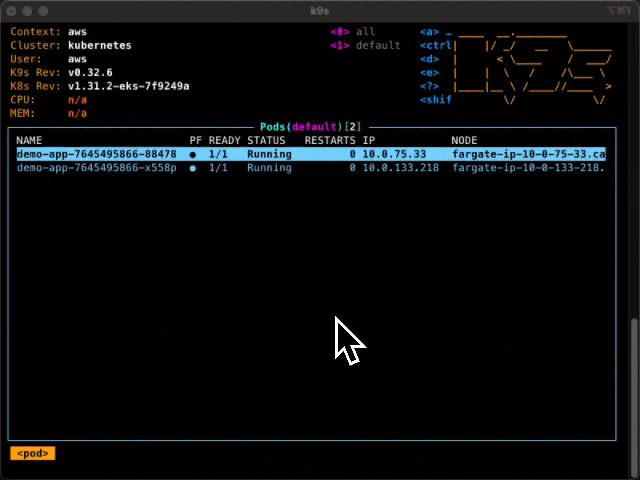
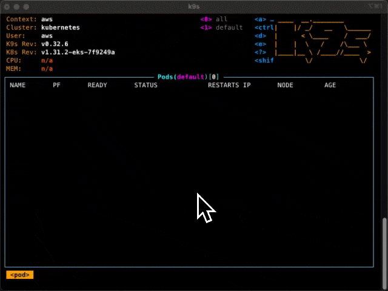
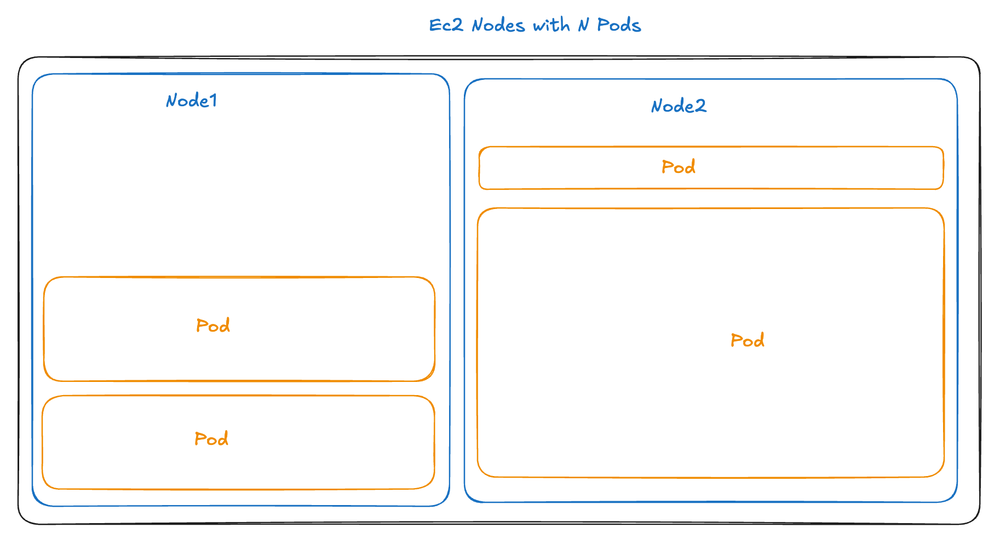
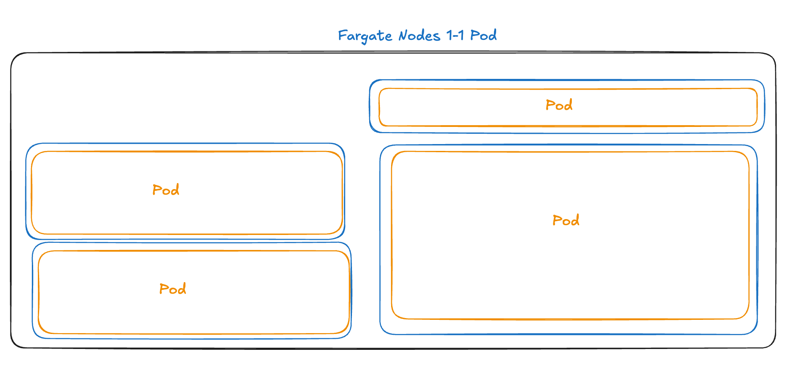

Choose AWS Fargate when you want AWS to run the servers: spiky or isolated workloads, small teams, and no node patching. Choose EC2 when you need the lowest cost per container at steady load, GPUs, DaemonSets, or deep Spot discounts. Many teams run both.

The same choice shows up on Amazon ECS and Amazon EKS. Either way you decide how your containers will actually run: on EC2 instances you manage or through Fargate's one-task-at-a-time approach. The differences can be pretty dramatic in practice. I'm setting up a demo EKS cluster right now using Pulumi, so let me show you what I mean. Later sections cover the ECS version of the same decision.

1. [Bin Packing](/blog/fargate-vs-ec2/#bin-packing)
2. [Pros and Cons](/blog/fargate-vs-ec2/#pros-and-cons)
3. [Workload Example: Static Analysis](/blog/fargate-vs-ec2/#workload-example-static-analysis)
4. [Example: Go Services for E-commerce](/blog/fargate-vs-ec2/#example-go-services-for-e-commerce)
5. [Fargate vs EC2 Pricing](/blog/fargate-vs-ec2/#fargate-vs-ec2-pricing)
6. [Misconceptions About Fargate](/blog/fargate-vs-ec2/#misconceptions-about-fargate)
7. [Fargate vs EC2 on Amazon ECS](/blog/fargate-vs-ec2/#fargate-vs-ec2-on-amazon-ecs)
8. [Managing Container Orchestration with Pulumi](/blog/fargate-vs-ec2/#managing-container-orchestration-with-pulumi)
9. [Frequently Asked Questions](/blog/fargate-vs-ec2/#frequently-asked-questions)
10. [Why Not Both](/blog/fargate-vs-ec2/#why-not-both)

Here is my Fargate cluster:

```python
import pulumi
import pulumi_awsx as awsx
import pulumi_eks as eks
import pulumi_kubernetes as k8s

# Create VPC with default CIDR
eks_vpc = awsx.ec2.Vpc("eks-vpc",
    enable_dns_hostnames=True)

# Create minimal EKS cluster
eks_cluster = eks.Cluster("eks-cluster",
    vpc_id=eks_vpc.vpc_id,
    private_subnet_ids=eks_vpc.private_subnet_ids,
    fargate=True,
)

pulumi.export("kubeconfig", eks_cluster.kubeconfig)
```

And when I look in k9s I see this:



You can see that each pod is on its own node. Even the core-dns pods in the system namespace are each on their own nodes. That is a lot of nodes, and it's going to keep growing with my cluster.

If I change my cluster to be backed by EC2 nodes, I get something different.

```diff
eks_cluster = eks.Cluster("eks-cluster",
    vpc_id=eks_vpc.vpc_id,
    private_subnet_ids=eks_vpc.private_subnet_ids,
-   fargate=True,
+   instance_type="t3.medium",
+   desired_capacity=2,
+   min_size=1,
+   max_size=2,
)
```

Now, there are only two nodes, with the pods distributed among them. Those are my two `t3.medium`s.



So when should you use Fargate, and when EC2? Well, it really all relates to what we are seeing here with the number and size of nodes.

Let me explain.

## Bin Packing

Normally, the Kubernetes scheduler has to solve a bin-packing problem—fitting M pods across N nodes based on available resources. This is a straight-up resource optimization problem of balancing CPU, memory, and other resource demands across the cluster.

This can be surprisingly complex in practice. Teams must balance selecting the right instance types for different workload needs while managing multiple node groups. Adding to this complexity are scheduling rules and resource quotas that need careful configuration. Perhaps most challenging is striking the right balance between high resource utilization and maintaining enough headroom for spikes in demand.



With Fargate, AWS sidesteps this challenge by providing a correctly sized bin for each pod. Each Fargate pod runs on its own dynamically provisioned, right-sized mini-environment, where the "bin" (the Fargate instance) is sized to match the pod's requested resources. This means there's no need for Kubernetes to optimize resource usage across a pool of shared nodes, as each pod effectively has its own "container" provided by Fargate that fits it's needs precisely.

In other words, AWS effectively pushes this bin-packing responsibility to itself, so you don't have to worry ( as much ) about it.



{}
While Fargate abstracts away node management, it's important to understand that Fargate pods [still run on EC2 instances](https://justingarrison.com/blog/2024-02-08-fargate-is-not-firecracker/) behind the scenes. And each Fargate pod gets its own ENI (Elastic Network Interface) that can sometimes limit your scaling because pods aren't sharing a network namespace.
{}

## Pros and Cons

So yeah, Fargate abstracts away the complexity of managing nodes and scaling clusters by shifting bin-packing to AWS. With its extensive infrastructure, AWS is arguably better positioned to optimize placements at scale. They can monitor their entire cloud landscape, placing Fargate instances dynamically across available resources. This allows them to potentially leverage underutilized resources in ways that would be challenging or impractical at an individual account's scale.

<div>

| Responsibility | EC2 | Fargate |
|----------------|-----|---------|
| Instance Types | You pick size and provision nodes | AWS provisions per pod request|
| Pod Isolation | You prevent noisy neighbors | AWS isolates each pod |
| Resource Allocation | You find space on nodes | AWS creates dedicated space |

<span style="text-align:center">
    <figcaption>
    <i>Customer vs AWS Responsibility EC2 vs Fargate</i>
    </figcaption>
</span>
</div>

Ideally, this frees you to focus on the services rather than on the underlying infrastructure, but in practice, it's a bit more complex.

Since each pod is treated as a standalone instance, you lose out on the cost efficiencies of co-locating multiple pods on a single node. Even though AWS is "solving" the bin-packing problem globally, to do so, they need to introduce hard barriers, and while noisy neighbors, therefore, aren't a problem, sharing resources is now impossible. In a way, you are throwing away the run time benefit of containers, the shared kernel virtualization, for something more like VMs. And just like VMs, Fargate pods take longer to start than pods on existing EC2 nodes (typically 30-60 seconds vs near-immediate starts).

### A Note on Scaling

Both EC2 and Fargate work with Kubernetes' Horizontal Pod Autoscaling (HPA), which adds or removes pods based on metrics like CPU usage. The difference? With EC2, you need enough nodes available to handle new pods. With Fargate, AWS automatically provisions resources for each new pod - though you'll face that 30-60 second startup delay and potential VPC limits since each pod needs its own network interface.

Here is how the two compare. Details are for Linux on-demand capacity and reflect AWS documentation as of November 2026.

| | Fargate | EC2 |
|---|---|---|
| Cost model | Pay per vCPU and GB for each task or pod, billed per second with a one-minute minimum | Pay per instance, whether or not it is full |
| Ops burden | No nodes to patch, size, or scale | You choose instance types, patch or replace AMIs, and scale node groups |
| GPU support | None | Yes, on GPU instance types |
| Spot support | Fargate Spot on ECS only, up to 70% off. Not available on EKS | EC2 Spot on ECS and EKS, up to 90% off |
| Scaling | Capacity appears per task or pod | Needs spare node capacity or a node autoscaler |
| Startup time | Typically 30-60 seconds | Near instant on a node with room |
| Max size | Up to 16 vCPU and 120 GB per task or pod | Whatever the instance type offers |
| DaemonSets and privileged containers | Not supported on EKS | Supported |
| Storage | 20 GiB ephemeral by default, EFS supported. EKS pods cannot mount EBS | EBS, instance store, and EFS |
| Arm (Graviton) | ECS only | ECS and EKS |

## Workload Example: Static Analysis


Have you ever had to run CPU-intensive batch jobs alongside lighter web services?

In a previous role, when my team and I were tasked with putting our static container image analyzer into production, we went the typical Kubernetes route, throwing it into an EC2-backed K8s cluster. The analyzer was built in Scala, running on the JVM, and was designed to take in work from a Kafka topic. Each analysis ultimately led to the results being sent to a database. We also had scheduled daily rescans of existing images whenever vulnerability lists were updated.

Then, a web app connected to this database and showed all your results. It was stateless and did far less work per request, mainly just answering an HTTP request by talking to a database.

The hard part though is that each analysis job involved uncompressing and analyzing Docker layers from S3 and could use a lot of CPU. Memory needs were around 2 GB per instance, which kept the JVM happy, but long sustained bursts in CPU usage were common, especially during intensive parts of the analysis.

In our K8s setup, the biggest pain point was handling this analysis workload's burstiness and keeping a bunch of stateless web apps up and answering requests. We ran multiple instances of the static analyzer. Still, the analyzer was the worst type of noisy neighbor to other services in the cluster, so we'd end up over-provisioning to ensure we had enough headroom, which led to wasted resources and extra cost. The setup worked, but was not great.

Thinking back, I can see how Fargate could've streamlined things here. With Fargate, each static analyzer instance would run in its own isolated environment, so there'd be no resource contention or need for pre-provisioned node capacity. Each pod would be fully provisioned with the exact CPU and memory needed, and we could do some sort of on-demand scaling to deal with backlogs of analysis work in the Kafka topic.

Fargate on EKS could be a great solution for this type of chunky, resource-heavy macro-services. There are probably other ways to handle this situation, and we worked on decomposing the analysis into smaller chunks, but Fargate might have been a good solution.

But there are lots of situations where Fargate is less of a fit.



## Example: Go Services for E-commerce


Ok, another workload that comes to mind is this one from a friend - He worked on an e-commerce backend with many lightweight Go services, each handling specific tasks—user profiles, catalog browsing, order processing, and notifications. These services were network-heavy, handling gRPC calls and database requests, but they didn't need much CPU or memory per instance.

Fargate wouldn't have made sense here—it would have isolated each pod, preventing resource sharing and driving up costs without real benefit. For lightweight services like these, EC2-backed Kubernetes is perfect, keeping costs low and maximizing resources by sharing nodes across small, efficient services.

So, for lightweight micro-services that can share resources, EC2 nodes with many pods each are probably the way to go.

### Other Fargate Cases

Fargate can excel with long-running event-driven and bursty workloads, where you need compute resources briefly or unpredictably. Think file processing jobs that trigger on uploads, or batch processing that runs sporadically. When jobs are intermittent, Fargate's ability to scale from zero and its isolated resources can outweigh its higher per-pod cost and startup delay. Just ensure your workload can tolerate the 30-60 second cold start.

{}
Fargate has some hard limitations that might rule it out for your use case. On EKS:

- No DaemonSets, privileged containers, HostPort, or HostNetwork
- Maximum of 16 vCPU and 120 GB memory per pod
- 20 GiB of ephemeral storage by default, up to 175 GiB. EFS volumes work, EBS volumes do not
- No GPU, Arm, or Windows support
- No Fargate Spot

{}

## Fargate vs EC2 Pricing

Ok, EC2 costs less than Fargate on a pure cost-of-compute basis. These numbers use the us-east-1 on-demand rates published by AWS in November 2026 for Linux on x86. Fargate charges $0.04048 per vCPU-hour and $0.004445 per GB-hour. A `t3.medium` (2 vCPU, 4 GiB) costs $0.0416 per hour. The same 2 vCPU and 4 GB on Fargate costs about $0.099 per hour, roughly 2.4 times as much for the same raw capacity.

The gap grows or shrinks with packing. If a `t3.medium` reliably runs 6-8 small pods, that works out to $0.005-0.007 per pod-hour. A comparable Fargate pod (0.5 vCPU, 1 GB) costs about $0.025 per hour on ECS. On EKS, Fargate adds 256 MB to every pod's memory request for the Kubernetes components, so that same pod rounds up to 0.5 vCPU and 2 GB, about $0.029 per hour. That is roughly 3.5 to 5 times the per-pod cost of well-packed EC2 nodes.

Headroom and packing change this math. If EC2 nodes sit half empty, the gap closes. Fargate is more expensive unless your containers fit the sizes Fargate offers and your load is intermittent, so you stop paying when tasks stop.

There are several ways to lower the bill on either side:

- Compute Savings Plans cover both Fargate and EC2 usage, with savings of up to 50% on Fargate in exchange for a one or three year commitment.
- Fargate Spot on ECS is up to 70% cheaper for interruption-tolerant tasks, and AWS can reclaim the capacity with a two-minute warning. EKS on Fargate does not support Spot, but EC2 Spot nodes on EKS can reach up to 90% off.
- Arm-based Graviton capacity is cheaper per vCPU than x86 on Fargate for ECS (about $0.0324 per vCPU-hour), and our post on [reducing cloud costs with ARM](/blog/reduce-cloud-costs-with-ARM/) covers the broader approach. For cost governance more generally, see [FinOps with Pulumi](/blog/finops-with-pulumi/).

But really, pure compute cost calculations are an insufficient metric for making this decision. You need to factor in your team's operational capacity, scaling patterns, and isolation requirements.

There are also options between the two. [EKS Auto Mode](/blog/aws-eks-auto-mode/) runs EC2 nodes that AWS manages for you, and Amazon ECS Managed Instances does something similar for ECS, including GPU instance types. Both keep EC2 pricing and instance flexibility while taking over patching and scaling.

## Misconceptions About Fargate


- **Fargate saves you from managing servers**
   With containerized workloads and immutable infrastructure, your EC2 nodes are minimal, standardized, and automatically replaced. You're not logging in, installing packages, or managing configuration - everything runs in containers. When a node needs updates, you replace it entirely.
- **Fargate handles all scaling challenges**
   While it handles node scaling, you still face ENI limits, longer pod startup times (30-60s), and potential networking bottlenecks.
- **It's simpler and more reliable**
  It may be, but it may not be. The complexity shifts to networking, pod configuration, and working within Fargate's constraints. You trade node management for new operational challenges like slower startups and possible networking complexity.

## Fargate vs EC2 on Amazon ECS

Everything above applies to ECS too, with a few differences. ECS tasks are the unit of Fargate capacity instead of pods, Fargate Spot is available, and Arm tasks are supported. For a broader comparison of ECS, Fargate, and EKS as platforms, see [ECS vs Fargate vs EKS: The Lowdown on Containers in AWS](/blog/running-containers-in-aws-the-lowdown-ecs-fargate-and-eks/).

Here is a web service on ECS with Fargate, using Pulumi's `awsx` package:

```python
import pulumi_aws as aws
import pulumi_awsx as awsx

cluster = aws.ecs.Cluster("app-cluster")

service = awsx.ecs.FargateService("web",
    cluster=cluster.arn,
    desired_count=2,
    assign_public_ip=True,
    task_definition_args=awsx.ecs.FargateServiceTaskDefinitionArgs(
        container=awsx.ecs.TaskDefinitionContainerDefinitionArgs(
            name="web",
            image="nginx:latest",
            cpu=512,
            memory=1024,
            essential=True,
            port_mappings=[awsx.ecs.TaskDefinitionPortMappingArgs(container_port=80)],
        ),
    ),
)
```

For interruption-tolerant batch work, adding `capacity_provider_strategies=[aws.ecs.ServiceCapacityProviderStrategyArgs(capacity_provider="FARGATE_SPOT", weight=1)]` to the same service moves it onto Fargate Spot.

And here is the EC2-backed version. The cluster needs container instances registered to it, for example from an Auto Scaling group capacity provider, which is the node management Fargate removes:

```python
service = awsx.ecs.EC2Service("web",
    cluster=cluster.arn,
    desired_count=2,
    task_definition_args=awsx.ecs.EC2ServiceTaskDefinitionArgs(
        container=awsx.ecs.TaskDefinitionContainerDefinitionArgs(
            name="web", image="nginx:latest", cpu=256, memory=512, essential=True,
        ),
    ),
)
```

## Managing Container Orchestration with Pulumi

Whether you choose EC2 or Fargate, Pulumi makes it easy to manage in your favorite programming languages. With its rich AWS support and infrastructure as code capabilities, you can define, deploy, and manage your entire Kubernetes infrastructure using familiar tools and practices. Pulumi's [AWS provider](/docs/integrations/clouds/aws/) helps you implement the right solution for your needs.

With Pulumi, you get:

- [Complete control over EKS cluster configuration](/docs/iac/clouds/aws/guides/eks/), including node types, scaling policies, and networking setup
- [Built-in support for both EC2 node groups and Fargate profiles](/docs/integrations/clouds/kubernetes/) within the same cluster
- [Infrastructure testing capabilities](/docs/iac/guides/testing/) to validate your cluster configuration before deployment
- [Automation APIs](/docs/iac/concepts/automation-api/) for programmatic infrastructure management and custom tooling

Ready to streamline your EKS infrastructure management?



## Frequently Asked Questions

### Is Fargate cheaper than EC2?

Usually not per unit of compute. At current us-east-1 on-demand rates, 2 vCPU and 4 GB on Fargate costs about 2.4 times a t3.medium with the same capacity. Fargate can still cost less overall for intermittent workloads, because you pay only while tasks run, while idle EC2 nodes keep billing.

### Can Fargate run GPU workloads?

No. Fargate does not offer GPUs, Inferentia, or Windows containers on EKS. For machine learning or video workloads, use EC2 GPU instances, EKS Auto Mode, or Amazon ECS Managed Instances, which supports GPU instance types.

### Does EKS on Fargate support Spot?

No. Fargate Spot is available only for Amazon ECS tasks, where it offers up to 70% off regular Fargate prices. On EKS, run interruption-tolerant pods on EC2 Spot nodes, which can be discounted by up to 90%.

### Can I use Fargate and EC2 in the same cluster?

Yes. On EKS, a Fargate profile selects which namespaces or labeled pods run on Fargate, and everything else lands on your node groups. On ECS, a service can use the Fargate and EC2 capacity providers in the same cluster.

### How fast do Fargate tasks and pods start?

Expect roughly 30 to 60 seconds, since AWS provisions capacity for each task or pod. Pods on an EC2 node with spare room start in a few seconds, limited mostly by image pull time. If your scaling needs fast bursts, keep warm EC2 capacity.

### Do I still manage servers if I run containers on EC2?

You manage nodes: instance types, AMI updates, node group scaling, and bin packing. With immutable, replaceable nodes this is lighter than managing pets, but it is still work that Fargate, EKS Auto Mode, and ECS Managed Instances take off your plate to different degrees.

## Why Not Both

I hope my examples point to a pragmatic approach: use EC2 as your foundation for efficient microservices that can share resources, like our Go e-commerce setup. Add Fargate when you need isolation or flexible scaling - like for the static analysis workload. Better yet, combine both approaches in the same cluster, for cost-efficiency and isolation where needed.

With `pulumi_eks`, that is one cluster with EC2 nodes as the default and a Fargate profile for the namespace that holds the bursty work:

```python
eks_cluster = eks.Cluster("eks-cluster",
    vpc_id=eks_vpc.vpc_id,
    private_subnet_ids=eks_vpc.private_subnet_ids,
    instance_type="t3.medium",
    desired_capacity=2,
    min_size=1,
    max_size=4,
    fargate=eks.FargateProfileArgs(
        selectors=[aws.eks.FargateProfileSelectorArgs(namespace="batch")],
    ),
)
```

Pods in the `batch` namespace get their own right-sized Fargate capacity, and everything else shares your EC2 nodes.

If you're interested in using Pulumi to manage EKS infra, here's a [practical EKS setup guide](/docs/iac/clouds/aws/guides/eks/) guide to get your started.

Now, back to getting this demo cluster up and working!
