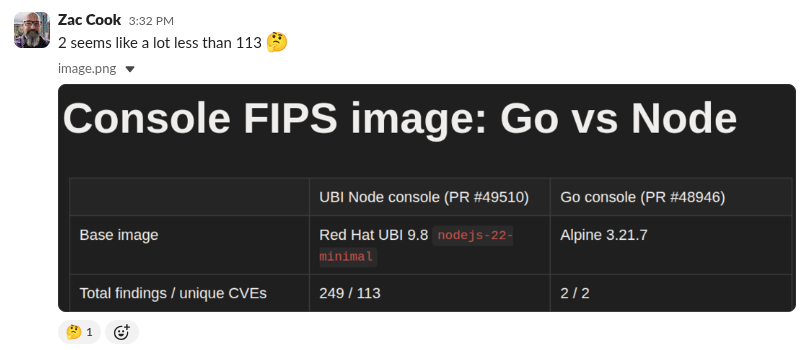

It started with a familiar story. A [Trivy](https://trivy.dev) scan of our service image flagged six distinct critical vulnerabilities and nine distinct high-severity vulnerabilities across `curl` and `libcurl`. We expected to rush out a patch. Then we traced what curl was doing in the image. Its only job was to make a health check request to localhost. Did we need it there at all?

That question took on more urgency as we worked with teams running [self-hosted Pulumi Cloud](/docs/administration/self-hosting/) in air-gapped networks or inside FedRAMP authorization boundaries. When those teams run our images inside their own networks, every package in them becomes theirs to scan, justify in a security review, and keep patched. Anything we ship that doesn’t need to be there becomes their problem, too.

Today, four new FIPS image variants are generally available on Docker Hub — three for self-hosted Pulumi Cloud, and one for [customer-managed runners](/docs/administration/concepts/customer-managed-runners/). The changes we’ve made apply to our standard container images too, so everyone running self-hosted Pulumi Cloud or customer-managed runners now gets leaner images, whether or not they need FIPS.

Here’s how we got there.

<!--more-->

## Charting a course to FIPS mode for each image

FIPS, short for [Federal Information Processing Standards](https://www.nist.gov/itl/publications-0/federal-information-processing-standards-fips), is the U.S. government’s set of rules for cryptography. For a FIPS image, the first thing that matters is where its cryptography comes from. The FIPS images for self-hosted Pulumi Cloud cover three pieces: the API service, the console (the web app), and a small tool that applies database migrations. The API service and the migrations tool are Go programs, and Go brings its own cryptographic module, so we could run those two in FIPS mode, where they use only FIPS-approved cryptography. The console, a Node.js app, was a different story, so we started with the API and came back to it.

## Replacing curl with a single-purpose binary

We traced curl in the API and workflow pool images back to their container health checks. While looking for a way to remove it, we realized we’d already built a similar probe for local development. We extended it into [`http_health`](https://github.com/pulumi/pulumi-self-hosted-installers/pull/1331/changes#diff-52097cf8c267d49a6a75bc514acc2a6335b586697720361c3c60bbb3301d4f33), a small binary that only sends requests to loopback addresses. The container health checks, API integration tests, and local dependency checks now use the same probe. Our API tests already used their own [certificate authority (CA)](/docs/administration/self-hosting/operations/database/#encrypting-connections-with-tls), so we made custom CA support part of the probe.

Removing curl cleared those findings from the API image. The migrations image turned out to be a freebie. It runs a small Go program to apply database migrations, and there was nothing extra we needed to strip out. Both binaries carried Go’s cryptographic module, so we could enable FIPS mode and keep [Alpine](https://alpinelinux.org), at least for now.

Two images down. Then came the console.

## Rewriting the console backend in Go

The curl work left us with a question for the FIPS console build: what does this image actually need at runtime, and what is just along for the ride?

The console had run on Alpine for years, most recently on the standard Node.js 22 Alpine image. A small [Express](https://expressjs.com) backend handled sign-in and configuration and served the [Angular](https://angular.dev) frontend. The Node.js console leans on OpenSSL, so it needed a base image with OpenSSL’s FIPS provider, the component that supplies FIPS-approved cryptography, and a host running in FIPS mode. We started with [Red Hat Universal Base Image (UBI) 9](https://catalog.redhat.com/software/base-images).

Getting the console running in FIPS mode on UBI 9 was a milestone. We had a working image with the same backend and frontend. Once the honeymoon was over, we had to reckon with what came along for the ride. UBI brought a lot more operating system than our Alpine image, and the scans showed it. The image meant for teams with the strictest security requirements carried more CVEs than our standard one, and keeping both patched meant maintaining two different foundations.

It was clear we still had some work to do before this felt right. We could start with a smaller UBI image, strip out what we didn’t need, and harden what remained. That would trim the image, but the console would still depend on Node.js and OpenSSL. For a backend that mostly handled sign-in and served an Angular app, it was worth asking whether we needed Node.js at runtime at all.

We decided to rewrite the backend in Go. We called it “Node to Go.” There was a little gratitude in that name for the Node.js backend we were saying goodbye to, and no mystery about where we were headed. It was also close enough to Chappell Roan’s “HOT TO GO!” to give the rewrite a soundtrack.

Then came the first test scan of the rebuild. We built both FIPS console images within a minute of each other and scanned them with the same version of Trivy. We expected fewer findings. Seeing the scan findings drop from 249 to two was still striking.

## Releasing agent containers and binaries together

The customer-managed workflow agent is the one image in this release that some customers build themselves. We publish a container and a standalone binary for teams that want to package it their own way. The agent uses semantic versions, like our open-source tools, and has its own release cadence. A version like `v2.3.4` should mean the same thing however you get it.

Adding the FIPS image gave us a reason to revisit how we shipped both. The public agent repo depended on private service code, which made it harder for people outside Pulumi to clone the repo and contribute. We moved the build and signing into our release pipeline. The [public repository](https://github.com/pulumi/customer-managed-workflow-agent#verifying-release-artifacts) now verifies the signed files from `get.pulumi.com` and mirrors them to GitHub Releases. Existing download links still work, and a base-image or Go dependency update can go out as an agent patch without someone having to cut a release by hand.

## Putting scan results in charge of releases

We came out of this with less software in the images and a simpler release process. The next job was keeping those images lean and patched. We kept the tools you’ll see across our open-source repos: [Dependabot](https://docs.github.com/en/code-security/dependabot) alerts flag vulnerable dependencies, and [Renovate](https://docs.renovatebot.com) opens pull requests with updates. We adopted [Grype](https://github.com/anchore/grype) after comparing our scan results with what customers were seeing, and moved image scans earlier in the release process so we could catch problems before publication.

The change was putting those scan results in charge of whether an image ships. When a fix becomes available for a serious vulnerability, the clock starts. If the image still contains the vulnerability after our remediation window, the pipeline blocks publication and alerts our team. The same check applies to standard and FIPS images, so every self-hosted Pulumi Cloud customer gets images held to the same patching policy.

## Moving to a distroless base

Getting the console back onto Alpine showed how much we could strip away and still run the same application. With the API, console, and migrations all running as statically compiled Go binaries, we decided to see how much of Alpine we still needed.

We had to revisit what our code assumed about the environment it ran in, from where it got time zone data to whether the images started on both CPU architectures we support. We made the runtime dependencies explicit and tested the images on both architectures. That let us move the API, console, and migrations to a [distroless](https://github.com/GoogleContainerTools/distroless) base without a shell or package manager.

## What ships today

| If you run | Pull from Docker Hub |
| --- | --- |
| Self-hosted Pulumi Cloud | [`pulumi/service-fips`](https://hub.docker.com/r/pulumi/service-fips), [`pulumi/console-fips`](https://hub.docker.com/r/pulumi/console-fips), and [`pulumi/migrations-fips`](https://hub.docker.com/r/pulumi/migrations-fips) |
| Customer-managed runners | [`pulumi/customer-managed-workflow-agent-fips`](https://hub.docker.com/r/pulumi/customer-managed-workflow-agent-fips) |

Helping customers run Pulumi in environments that require FIPS made us more demanding about what we ship to everyone who runs our images. Every dependency in an image you run yourself is something we have to maintain and something a customer might have to explain in a security review. We want to give you fewer of those to account for and get fixes into your hands sooner. That’s the standard we’ll keep pushing for across our images.
