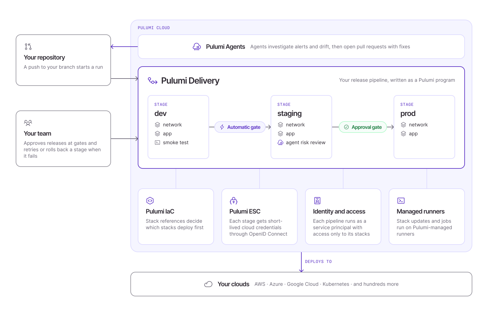
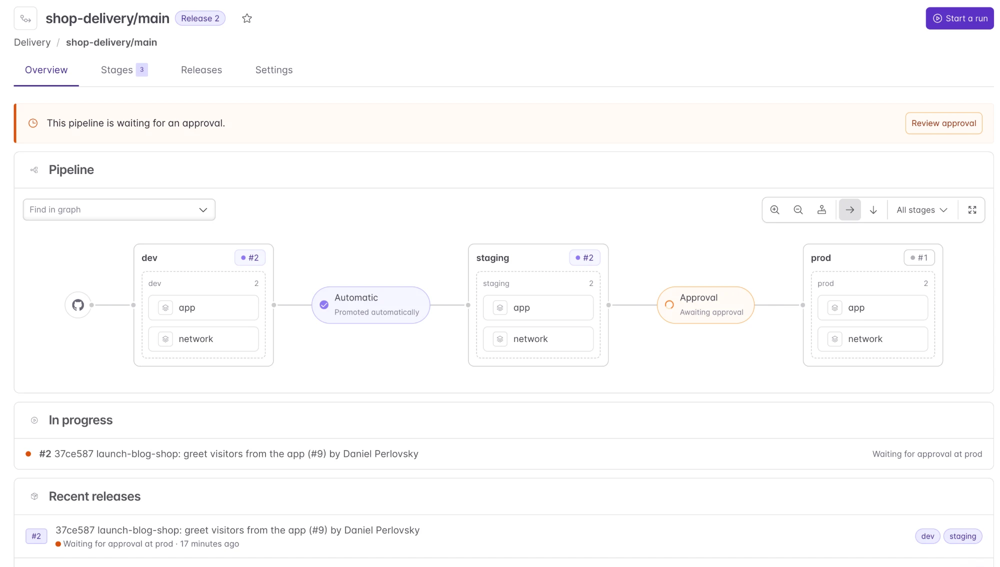

Coding agents have made writing software faster than shipping it. The bottleneck is now everything after the code: release pipelines full of bespoke scripts, console steps, and hand-run promotions that slow teams down and don't scale.

Today, we're introducing Pulumi Delivery, available in public preview. With Delivery, you define how a change moves from development through staging to production in the same languages you already use for infrastructure: TypeScript, Python, Go, HCL, YAML, and more. Your pipeline becomes a Pulumi program, so it gets the same policies and review process as the rest of your infrastructure, whether a person or an agent wrote the change.

<!--more-->

## The new bottleneck

Most applications span many infrastructure stacks. For example, your service may have separate stacks per environment for its networking layer, database, and application code, and they need to be deployed in the correct order. Today, that ordering and the rest of your delivery logic live in standalone pipeline files and manual console steps. Those tools run separately from your infrastructure, your secrets, and your policies, so the rules you enforce on a stack often don't apply to the pipeline that deploys it. Reusing logic across services usually means copying YAML, and testing a pipeline usually means running it and watching.

Agents make that gap wider. They're fluent in code, but the context needed to promote a release is scattered across consoles and config files they can't see or access. Delivery puts your release pipeline in the same code your agents already work in, so you can ship as fast as they write.

## Your delivery pipeline, as code

A Delivery pipeline is a Pulumi program. In it, you declare the repositories you deploy from, the stages a release moves through, the stacks each stage updates, and the gates that hold a release. Pulumi Cloud then runs each release through those stages in order.



Here's a pipeline that deploys a shop app from `dev` through `staging` to `prod`, and waits for approval before production:



{}

```typescript
import * as delivery from "@pulumi/delivery";

const repo = new delivery.GitHubSource("repo", {
    repository: "acme/shop",
    branch: "main",
    trigger: true,
});

const pipeline = new delivery.Pipeline("shop");

const dev = new delivery.Stage("dev", { pipeline });
const staging = new delivery.Stage("staging", { pipeline, from: [dev] });
const prod = new delivery.Stage("prod", {
    pipeline,
    from: [staging],
    when: delivery.approval(),
});

for (const [env, stage] of Object.entries({ dev, staging, prod })) {
    new delivery.Stacks(env, {
        stage,
        stacks: {
            network: { stack: `shop-network/${env}`, source: repo, directory: "network" },
            app: { stack: `shop-app/${env}`, source: repo, directory: "app" },
        },
    });
}
```

{}
{}

```python
import pulumi_delivery as delivery

repo = delivery.GitHubSource(
    "repo", repository="acme/shop", branch="main", trigger=True
)

pipeline = delivery.Pipeline("shop")

dev = delivery.Stage("dev", pipeline=pipeline)
staging = delivery.Stage("staging", pipeline=pipeline, from_=[dev])
prod = delivery.Stage(
    "prod",
    pipeline=pipeline,
    from_=[staging],
    when=delivery.RuleArgs(kind="approval"),
)

for env, stage in {"dev": dev, "staging": staging, "prod": prod}.items():
    delivery.Stacks(
        env,
        stage=stage,
        stacks={
            "network": {"stack": f"shop-network/{env}", "source": repo, "directory": "network"},
            "app": {"stack": f"shop-app/{env}", "source": repo, "directory": "app"},
        },
    )
```

{}
{}

```go
package main

import (
	"github.com/pulumi/pulumi-delivery/sdk/go/delivery"
	"github.com/pulumi/pulumi/sdk/v3/go/pulumi"
)

func main() {
	pulumi.Run(func(ctx *pulumi.Context) error {
		repo, err := delivery.NewGitHubSource(ctx, "repo", &delivery.GitHubSourceArgs{
			Repository: pulumi.String("acme/shop"),
			Branch:     pulumi.String("main"),
			Trigger:    pulumi.Bool(true),
		})
		if err != nil {
			return err
		}

		pipeline, err := delivery.NewPipeline(ctx, "shop", nil)
		if err != nil {
			return err
		}

		dev, err := delivery.NewStage(ctx, "dev", &delivery.StageArgs{Pipeline: pipeline})
		if err != nil {
			return err
		}
		staging, err := delivery.NewStage(ctx, "staging", &delivery.StageArgs{
			Pipeline: pipeline,
			From:     delivery.StageArray{dev},
		})
		if err != nil {
			return err
		}
		prod, err := delivery.NewStage(ctx, "prod", &delivery.StageArgs{
			Pipeline: pipeline,
			From:     delivery.StageArray{staging},
			When:     delivery.RuleArgs{Kind: pulumi.String("approval")},
		})
		if err != nil {
			return err
		}

		for env, stage := range map[string]*delivery.Stage{"dev": dev, "staging": staging, "prod": prod} {
			_, err := delivery.NewStacks(ctx, env, &delivery.StacksArgs{
				Stage: stage,
				Stacks: delivery.StacksEntryMap{
					"network": delivery.StacksEntryArgs{Stack: pulumi.String("shop-network/" + env), Source: repo, Directory: pulumi.String("network")},
					"app":     delivery.StacksEntryArgs{Stack: pulumi.String("shop-app/" + env), Source: repo, Directory: pulumi.String("app")},
				},
			})
			if err != nil {
				return err
			}
		}
		return nil
	})
}
```

{}
{}

```csharp
using System.Collections.Generic;
using Pulumi;
using Pulumi.Delivery.Delivery;
using Pulumi.Delivery.Delivery.Inputs;

return await Deployment.RunAsync(() =>
{
    var repo = new GitHubSource("repo", new GitHubSourceArgs
    {
        Repository = "acme/shop",
        Branch = "main",
        Trigger = true,
    });

    var pipeline = new Pipeline("shop");

    var dev = new Stage("dev", new StageArgs { Pipeline = pipeline });
    var staging = new Stage("staging", new StageArgs { Pipeline = pipeline, From = { dev } });
    var prod = new Stage("prod", new StageArgs
    {
        Pipeline = pipeline,
        From = { staging },
        When = new RuleArgs { Kind = "approval" },
    });

    var stages = new Dictionary<string, Stage> { ["dev"] = dev, ["staging"] = staging, ["prod"] = prod };
    foreach (var (env, stage) in stages)
    {
        new Stacks(env, new StacksArgs
        {
            Stage = stage,
            Stacks =
            {
                ["network"] = new StacksEntryArgs { Stack = $"shop-network/{env}", Source = repo, Directory = "network" },
                ["app"] = new StacksEntryArgs { Stack = $"shop-app/{env}", Source = repo, Directory = "app" },
            },
        });
    }
});
```

{}
{}

```java
package myproject;

import com.pulumi.Pulumi;
import com.pulumi.delivery.delivery.*;
import com.pulumi.delivery.delivery.inputs.*;
import java.util.Map;

public class App {
    public static void main(String[] args) {
        Pulumi.run(ctx -> {
            var repo = new GitHubSource("repo", GitHubSourceArgs.builder()
                .repository("acme/shop")
                .branch("main")
                .trigger(true)
                .build());

            var pipeline = new Pipeline("shop");

            var dev = new Stage("dev", StageArgs.builder().pipeline(pipeline).build());
            var staging = new Stage("staging", StageArgs.builder().pipeline(pipeline).from(dev).build());
            var prod = new Stage("prod", StageArgs.builder()
                .pipeline(pipeline)
                .from(staging)
                .when(RuleArgs.builder().kind("approval").build())
                .build());

            Map.of("dev", dev, "staging", staging, "prod", prod).forEach((env, stage) ->
                new Stacks(env, StacksArgs.builder()
                    .stage(stage)
                    .stacks(Map.of(
                        "network", StacksEntryArgs.builder().stack("shop-network/" + env).source(repo).directory("network").build(),
                        "app", StacksEntryArgs.builder().stack("shop-app/" + env).source(repo).directory("app").build()))
                    .build()));
        });
    }
}
```

{}
{}

```yaml
name: shop-delivery
runtime: yaml

resources:
  repo:
    type: delivery:GitHubSource
    properties:
      repository: acme/shop
      branch: main
      trigger: true
  shop:
    type: delivery:Pipeline

  dev:
    type: delivery:Stage
    properties:
      pipeline: ${shop}
  staging:
    type: delivery:Stage
    properties:
      pipeline: ${shop}
      from:
        - ${dev}
  prod:
    type: delivery:Stage
    properties:
      pipeline: ${shop}
      from:
        - ${staging}
      when:
        kind: approval

  devStacks:
    type: delivery:Stacks
    properties:
      stage: ${dev}
      stacks:
        network: { stack: shop-network/dev, source: "${repo}", directory: network }
        app: { stack: shop-app/dev, source: "${repo}", directory: app }
  stagingStacks:
    type: delivery:Stacks
    properties:
      stage: ${staging}
      stacks:
        network: { stack: shop-network/staging, source: "${repo}", directory: network }
        app: { stack: shop-app/staging, source: "${repo}", directory: app }
  prodStacks:
    type: delivery:Stacks
    properties:
      stage: ${prod}
      stacks:
        network: { stack: shop-network/prod, source: "${repo}", directory: network }
        app: { stack: shop-app/prod, source: "${repo}", directory: app }
```

{}
{}

```hcl
terraform {
  required_providers {
    delivery = {
      source = "pulumi/delivery"
    }
  }
}

resource "delivery_git_hub_source" "repo" {
  repository = "acme/shop"
  branch     = "main"
  trigger    = true
}

resource "delivery_pipeline" "shop" {}

resource "delivery_stage" "dev" {
  pipeline = delivery_pipeline.shop
}

resource "delivery_stage" "staging" {
  pipeline = delivery_pipeline.shop
  from     = [delivery_stage.dev]
}

resource "delivery_stage" "prod" {
  pipeline = delivery_pipeline.shop
  from     = [delivery_stage.staging]
  when     = { kind = "approval" }
}

locals {
  environments = {
    dev     = delivery_stage.dev
    staging = delivery_stage.staging
    prod    = delivery_stage.prod
  }
}

resource "delivery_stacks" "env" {
  for_each = local.environments
  stage    = each.value
  stacks = {
    network = { stack = "shop-network/${each.key}", source = delivery_git_hub_source.repo, directory = "network" }
    app     = { stack = "shop-app/${each.key}", source = delivery_git_hub_source.repo, directory = "app" }
  }
}
```

{}



Once you register the pipeline, every push to `main` starts a new release. Delivery pins the release to that commit, so the code that passed in `staging` is exactly the code that reaches `prod`.



Because a pipeline is a real program, you can express common patterns like promotion logic, canary rollouts, blue-green deployments, and multi-region sequencing as composable code. Write a rollout pattern once as a function, reuse it across services, and test it like any other code.

## One pipeline for all your stacks

Getting the order right is what makes a release safe, and the more stacks you have, the harder it is to get right. Delivery uses what Pulumi already knows about your infrastructure to work out the order for you. When your app stack depends on a value from your network stack, such as a subnet ID, Delivery updates the network first and the app second, without you writing that order down anywhere. Stacks that don't depend on each other update at the same time.

You still set the big steps, such as `dev`, `staging`, and `prod`, yourself, and you can order individual stacks by hand when you need to.

## Gate releases with AI risk review

Approval gates work well until the number of changes outgrows the number of people available to review them. With Delivery, you can add an AI reviewer as a gate. It assesses each change's risk and either promotes the change or escalates it to a human for review.

You can also gate releases on decision models such as [TypeSafe's Jev](https://docs.typesafe.ai/introduction), which return a calibrated risk score. Your pipeline compares that score against a threshold you set, so routine changes move on their own and the risky ones wait for a person. You decide where that line sits, and you can move it as you build trust in the results.

<!-- CODE + IMAGE: Once eng confirms the API, add a short snippet of the prod stage with a risk gate, and a
screenshot of a gate showing the score and the reviewer's reasoning (delivery-risk-gate.png). -->

## Turn production signals into reviewed fixes

Delivery can also react to the observability tools you already have, including PagerDuty, Honeycomb, Sentry, and Datadog. When a signal points to a problem in production, an agent can prepare a fix and open a pull request under your policies. That fix then moves through the same pipeline as any other change, with the same gates at every stage. Agents get a fast path to production that's also the governed one.

<!-- TODO: Link "an agent" to the Pulumi Agents launch post once its slug is final. -->

## Get started with Pulumi Delivery
<!-- TODO: Link to getting started instead of docs.  -->

Pulumi Delivery is available today in public preview in the Free, Essentials, Pro, and Enterprise editions of Pulumi Cloud. To build your first pipeline, start with the [Delivery documentation](/docs/delivery/).

We'd love to hear what you're shipping with it. Share feedback in the [Pulumi Community Slack](https://slack.pulumi.com) or [contact support](/support/).
