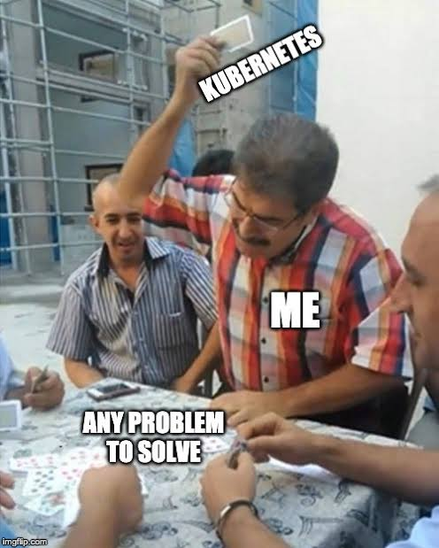

**Kubernetes best practices** are the production-tested rules that keep clusters reliable, secure, and affordable: set resource requests and limits on every container, isolate workloads with namespaces and NetworkPolicies, enforce least-privilege RBAC, automate health checks, ship via GitOps, validate every change with policy-as-code, generate an SBOM for every image, and manage Kubernetes itself with infrastructure as code instead of hand-rolled YAML. The 20 practices below cover what production teams do in 2026, and each one has been checked against Kubernetes v1.37.

<!--more-->

## TL;DR: 20 Kubernetes best practices for 2026

- Set resource **requests and limits** on every container, and resize them **in place** (GA in v1.35) instead of restarting Pods.
- Use **namespaces** plus **ResourceQuota** and **LimitRange** for isolation.
- Run **one container per Pod** unless you need a sidecar, and declare sidecars as **native sidecars** (`restartPolicy: Always` on an init container).
- Manage manifests with **Helm, Kustomize, or Pulumi** — never raw copies.
- Use the **Gateway API** for north-south traffic. ingress-nginx is retired and its repository is archived.
- Configure **liveness, readiness, and startup probes** for every workload.
- Enforce **RBAC** with the principle of least privilege from day one.
- Apply **Pod Security Admission** at the `restricted` level by default, and set `hostUsers: false` (user namespaces, GA in v1.36) where workloads allow it.
- Lock down east-west traffic with **NetworkPolicy** (default-deny).
- Store secrets in an **external secret manager** (Pulumi ESC, Vault, AWS Secrets Manager) — not as plain Kubernetes Secrets.
- Autoscale with **HPA, VPA (`InPlaceOrRecreate` or `Off`), and Cluster Autoscaler / Karpenter**.
- Monitor with **Prometheus, Grafana, and OpenTelemetry**; alert before users do.
- Deploy with **GitOps** (Argo CD or Flux) — Git is the only source of truth.
- Gate every change with **policy-as-code** (Pulumi Policies, ValidatingAdmissionPolicy, OPA/Gatekeeper, Kyverno).
- Generate and verify an **SBOM** for every image; sign with **Sigstore/cosign**.
- Manage cost with **FinOps** practices: right-size, schedule, and chargeback by namespace.
- Keep clusters and add-ons **patched** on a documented cadence, always on one of the three supported minor versions.
- Use **labels and annotations** consistently for ownership, cost, and SLO tracking.
- Separate **dev, staging, and prod** clusters — or virtualize with vCluster.
- Treat clusters as **cattle, not pets**: rebuild from code, never edit live.

> **Last updated October 30, 2026** — rechecked every practice against Kubernetes v1.37. Added a version-support section and a "what changed" table; updated resource sizing for in-place Pod resize and VPA's new modes; moved sidecars to the native model; rewrote the ingress guidance now that ingress-nginx is archived; added the cgroup v2 and containerd 2 prerequisites to upgrades; and added scanner-pinning and Bitnami image guidance.



## Which Kubernetes version should you run in 2026?

**Run one of the three supported minor releases, and prefer the newest your add-ons support.** As of October 2026 that means Kubernetes v1.37 "Garhwal" (released August 26, 2026), v1.36, or v1.35. Version v1.34 reached end of life on October 27, 2026. Each minor release gets about 14 months of patches, and three minors ship per year.

| Minor version | Released | End of life | Status |
| --- | --- | --- | --- |
| v1.37 | August 26, 2026 | October 28, 2027 | Latest stable |
| v1.36 | April 22, 2026 | June 28, 2027 | Supported |
| v1.35 | December 17, 2025 | February 28, 2027 | Supported |
| v1.34 | August 27, 2025 | October 27, 2026 | End of life |

The next minor, v1.38, is expected in December 2026. See the official [Kubernetes releases page](https://kubernetes.io/releases/) for current patch versions.

### What changed since Kubernetes v1.32?

Several practices from earlier versions of this post have been superseded by features that reached GA. This table shows what to change.

| Feature | Status | What to do |
| --- | --- | --- |
| In-place Pod resize | GA in v1.35 | Resize CPU and memory on a running Pod through the `resize` subresource instead of recreating it |
| Native sidecar containers | GA in v1.33 | Declare sidecars as init containers with `restartPolicy: Always` |
| Pod-level resources | Beta, on by default since v1.34 | Set a shared CPU and memory budget for all containers in a Pod |
| User namespaces | GA in v1.36 | Set `hostUsers: false` so root in the container maps to an unprivileged host user |
| ValidatingAdmissionPolicy | GA in v1.30 | Write CEL admission rules in-tree, with no webhook to run |
| MutatingAdmissionPolicy | GA in v1.36 | Replace simple mutating webhooks with CEL-based policies |
| Dynamic Resource Allocation | GA in v1.34 | Allocate GPUs and other accelerators through `ResourceClaim` objects |
| HPA configurable tolerance | GA in v1.37 | Tune the 10% default scaling tolerance per workload |
| kube-proxy nftables mode | GA in v1.33 | Move off `ipvs`, which was deprecated in v1.35 |
| Endpoints API | Deprecated in v1.33 | Read EndpointSlices in controllers and tooling |
| cgroup v1 | kubelet refuses to start by default since v1.35 | Run nodes on cgroup v2 |
| containerd 1.x | v1.35 is the last release that supports it | Move nodes to containerd 2.0 or later before upgrading past v1.35 |
| `gitRepo` volumes | Permanently disabled in v1.36 | Clone with an init container or git-sync |
| Service `externalIPs` | Deprecated in v1.36 | Use a LoadBalancer Service or the Gateway API |

## What are Kubernetes best practices?

Kubernetes best practices are the operational patterns that keep workloads available, secure, observable, and cost-efficient on a Kubernetes cluster. They span four areas: **workload configuration** (resources, probes, images), **security** (RBAC, NetworkPolicy, Pod Security, secrets, supply chain), **delivery** (GitOps, policy-as-code, IaC), and **platform operations** (autoscaling, monitoring, upgrades, FinOps). The rest of this post explains each one with a copy-pasteable rule, a definition of the underlying Kubernetes object, and a common anti-pattern to avoid.

## Common Kubernetes anti-patterns vs. the correct approach

| Common mistake | What goes wrong | Correct approach |
| --- | --- | --- |
| No resource requests or limits | Noisy-neighbor evictions, OOMKills, unschedulable Pods | Set requests for **every** container; use VPA recommendations and in-place resize to tune |
| Everything in the `default` namespace | No isolation, no quota, no RBAC boundary | One namespace per team or environment + ResourceQuota + RBAC |
| `cluster-admin` for service accounts | Full-cluster blast radius on compromise | Per-namespace Role + RoleBinding (least privilege) |
| Plain Kubernetes `Secret` objects | Base64 ≠ encryption; secrets leak via etcd, kubectl, audit logs | External Secrets Operator + [Pulumi ESC](/docs/esc/), Vault, or AWS Secrets Manager |
| Open east-west traffic | One compromised Pod can reach every service | Default-deny NetworkPolicy; allow only required flows |
| `kubectl apply -f` from a laptop | No history, no review, no rollback | GitOps with Argo CD or Flux; Git is the source of truth |
| Manual `latest` image tags | Non-reproducible deploys, supply-chain risk | Pinned digests (`@sha256:...`) with cosign verification |
| Ingress-nginx in 2026 | Retired in March 2026 and archived: existing installs keep running but get no security fixes | Migrate to the Gateway API (Envoy Gateway, Istio, kgateway) |
| Sidecars declared as regular containers | Jobs never complete, and sidecars have no guaranteed start or stop order relative to the app | Native sidecars: init container with `restartPolicy: Always` |
| cgroup v1 nodes or containerd 1.x | kubelet fails to start on cgroup v1 since v1.35; blocks upgrades past v1.35 | Cgroup v2 nodes and containerd 2.0 or later |
| VPA `updateMode: Auto` | Deprecated mode that evicts Pods to apply changes | `InPlaceOrRecreate` where workloads tolerate resize, otherwise `Off` |
| Hand-rolled YAML in dozens of repos | Drift, copy-paste bugs, no testing | [Pulumi](/docs/iac/get-started/kubernetes/), Helm, or Kustomize with reviews |
| One shared `prod` cluster for everything | Blast radius spans every team | Separate clusters or [vCluster](https://www.vcluster.com/) virtual clusters |

## 1. How do you set Kubernetes resource requests and limits?

**What are resource requests and limits?** A resource *request* is the minimum CPU and memory the kube-scheduler guarantees a container; a resource *limit* is the maximum the kubelet allows it to consume before throttling CPU or OOMKilling memory. Pods without requests are scheduled blind, so a noisy neighbor can evict your workload at any time.

**The rule:** every container in production sets a request for both CPU and memory, and a memory limit. CPU limits are optional and frequently counter-productive — they cause throttling spikes that look like outages.

- Start at **100–200m CPU and 128–512Mi memory** for a typical web service.
- Tune from real data using **Vertical Pod Autoscaler** with `updateMode: Off` (recommendation-only) or Prometheus histograms.
- Apply changes **in place**. In-place Pod resize is GA in Kubernetes v1.35: patch the Pod's `resize` subresource (`kubectl patch --subresource resize`) and the kubelet adjusts CPU and memory without restarting the container when the resize policy allows it.
- On v1.34 and later, **pod-level resources** (beta, on by default) let you set one CPU and memory budget for the whole Pod, which suits Pods with sidecars.
- Use a per-namespace `LimitRange` so teams cannot ship a container with no requests at all.

## 2. How should you structure Kubernetes namespaces?

**What is a Kubernetes namespace?** A namespace is a logical partition of cluster resources. It scopes object names, RBAC bindings, NetworkPolicies, and quotas — but does not provide hard isolation by itself.

**The rule:** never deploy production workloads to `default`. Map namespaces to ownership boundaries — usually one per team, environment, or tenant — and pair every namespace with three things:

- A **`ResourceQuota`** to cap aggregate CPU, memory, and object counts.
- A **`LimitRange`** to enforce per-container defaults.
- A **`RoleBinding`** that grants only the permissions that team needs.

This is the smallest unit that gives you predictable cost, blast-radius containment, and an RBAC perimeter.

## 3. Should you run multiple containers in one Pod?

**What is a Pod?** A Pod is the smallest deployable unit in Kubernetes — one or more containers that share a network namespace, IPC, and storage volumes, and that are scheduled and scaled as a single unit.

**The rule:** one container per Pod by default. Add a second container only when it must share the Pod's network or volumes — for example, a service-mesh proxy (Istio/Linkerd), a logging shipper, or an [init container](https://kubernetes.io/docs/concepts/workloads/pods/init-containers/) that prepares state before the main process starts. Multi-container Pods couple lifecycles and scaling, so add them only when the shared network or volume requires it.

Declare sidecars as [native sidecar containers](https://kubernetes.io/docs/concepts/workloads/pods/sidecar-containers/), which reached GA in Kubernetes v1.33. A native sidecar is an init container with `restartPolicy: Always`. It starts before the main container, keeps running alongside it, shuts down after it, and no longer blocks Jobs from completing.



## 4. Should you use Helm, Kustomize, or Pulumi for Kubernetes manifests?

**The rule:** never copy-paste raw YAML across services. Pick one of these:

- **[Helm](https://helm.sh/)** — Go-templated charts; the de-facto distribution format for off-the-shelf software (Prometheus, cert-manager, Argo CD).
- **[Kustomize](https://kustomize.io/)** — overlay-based, no templating; ships in `kubectl`. Best for "same app, different environment" diffs.
- **[Pulumi](/docs/iac/get-started/kubernetes/)** — real programming languages (TypeScript, Python, Go, Java, .NET) for Kubernetes plus the cloud resources around it (EKS, GKE, AKS, DNS, IAM). Type checking, tests, and the Pulumi [Kubernetes Operator](/docs/integrations/clouds/kubernetes/pulumi-kubernetes-operator/) for GitOps-style reconciliation.

If you are already managing cloud infrastructure with code, extending the same Pulumi program to Kubernetes is the smallest cognitive jump — the cluster, its IAM, its DNS, and its workloads live in one stack and one review.

## 5. How should you handle ingress and networking on Kubernetes in 2026?

**What is the Gateway API?** The [Gateway API](https://gateway-api.sigs.k8s.io/) is the successor to the legacy `Ingress` resource. It splits responsibility between infrastructure (`GatewayClass`, `Gateway`) and application (`HTTPRoute`, `GRPCRoute`, `TLSRoute`) teams, and it is the SIG-Network direction for north-south traffic. `HTTPRoute` and `GRPCRoute` are GA, and `TLSRoute` and `ListenerSet` moved to the Standard channel in v1.5.0.

**The rule:** new clusters should standardize on the Gateway API. The widely deployed `ingress-nginx` controller [retired in March 2026](/blog/ingress-nginx-to-gateway-api-kgateway/) and its repository is archived. Existing installs keep running but receive no security fixes, so migrate them to a Gateway API implementation such as Envoy Gateway, Istio, or kgateway.

- Terminate TLS at the gateway and automate certificates with [cert-manager](https://cert-manager.io/).
- Use **path-based and host-based routing** instead of one gateway per service.
- Protect every gateway with a WAF (managed cloud WAF or [Coraza](https://coraza.io/) on Envoy).

    

{}
Here is a guide on [How to Move to the Gateway API: post ingress-nginx Retirement](/blog/ingress-nginx-to-gateway-api-kgateway/).
{}

## 6. What's the difference between liveness, readiness, and startup probes?

Probes tell the kubelet whether to restart a container, route traffic to it, or wait for it. Configure them per workload:

- **Liveness probe** — restarts a hung container. Use sparingly; a bad liveness probe is a self-inflicted DoS.
- **Readiness probe** — gates traffic from Services and Gateway routes. Use for *every* network-facing workload.
- **Startup probe** — gives slow-booting apps (JVM, ML models) time to come up before liveness checks begin. Use whenever cold-start exceeds 10 seconds.

See [the upstream guide](https://kubernetes.io/docs/tasks/configure-pod-container/configure-liveness-readiness-startup-probes/) for HTTP, TCP, and exec probe syntax. Tune `failureThreshold`, `periodSeconds`, and `timeoutSeconds` based on real latency, not defaults.

## 7. How do you secure a Kubernetes cluster?

Cluster security is layered: identity, workload posture, network, and secrets. Get all four right.

### What is RBAC in Kubernetes?

**RBAC (Role-Based Access Control)** is the Kubernetes authorization model that maps subjects (users, groups, ServiceAccounts) to verbs (`get`, `list`, `create`, `delete`) on resources, scoped to a namespace (`Role`) or the whole cluster (`ClusterRole`).

- Grant **least privilege** — never bind humans or workloads to `cluster-admin`.
- Prefer per-namespace `Role` + `RoleBinding` over `ClusterRoleBinding`.
- Audit with `kubectl auth can-i --as=...` and tools like [`rbac-lookup`](https://github.com/FairwindsOps/rbac-lookup).

### What is Pod Security Admission?

[Pod Security Admission](https://kubernetes.io/docs/concepts/security/pod-security-admission/) is the built-in admission controller that enforces the three Pod Security Standards (`privileged`, `baseline`, `restricted`) at the namespace level.

- Label every namespace `pod-security.kubernetes.io/enforce=restricted` by default.
- Drop `NET_RAW` and all capabilities; run as non-root with a read-only root filesystem.
- Use `seccompProfile: RuntimeDefault` and a tight `securityContext` for every container. Set AppArmor through the `securityContext.appArmorProfile` field, since the old annotations are deprecated.
- Set `hostUsers: false` to use [user namespaces](https://kubernetes.io/docs/concepts/workloads/pods/user-namespaces/) (GA in v1.36), so a process running as root in the container maps to an unprivileged user on the node.
- Add CEL rules with [ValidatingAdmissionPolicy](https://kubernetes.io/docs/reference/access-authn-authz/validating-admission-policy/) (GA since v1.30) for checks that Pod Security Standards do not cover, with no webhook to operate.

### What is a NetworkPolicy?

A **NetworkPolicy** is a Kubernetes object that defines allowed ingress and egress traffic for selected Pods at the IP/port level. Without one, every Pod can reach every other Pod by default.

- Apply a **default-deny** ingress and egress policy in every namespace.
- Allow only the flows your service actually needs (DNS, the database, the upstream API).
- For richer L7 controls (mTLS, JWT auth), layer a service mesh on top.

### How should you manage Kubernetes secrets?

**Built-in `Secret` objects are base64-encoded, not encrypted.** Use them only to deliver a value to a Pod, and keep the source of truth elsewhere.

- Store the source of truth in [Pulumi ESC](/docs/esc/), [HashiCorp Vault](https://www.vaultproject.io/), [AWS Secrets Manager](https://aws.amazon.com/secrets-manager/), GCP Secret Manager, or Azure Key Vault.
- Project secrets into Pods with the [External Secrets Operator](/docs/esc/integrations/kubernetes/external-secrets-operator/) or the [Secret Store CSI Driver](/docs/esc/integrations/kubernetes/secret-store-csi-driver/).
- Enable **etcd encryption-at-rest** with a KMS provider so leaked etcd snapshots stay opaque.
- Rotate automatically; never commit secrets to Git, even encrypted.

## 8. How do you set up Kubernetes observability?

Observability rests on the three pillars: metrics, logs, and traces. The 2026 default stack is OpenTelemetry-first.

- **Metrics** — [Prometheus](https://github.com/prometheus-operator/kube-prometheus) (or a Prometheus-compatible TSDB like Mimir, Thanos, VictoriaMetrics) plus Grafana dashboards.
- **Logs** — Fluent Bit or the OpenTelemetry Collector shipping structured JSON to Loki, Elastic/OpenSearch, or a managed service. Never depend on `kubectl logs` for incidents — Pods are ephemeral.
- **Traces** — OpenTelemetry SDKs in your apps emitting to Tempo, Jaeger, or a vendor backend. Correlate trace IDs with logs.
- **Alerts** — page on **SLO burn rate**, not on every crashed Pod. Burn-rate alerting catches real user impact without firing on every restart.

## 9. How do you automate Kubernetes deployments with GitOps?

**What is GitOps?** [GitOps](https://opengitops.dev/) is a deployment model where the desired cluster state lives in a Git repository and a controller continuously reconciles the live cluster to match. Changes happen through pull requests, not `kubectl apply`.

**The rule:** every cluster has a controller — [Argo CD](https://argoproj.github.io/cd/), [Flux](https://fluxcd.io/), or the [Pulumi Kubernetes Operator](/docs/integrations/clouds/kubernetes/pulumi-kubernetes-operator/) — that owns reconciliation. Humans never `kubectl apply` to production.

- Use **app-of-apps** (Argo) or **Kustomization trees** (Flux) to bootstrap whole clusters from a single root.
- Keep manifests, Helm values, and Pulumi stack references in Git, with environment promotion via PR.
- Combine GitOps with [Pulumi Deployments](/docs/deployments/concepts/) so cloud infrastructure (VPCs, EKS clusters, IAM, DNS) and the workloads on top promote through the same review pipeline. See [improving GitOps with the Pulumi Operator](/blog/improving-gitops-with-pulumi-operator/) for a worked example.
- Configure **automated rollback** on health-check failure, and **drift detection** alerts when someone edits live state.

## 10. How often should you upgrade Kubernetes?

Kubernetes ships three minor releases a year (v1.35 in December 2025, v1.36 in April 2026, v1.37 in August 2026) and supports each one for about 14 months. Treat upgrades as routine maintenance that fits in a sprint.

- Run **one of the three supported minors**. As of October 2026 that is v1.35, v1.36, or v1.37; anything older misses CVE patches.
- Check node prerequisites first. Since v1.35 the kubelet fails to start on **cgroup v1** by default, and v1.35 is the last release that supports **containerd 1.x**, so move nodes to cgroup v2 and containerd 2.0 or later.
- Audit removals before each upgrade: the Endpoints API (deprecated in v1.33), `ipvs` kube-proxy mode (deprecated in v1.35), `gitRepo` volumes (disabled in v1.36), and Service `externalIPs` (deprecated in v1.36).
- Test upgrades in a non-prod cluster, run a [conformance test](https://github.com/cncf/k8s-conformance), then promote.
- Back up etcd before control-plane changes; managed services (EKS, GKE, AKS) handle most of this for you.
- Upgrade add-ons (CNI, CSI, Gateway controller, cert-manager, metrics-server) on the same cadence — pin versions in code so the upgrade is auditable.
- Watch the [Kubernetes deprecation guide](https://kubernetes.io/docs/reference/using-api/deprecation-guide/) and run [`pluto`](https://github.com/FairwindsOps/pluto) to find deprecated APIs before they break. [`kubent`](https://github.com/doitintl/kube-no-trouble/releases) still works but has had no release since August 2024.

## 11. How should you label and annotate Kubernetes resources?

Labels and annotations are the metadata layer that everything — Services, NetworkPolicies, monitoring, cost tools, GitOps — keys off of. Consistency matters more than cleverness.

- Adopt the [recommended labels](https://kubernetes.io/docs/concepts/overview/working-with-objects/common-labels/): `app.kubernetes.io/name`, `app.kubernetes.io/instance`, `app.kubernetes.io/version`, `app.kubernetes.io/component`, `app.kubernetes.io/part-of`, `app.kubernetes.io/managed-by`.
- Add organization-specific labels for **owner**, **cost-center**, **environment**, and **SLO tier** — your FinOps and on-call processes will need them.
- Reserve [annotations](https://kubernetes.io/docs/concepts/overview/working-with-objects/annotations/) for non-identifying metadata: build SHA, change-ticket, last-deployed timestamp, ingress controller hints.


Provision your clusters, their cloud resources, and the workloads on them from one Pulumi program, and use stacks to promote changes from dev to production.


## 12. How should you separate Kubernetes environments?

**The rule:** production is its own cluster. Dev and staging can share — sometimes. Mixing prod with anything else couples blast radius, upgrade cadence, and quotas.

- **Separate clusters per environment** is the safe default. With managed control planes (EKS, GKE, AKS) the cost is small.
- **Virtual clusters** with [vCluster](https://www.vcluster.com/) give each team a Kubernetes API of their own without the operational cost of a real cluster.
- **Namespace-only segregation** can work for dev/staging if you enforce strict NetworkPolicy, RBAC, and ResourceQuota boundaries.
- Provision all of them from the same [Pulumi](/docs/iac/get-started/kubernetes/) program with different stacks — `dev`, `staging`, `prod` — so promotion happens by changing config.

## 13. How do you optimize Kubernetes container images?

- Start from a **distroless** ([gcr.io/distroless](https://github.com/GoogleContainerTools/distroless)) or `chainguard/static` base. Alpine is fine if you accept musl.
- Build with **multi-stage Dockerfiles** so build tools never ship in the final image.
- Pin the base image **by digest** (`@sha256:...`), not by tag — `latest` and `1.21` move under you.
- Scan every image with **[Trivy](https://trivy.dev/latest/)**, [Grype](https://github.com/anchore/grype), or your registry's built-in scanner. Block builds on `Critical`/`High` CVEs.
- **Pin the scanner itself** by version digest or commit SHA. In March 2026 attackers published malicious Trivy v0.69.4 binaries and images and force-pushed `trivy-action` tags, which hit pipelines that referenced a mutable tag. See [the incident write-up](https://www.legitsecurity.com/blog/the-trivy-supply-chain-compromise-what-happened-and-playbooks-to-respond).
- **Audit charts that pull `docker.io/bitnami/*`.** Bitnami removed its public image catalog in September 2025; old tags live in `bitnamilegacy/` with no updates. Switch to maintained images or a paid source ([details](https://github.com/bitnami/charts/issues/36215)).
- Put a **pull-through cache or registry mirror** in front of Docker Hub so anonymous pull rate limits can't stall node scale-ups.
- Smaller images mean faster pulls, faster autoscaling, and a smaller attack surface.

## 14. What's a reliable Kubernetes logging strategy?

- **Centralize** with a log collector running as a DaemonSet on every node (see the logs stack in section 8).
- **Structure** logs as JSON with consistent field names (`trace_id`, `span_id`, `service`, `level`).
- **Retain** by tier — 7 days hot, 30–90 days warm, archive to object storage for compliance.
- **Redact** secrets and PII at the collector, not after the fact.



## 15. How should you autoscale workloads on Kubernetes?

**What is the Horizontal Pod Autoscaler?** The **HPA** scales the replica count of a Deployment or StatefulSet up and down based on CPU, memory, or custom/external metrics.

**What is the Vertical Pod Autoscaler?** The **VPA** adjusts a Pod's CPU and memory *requests* over time based on observed usage. Run it with `updateMode: Off` (recommendation-only) and apply the recommendations through your IaC tool, or use `InPlaceOrRecreate` (GA in VPA 1.6) where workloads tolerate in-place resize. The older `Auto` mode is deprecated.

**What are Cluster Autoscaler and Karpenter?** **Cluster Autoscaler** adds and removes nodes to match Pod demand. **[Karpenter](https://karpenter.sh/)** is a faster, group-less node provisioner widely used on EKS. AKS offers a Karpenter-based [Node Auto Provisioning](https://learn.microsoft.com/en-us/azure/aks/node-auto-provisioning) feature, and community providers cover other clouds.

**The rule:** every production workload has an HPA. Every cluster has a node-level autoscaler. Set sensible `min`/`max` replicas, define a `PodDisruptionBudget`, and gate scale-down behavior so traffic spikes don't pile up at restart time. Pair with **KEDA** for event-driven scaling (queues, Kafka lag, scheduled scale).

Two recent additions help. HPA configurable tolerance went GA in v1.37, so you can replace the fixed 10% scaling tolerance per workload, and HPA scale-to-zero is in beta in v1.37. For GPU and accelerator workloads, Dynamic Resource Allocation has been GA since v1.34. See [running AI agents on Kubernetes](/blog/ai-agents-on-kubernetes/) for the wider ecosystem.

## 16. How do you enforce policy-as-code on Kubernetes?

**What is policy-as-code?** Policy-as-code expresses governance rules — security baselines, tagging, region restrictions, cost guardrails — as code that runs in CI and at admission time, blocking non-compliant changes before they reach the cluster.

**The rule:** every change goes through at least one policy engine.

- **Pre-deploy** — validate Pulumi or Helm output with [Pulumi Policies](/docs/discovery-governance/concepts/policy-as-code/) or [Conftest](https://www.conftest.dev/) in CI.
- **Admission-time** — start with the built-in [ValidatingAdmissionPolicy](https://kubernetes.io/docs/reference/access-authn-authz/validating-admission-policy/) (CEL, GA since v1.30), and add [OPA Gatekeeper](https://open-policy-agent.github.io/gatekeeper/) or [Kyverno](https://kyverno.io/) for richer cases such as signed images, a `team` label, and a non-root `securityContext` on every Pod. See [Gatekeeper and full-stack governance](/blog/kubernetes-gatekeeper-full-stack-governance-opa/).
- **Continuous** — scan running clusters with [Pulumi discovery and governance](/docs/discovery-governance/) or `kubescape` for drift from policy.

See [the benefits of policy-as-code](/blog/benefits-of-policy-as-code/) and [enforcing policy-as-code on discovered resources](/blog/enforcing-policy-as-code-on-discovered-resources-with-pulumi/) for end-to-end examples.

## 17. How do you secure the Kubernetes software supply chain?

**What is an SBOM?** A **Software Bill of Materials** is a machine-readable inventory of every component in a container image — packages, versions, licenses, hashes — typically in [SPDX](https://spdx.dev/) or [CycloneDX](https://cyclonedx.org/) format.

**The rule:** every image you run in production has a verified SBOM and a verified signature.

- Generate SBOMs at build time with [Syft](https://github.com/anchore/syft) or `docker sbom`.
- Sign images and SBOMs with [Sigstore/cosign](https://www.sigstore.dev/) keylessly via GitHub OIDC.
- Verify signatures at admission with [Kyverno](https://kyverno.io/policies/?policytypes=Cosign) or [Connaisseur](https://github.com/sse-secure-systems/connaisseur).
- Generate **provenance attestations** ([SLSA](https://slsa.dev/)) so you can prove which build pipeline produced a given image.
- Pin base images by digest and rebuild on a cadence so CVE patches actually land.

In the EU, Cyber Resilience Act vulnerability-reporting obligations started applying on September 11, 2026, with full application due in December 2027. In the US, 2025 executive orders scaled back the 2021 federal attestation mandates, but enterprise buyers still ask for SBOMs and SSDF-aligned build practices.

## 18. How do you manage Kubernetes cost (FinOps)?

**The rule:** Start with labeling and right-sizing, and look at discounts afterward.

- **Right-size** with VPA recommendations, [Goldilocks](https://github.com/FairwindsOps/goldilocks), or your APM's recommendation engine. Most workloads request more CPU than they actually use; right-sizing is usually the largest single saving.
- **Schedule** non-prod clusters off overnight and on weekends.
- **Spot/preemptible nodes** for fault-tolerant workloads; use Karpenter's consolidation to compact bin-packing.
- **Show back / charge back** by namespace and label using [OpenCost](https://www.opencost.io/), a CNCF incubating project, or IBM Kubecost. Without per-team attribution, no team owns cost.
- **Provision the underlying cluster with IaC** — see [Pulumi for Kubernetes](/docs/iac/get-started/kubernetes/) — so node types, autoscaling limits, and reserved capacity are reviewable artifacts. Pulumi's [hidden-cost analysis](/blog/hidden-costs-of-infrastructure-management/) walks through where the money actually goes.

## 19. Why should you treat Kubernetes clusters as cattle, not pets?

The old "cattle, not pets" adage applies more strictly to Kubernetes than to VMs. Manual edits to a live cluster will be reconciled away, drift between environments, or vanish on the next Pod restart.

- Fix problems in code — YAML, Helm chart, or [Pulumi program](/docs/iac/get-started/kubernetes/) — and let the controller redeploy.
- If you can't redeploy a cluster from Git in under an hour, you have a pet.
- Use ephemeral preview environments for PRs (see [building Kubernetes PR previews with shared Pulumi components](/blog/building-kubernetes-pr-previews-with-shared-pulumi-components/)); use blue/green or progressive delivery (Argo Rollouts, Flagger) for production cutovers.

## 20. Why use Pulumi to manage Kubernetes?

Native YAML stops scaling at a certain team size. Once you have more than a handful of services, dependencies between cloud resources and Kubernetes objects, or more than one cluster, **infrastructure as code in a real programming language** wins on every axis.

- **Real languages** — TypeScript, Python, Go, Java, .NET — through the [Pulumi Kubernetes provider](/registry/packages/kubernetes/) for [type-safe, testable Kubernetes infrastructure](/docs/iac/languages-sdks/). Loops, conditionals, and unit tests instead of templating.
- **One stack, full topology** — manage the cloud (EKS/GKE/AKS, VPC, IAM, DNS) and the workloads in it together. See [easily create and manage AWS EKS clusters with Pulumi](/blog/easily-create-and-manage-aws-eks-kubernetes-clusters-with-pulumi/).
- **Reusable components** — abstract platform patterns into [Pulumi packages](/docs/iac/concepts/packages/) other teams `import` instead of copy-pasting.
- **GitOps reconciliation** — the [Pulumi Kubernetes Operator](/docs/integrations/clouds/kubernetes/pulumi-kubernetes-operator/) reconciles a cluster to a Pulumi stack whenever the tracked Git branch changes.
- **Policy-as-code** built in — [Pulumi Policies](/docs/discovery-governance/concepts/policy-as-code/) block non-compliant changes during `pulumi preview` and `pulumi up`, before anything changes in your cloud.
- **Secrets done right** — [Pulumi ESC](/docs/esc/) federates secrets and configuration across stacks, environments, and Kubernetes clusters.

For a deeper comparison of hand-written YAML, Terraform, and Pulumi for Kubernetes, see [YAML, Terraform, Pulumi: what's the smart choice for deployment automation with Kubernetes](/blog/yaml-terraform-pulumi-whats-the-smart-choice-for-deployment-automation-with-kubernetes/), and the [beyond YAML](/blog/beyond-yaml-kubernetes-2026-automation-era/) write-up on where Kubernetes automation is heading in 2026.



{}See how Pulumi helps you manage Kubernetes Services and Deployments with code instead of YAML—bringing structure, reuse, and type safety to your configs.{}

By adopting Pulumi, you can avoid the complexity of juggling endless YAML files and gain a more streamlined, maintainable workflow for your Kubernetes infrastructure.

## Final thoughts

    

Kubernetes rewards discipline. The 20 practices above — resource hygiene, namespaced isolation, RBAC, NetworkPolicy, Pod Security, external secrets, probes, the Gateway API, observability, GitOps, policy-as-code, signed images and SBOMs, autoscaling, FinOps, multi-cluster strategy, and IaC — are the dial settings that separate clusters that page their owners every week from clusters that don't.

Pick the three weakest spots in your environment and fix those first. Then promote the fixes through code and keep `kubectl` read-only in production.

Want to learn how to put these practices into action? Watch the on-demand [Zero to Production in Kubernetes](/events/from-zero-to-production-in-kubernetes/) workshop, and see [the best Kubernetes IaC tools in 2026](/blog/best-kubernetes-iac-tools-2026/) for how the options compare.


