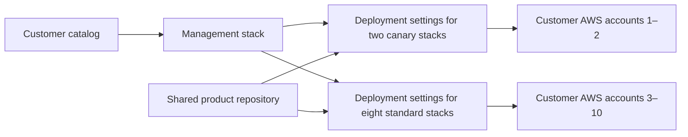

Your team has a product that runs in a customer's AWS account. The infrastructure program creates the same kinds of resources for every installation, while configuration supplies the customer's region and product settings. For the first account, you create a stack, establish credentials, and run the program.

By the tenth customer, the operating questions deserve as much attention as the infrastructure code. Which account does each stack reach? How do you apply a common deployment policy without editing ten settings pages? And how do you introduce a release to a few customers before sending it to everyone else?

<!--more-->

One useful approach is to manage the deployment configuration as a separate Pulumi program. A customer catalog describes the targets, and a management stack turns those records into [Pulumi Deployments settings](/docs/deployments/concepts/settings/). The product program stays shared, each installation keeps its own state, and the team has a reviewable place to maintain the fleet's deployment policy.

This post follows that model for ten customer accounts: two canary installations and eight standard installations, all represented as stacks in one Pulumi organization. The account IDs and names in the example are illustrative.

## Share the project, separate the installations

A [Pulumi project](/docs/iac/concepts/projects/) contains the infrastructure program; a [stack](/docs/iac/concepts/stacks/) represents an instance of it with its own configuration and state. For this product, the project might be `customer-product`, with stacks named `customer-01-prod` through `customer-10-prod`.

All ten stacks use the program under `infra/` in the product repository. They don't need ten copies of that code. Their [stack configuration](/docs/iac/concepts/config/) supplies values such as the customer ID and region, and each deployment assumes an IAM role in the appropriate AWS account.

Separate state lets you update one installation without including the others in the same Pulumi operation. It also gives each customer a deployment history. The AWS role and its trust policy enforce which account the deployment can access; a distinct stack name alone does not provide that authorization boundary.

The management program lives in another project, `customer-deployment-settings`, with its own stack. Its resources are the deployment settings for those ten product stacks. It does not own their databases, clusters, or other AWS resources. That separation is important when the team changes its deployment process or removes a customer from the fleet.



The diagram shows who configures and deploys what. Promotion between the two groups is a release-process decision, not a dependency implied by these arrows.

## Describe customers in a catalog

The catalog connects each customer to a target stack, an AWS account, and a rollout ring. One record looks like this:

```json
{
    "id": "customer-01",
    "stack": "customer-01-prod",
    "accountId": "111111111101",
    "region": "us-east-1",
    "roleArn": "arn:aws:iam::111111111101:role/PulumiProductDeployment",
    "ring": "canary"
}
```

Shared configuration names the Pulumi organization, product project, GitHub repository, and program directory. The ring definitions select source branches: `release/canary` for the first two customers and `release/standard` for the remaining eight. Push triggers start disabled so onboarding can be completed before a branch change starts product deployments.

Using stable customer IDs gives the generated resources predictable names. Reordering the catalog should not rename deployment settings, and adding a customer should add one settings resource. The example validates duplicate IDs and stack names, unknown rings, and role ARNs whose account does not match the customer's record.

Keep this catalog in a reviewed platform repository. It describes how the organization routes deployments, rather than storing the product's application secrets. Customer-specific product values belong in versioned `Pulumi.<stack>.yaml` files or imported [Pulumi ESC environments](/docs/esc/guides/pulumi-iac/).

## Generate the deployment settings

The [Pulumi Cloud provider](/registry/packages/pulumiservice/) exposes a `DeploymentSettings` resource, so the management program can apply the same policy to every catalog entry. With the catalog loaded and validated as `fleet`, the central loop has this shape:

```typescript
import * as pulumiservice from "@pulumi/pulumiservice";

for (const customer of fleet.customers) {
    const ring = fleet.rings[customer.ring];

    new pulumiservice.DeploymentSettings(`deployment-${customer.id}`, {
        organization: fleet.organization,
        project: fleet.project,
        stack: customer.stack,
        github: {
            repository: fleet.repository,
            deployCommits: ring.deployOnPush,
            previewPullRequests: false,
            pullRequestTemplate: false,
            paths: fleet.paths,
        },
        sourceContext: {
            git: { branch: ring.branch, repoDir: fleet.directory },
        },
        operationContext: {
            oidc: {
                aws: {
                    roleARN: customer.roleArn,
                    sessionName: "${stack.name}-${deployment.id}",
                },
            },
        },
    });
}
```

The full program also sets the runtime image, AWS region, and dependency-caching options, and exports the targets grouped by ring. Path filters include the program and the shared files it consumes, so relevant component or configuration changes can trigger deployments too.

Applying the management stack updates execution settings in Pulumi Cloud. The program does not call the deployment trigger API or run the customer's infrastructure program. With push triggers disabled, you can review and apply the settings before testing a target manually. If a target already has settings managed elsewhere, import them and establish one owner rather than having two management stacks compete over the same resource.

## Make onboarding a distinct operation

Before a customer joins a rollout, its AWS role and target stack need to exist. The example deliberately leaves those responsibilities with the customer-account bootstrap process and the product team. A catalog entry describes an installation that is ready to be managed; it does not create an AWS account or grant itself access to one.

The sample uses [Deployments' AWS OpenID Connect integration](/docs/deployments/guides/oidc/aws/) to exchange an identity token for short-lived credentials. Each customer's role trusts the intended Pulumi organization, project, and stack, with permissions for the product resources in that account. The management stack stores the role ARN, not an AWS access key, and needs no AWS credentials to configure those settings.

For an organization already using ESC, a customer-specific credential environment can supply the AWS login instead. In that arrangement, remove the direct OIDC configuration from the settings and import the environment into the target stack. Choose a consistent credential model; Deployments OIDC alone does not provide credentials to a developer running `pulumi up` locally.

Product configuration has a separate lifecycle from deployment settings. The companion includes a local generator that creates initial stack configuration files from the catalog, including `aws:region`, `aws:allowedAccountIds`, and the product's `customerId`. Review those values and commit them to the product repository, preserving any existing secrets or ESC imports. The account allowlist helps the Pulumi AWS provider reject credentials for an unexpected account; apply the same restriction to explicit AWS providers in the program.

A practical onboarding sequence is to establish account trust, prepare the product configuration, create the target stack, and then apply its deployment settings. Test a disposable installation before enabling automatic triggers. Changing the catalog later does not rewrite configuration in Git, and moving an existing installation to another account or region remains an infrastructure migration.

## Promote the same revision through rollout rings

Once onboarding is complete, enable push deployments for the rings you intend to drive from Git. Advancing `release/canary` to a selected product commit makes the two canary stacks eligible to deploy. They can run concurrently, subject to the organization's [deployment concurrency limit](/docs/deployments/operations/deployment-queue/) and available runner capacity.

Check both deployment results and the product's health before advancing `release/standard` to that same commit. The other eight stacks can then deploy independently. Separate stacks do not guarantee ten simultaneous execution slots, and success in one account does not undo a failure in another. Recovery can target the affected installation without rerunning every customer.

The branches identify which revision each ring follows; they don't enforce an approval workflow on their own. Branch protections or the team's release automation must control promotion. Pulumi Deployments has [no native deployment-level approval gate](/docs/deployments/guides/gated-deployments/), so the example does not present a ring label as one. It leaves intermediate-deployment consolidation disabled; enable it only when the latest desired state can replace the queued revisions.

If the organization prefers API-driven releases, leave push triggers disabled and dispatch deployments for the exported ring targets with an explicit source commit. Pick one trigger path for each release so a branch update and an API call don't accidentally enqueue the same work twice.

## Keep ownership clear as the fleet grows

With this structure, onboarding another customer adds another catalog record and settings resource after the account and target stack are ready. A shared policy change can be reviewed once and applied across the fleet, while each product installation continues to have its own configuration and state.

Offboarding follows those ownership boundaries too. Removing a record deletes its deployment settings; it does not destroy the product infrastructure or remove the customer's IAM role. Decommission those through the stacks and account processes that own them. Likewise, destroying the management stack removes the settings it manages, rather than acting as a fleet-wide product destroy.

<!-- TODO: Publish the local deployment-settings example in workshop PR #288 and replace this PR link with a pinned README URL before publication. -->
The draft [workshop companion](https://github.com/pulumi/workshops/pull/288) puts the implementation under `faster-pulumi-deployments/deployment-settings/`: a ten-account catalog, the settings program, and the configuration generator. Its local tests use Pulumi mocks to check resource registration and account routing; the example has not been applied to ten real customer accounts. The companion explains which onboarding and deployment checks still belong in your organization.

The team now has one place to manage how customer stacks deploy, with each installation retaining its own state and configuration. That gives you a useful foundation for the next question: when all those stacks consume the same release, how much preparation are they repeating? Measure that work before deciding whether dependency caches or a prepared executable environment should become part of the release process.
