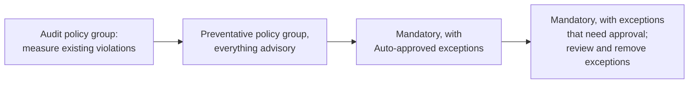

Policy exceptions, now in public preview in [Pulumi Policies](/docs/discovery-governance/concepts/policy-as-code/), let you make policies mandatory without blocking your pipelines. An exception accepts specific resources as they are against specific policies in one [policy pack](/docs/discovery-governance/concepts/policy-as-code/policy-packs/), with a written reason: a bucket that has to be public, or a resource that predates the policy and can't be fixed yet. Teams request their own exceptions, and the violations an exception exempts are still reported, marked as exempted. Every exception leaves a record of who created it, why, and where it applied. See the [policy exceptions documentation](/docs/discovery-governance/concepts/policy-as-code/policy-exceptions/) for the full reference.

<!--more-->

## Why do mandatory policies stall?

Mandatory policies are what actually prevent misconfiguration. An advisory policy prints a warning that a busy developer scrolls past; a mandatory one stops the `pulumi preview` or `pulumi up` before a public bucket or an open security group reaches production.

Turning one on is the hard part. A new mandatory policy applies to every stack at once, including the resources that were deployed long before the policy existed. That leaves two bad options: ask every team to fix every existing violation overnight, or accept that entire pipelines are blocked until they do.

Some violations also aren't mistakes. A bucket that serves a static website has to be public. A log target bucket has to allow the log delivery group.

Teams that push ahead anyway reach for workarounds. They clone a policy group to turn off one rule, which works per stack, so the copies multiply. They mark a finding as ignored, which needs no reason and doesn't survive the next scan. Or they write exemption config by hand inside their own policy packs. None of these leaves a record a reviewer can rely on, so the usual answer is to keep the policy advisory forever, and an advisory policy doesn't prevent anything.

## What does a policy exception exempt?

A policy exception exempts the violations of specific policies on specific resources. Each exception belongs to one policy pack and has:

- **A reason** that explains why it's safe to exempt the violations. Reviewers and auditors read it.
- **Match entries**, each listing one or more policies and one or more resource URNs. A violation is exempted only when its policy and its resource URN both appear in the same entry.

In the public preview, matching is exact: entries name policies and resource URNs, with no wildcards, and no entry matches every policy in a pack.

Exceptions work with any policy pack, including the [pre-built compliance packs](/docs/discovery-governance/guides/pre-built-policy-packs/). Pulumi matches the violations a pack reports against your exceptions itself, so there's no pack to clone or edit.

An exempted violation doesn't fail the operation, even when its policy is mandatory, but it's still reported. The CLI summarizes exempted violations under `Policies:` with a count per policy, and `--show-policy-exceptions` lists each exempted violation with the ID and reason of every exception that exempts it. In Pulumi Cloud, the [policy findings](/docs/discovery-governance/operations/policy-findings/) that an exception exempted show its ID, so anyone reading the finding can see why it didn't block.

## How do teams request exceptions in Pulumi Cloud?

<!-- TODO(edition): confirm edition wording -->

In Pulumi Cloud, exceptions belong to your organization and apply to the policy packs in your [preventative policy groups](/docs/discovery-governance/concepts/policy-as-code/policy-groups/#preventative-policy-groups). When a preview or update starts, Pulumi Cloud sends the stack's active exceptions to the CLI, so there's nothing to configure locally.

A developer whose stack hits a violation opens the stack's **Overview** page, selects **Request exception** on the **Policy exceptions** card, picks the findings from the stack's latest run, and enters a reason. The exception applies from the stack's next run.

The same flow works from the CLI. The `pulumi policy exception` commands are experimental in the public preview, so set `PULUMI_EXPERIMENTAL` first. The command reads the violations from the stack's latest update or preview, so there are no URNs to copy:

```bash
export PULUMI_EXPERIMENTAL=true
pulumi policy exception new aws-guard --stack prod --policy s3-no-public-read \
    --reason "Log target buckets must allow the log delivery group"
```

An organization admin decides how much review an exception needs, with the mode switch on the **Exceptions** tab of the **Policy configuration** page:

- **Auto-approved**: anyone with permission to create exceptions creates them directly, and the button reads **Create exception**.
- **With approval**: each request opens a change request, and one approval from a user with the `policy_exceptions:approve` permission creates the exception. Pending requests wait on the **Requests** sub-tab.
- **Disabled**: no exceptions can be created, and existing ones don't apply until you turn exceptions back on.

## How do you roll out a mandatory policy with exceptions?

Exceptions let a policy rollout end at mandatory enforcement instead of stopping at advisory:



1. **Measure.** Add the policy pack to an audit policy group and review the findings.
1. **Make the policies advisory in a preventative policy group.** Developers see violations at deployment time, and you learn which policies are noisy, without anyone being blocked.
1. **Make the policies mandatory, with self-service exceptions.** Set exceptions to **Auto-approved**. Teams that hit a violation they can't fix yet create an exception with a reason and keep deploying, instead of waiting on you.
1. **Require approval.** Once the backlog is under control, switch to **With approval**. New exceptions need a reviewer through a change request, and you remove existing ones as teams fix their resources.

The policy is mandatory from step three on. Every violation that doesn't block is one that someone explained in writing, and any violation that no exception covers blocks until it's fixed.

## What record does every exception leave?

For regulated teams, the exception itself is the artifact an auditor asks for. Each one records:

- **The reason**, written by the requester.
- **Who requested it, and who approved it.** With approval required, the request is a change request, so the approval is recorded with it.
- **Where it applied**: for each policy and resource, when the exception last exempted a violation in a stack update.
- **Audit log events**: creating and removing exceptions is recorded in the [audit logs](/docs/administration/concepts/audit-logs/) as `policy-exception-created` and `policy-exception-removed`, alongside the rest of your organization's activity.

The **Exceptions** tab lists every exception in your organization, active and removed, with its status, policy pack, stacks, and reason.

That record is what makes **Auto-approved** safe to run. Security becomes a trailing reviewer: teams create exceptions and keep deploying, and security reads the reasons afterward instead of blocking deploys while it reviews.

You can remove any exception at any time, from the console or with `pulumi policy exception remove`. From the next preview or update, the violations it exempted are reported again, and mandatory ones block. A removed exception stays in the list with the **Removed** status, so the record of what was exempted, and why, doesn't disappear with it.

## Can you use exceptions without Pulumi Cloud?

Yes. Anyone can add exceptions to a local policy pack, with the open source CLI and any backend. Exceptions live in the JSON file you pass with `--policy-pack-config`, in version 2 of the file format:

```json
{
    "version": 2,
    "policies": {
        "all": "mandatory"
    },
    "exceptions": {
        "log-buckets": {
            "reason": "Log target buckets must allow the log delivery group",
            "match": [
                {
                    "policies": ["s3-no-public-read"],
                    "targets": ["urn:pulumi:prod::web::aws:s3/bucket:Bucket::logs"]
                }
            ]
        }
    }
}
```

Pass the file with the pack it configures, for example `pulumi preview --policy-pack ./aws-guard --policy-pack-config ./aws-guard-config.json`. Pulumi validates it before the operation runs, so an empty reason or an invalid URN stops the operation before anything deploys.

The file gives you the same matching and reporting. Pulumi Cloud adds the organization-managed workflow on top: requests, approvals, and the auditable list of every exception.

## Next steps

Policy exceptions are in public preview, and a few things are still limited: matches name exact resource URNs, exceptions don't expire and can't be edited (remove one and create another), and they apply to preventative policy groups only.

<!-- TODO(launch): state the minimum Pulumi CLI version once it's released; the docs page carries the same TODO. -->

- Read the [policy exceptions documentation](/docs/discovery-governance/concepts/policy-as-code/policy-exceptions/) for matching rules, the config file format, approval modes, and permissions.
- Plan a staged rollout with [policy groups](/docs/discovery-governance/concepts/policy-as-code/policy-groups/#adopting-policy-across-an-organization).
- Share feedback in the [Pulumi Community Slack](https://slack.pulumi.com/) or on [GitHub](https://github.com/pulumi/pulumi/issues).
