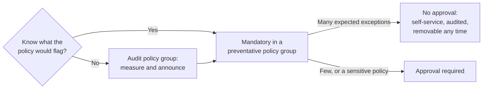

Policy exceptions in [Pulumi Policies](/docs/discovery-governance/concepts/policy-as-code/) let you keep a policy mandatory while letting specific resources break it for a valid reason. Each exception identifies the resources and policies it applies to, and records who created it and why. You can require approval before it takes effect and set an expiry date so it doesn't last forever. Everything the exception doesn't cover must still comply.

<!--more-->

## Why do mandatory policies stall?

An advisory policy only warns. A mandatory policy blocks `pulumi preview` or `pulumi up` before a public bucket or an open security group reaches production. That difference matters more as coding agents build more of your infrastructure: agents make changes faster than people can review them, and a warning gets lost in a long preview. A mandatory policy forbids the misconfiguration entirely, so the code must comply before any change is applied, whether a developer or an agent wrote it.

Many users struggle with updating their policies from advisory to mandatory. The new required policy applies to every stack, including resources created before the policy existed. Some violations are intentional: a static website bucket needs to be public, and a log bucket needs to allow the log delivery group. The policy is still correct, but it needs a few known exceptions.

Without ways to handle edge cases, some users run into these situations:

- **Leaving the policy advisory or disabled.** Nothing is blocked, so nothing is prevented.
- **Turning off the policy for a few stacks.** A copied policy group with one rule disabled exempts every resource in those stacks, not only the one that needs it, and the copies multiply.
- **Excluding resources in the policy configuration.** This is more precise, but the exclusion lists spread across packs and policy groups and quickly become a maintenance burden.

In each case, the reason a policy was skipped ends up in a chat thread, a ticket, or someone's memory, where it's hard to trace back to the resource.

## What changes with policy exceptions?

### Mandatory stays mandatory

An exception is not a weaker enforcement level or a one-time pass for a deployment. It applies only to specified policies and resources. The policy still blocks all other resources, and all other policies still apply to exempted resources. With exceptions, you can make a policy mandatory without first resolving every existing violation.

Exceptions work with any policy pack, including the [pre-built compliance packs](/docs/discovery-governance/guides/pre-built-policy-packs/). Pulumi matches violations against your exceptions, so there's no need to clone or edit a pack.

### Teams unblock themselves, on terms you set

If a deployment hits a violation that the developer can’t fix yet, they can request an exception directly from the Pulumi CLI or the failed stack page and explain why. The organization settings decide whether exceptions can be created immediately, with a full audit trail maintained, or require approval from designated people.

An exception can expire. If a team plans to fix a violation, set an expiry to keep the exception temporary. Once it expires, the exception is removed, and the violation blocks again on the next update. Without an expiry, the exception can become part of the policy, so set one whenever a fix is planned.

### Everything is on the record

An exempted violation is still reported. By default, the CLI summarizes exempted violations with the rest of the policy results:

```output
Policies:
    ⚠️ aws-guard@v1.0.0
        - [advisory]  bucket-versioning  (aws:s3:Bucket: logs-bucket)
          Buckets should enable versioning
        · [exempted]  s3-no-public-read  (1 violation)
```

Each exception records its reason, who requested it, the change request that approved it, its expiry, and each policy and resource it applied to. Creating and removing exceptions are recorded in your [audit logs](/docs/administration/concepts/audit-logs/), and removed and expired exceptions remain always accessible. When an auditor asks why a resource is out of policy, the answer is the exception attached to the resource.

## How does it work for each team?

In Pulumi Cloud, exceptions belong to your organization and apply to the policy packs within your [policy groups](/docs/discovery-governance/concepts/policy-as-code/policy-groups/#preventative-policy-groups). When a preview or update starts, Pulumi Cloud sends the stack's active exceptions to the CLI, so no local configuration is required. Applying them needs Pulumi CLI v3.274.1 or later.

- **Developers** request an exception from the **Policy exceptions** card on the stack's **Overview** page or via the experimental `pulumi policy exception new` command. They select the findings from the stack's latest run, enter a reason, and optionally an expiry. The exception takes effect from the stack's next run, once it's approved if approval is required.
- **Admins** decide whether exceptions require approval, and if so, who approves (organization admins, policy managers, or specific teams and users) and how many approvals a request requires. No one approves their own request unless you allow it.
- **Approvers** review requests on the **Approvals** page, where findings, the reason, and the expiry are all in one place. Approving a request creates the exception.
- **Security and compliance teams** see both active and removed exceptions on a single list, and anyone with permission to remove exceptions can remove one at any time. In the next preview or update, its violations are reported again, and mandatory ones block.

## How do you roll out mandatory policies with exceptions?

With exceptions, you don't have to fix every existing violation before making a policy mandatory. A violation a team can't fix yet costs them an exception request, not a blocked pipeline, so you can enforce sooner.



Start from where you are:

- **If you don't know what a policy would flag**, add its pack to an audit policy group first. Audit scans report existing violations without blocking anything, so you can see the volume and let teams know what's coming.
- **Otherwise, make the policy mandatory** in a preventative policy group, and choose how exceptions are granted based on how many you expect:
    - **No approval**, when there are many. Developers create their own exceptions with a reason and keep deploying. You still get the full audit trail, and you can remove any exception, so its violations block again from the next update.
    - **Approval required**, when there are few or the policy is sensitive. Each exception waits for a reviewer before it applies.

You can switch between the two at any time. Either way, the policy is mandatory from the start and always documented.

## Can you use exceptions without Pulumi Cloud?

Yes! The Pulumi CLI applies exceptions from a local policy pack config file with any backend. It uses the same matching and reporting as other exceptions. See [exceptions in a local policy pack config file](/docs/discovery-governance/concepts/policy-as-code/policy-exceptions/#exceptions-in-a-local-policy-pack-config-file) for the format.

## Next steps

Policy exceptions are in public preview on the Essentials, Pro, and Enterprise editions; requiring approval needs Pro or Enterprise. Applying exceptions from Pulumi Cloud requires Pulumi CLI v3.274.1 or later. Older versions may not apply them, and report the violations as usual.

- Read the [policy exceptions documentation](/docs/discovery-governance/concepts/policy-as-code/policy-exceptions/) for matching rules, approvals, expiry, and permissions.
- Plan a staged rollout with [policy groups](/docs/discovery-governance/concepts/policy-as-code/policy-groups/#adopting-policy-across-an-organization).
- Share feedback in the [Pulumi Community Slack](https://slack.pulumi.com/) or on [GitHub](https://github.com/pulumi/pulumi/issues).
