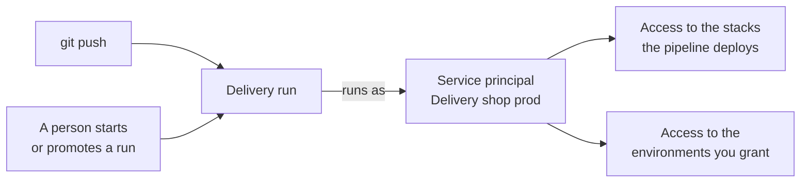

Access control in [Pulumi Cloud](/docs/administration/concepts/rbac/) now starts from least privilege. Every organization gets three new built-in roles, you can share a single stack or environment with a teammate, and you can create service principals to give your automated workloads their own identity.

<!--more-->

## Why change how access works?

Protecting your infrastructure is central to how we build Pulumi Cloud, and access control has to keep up with how teams work. More people outside the platform team touch infrastructure, and a growing share of changes comes from pipelines and coding agents, which need to be governed as carefully as the people they work for.

Security works best when the secure choice is also the convenient one. Giving people, agents, and automation the access they need, and nothing more, shouldn't take extra work. The changes below make the narrow, deliberate choice the default one.

## Three new built-in roles

Every organization now has three new built-in roles, alongside Admin and Billing Manager. Each one includes everything the one before it allows:

| Role | What members can do |
|------|---------------------|
| Reader | See the organization's stacks, environments, and cloud accounts. |
| Builder | Everything a Reader can, plus create stacks, environments, and cloud accounts, and manage the ones they create. |
| Maintainer | Everything a Builder can, plus change every stack, environment, and cloud account in the organization. |

One of them is the organization's [default role](/docs/administration/concepts/rbac/default-roles/), the role members have unless an admin assigns them a different one. New organizations start on Builder: people create and manage their own infrastructure, and get access to everyone else's when someone decides they should. Existing organizations were moved to a built-in role that matches what their members could already do, or kept their existing default, so nobody gained or lost access.

When an admin changes the default role, every member who follows it moves to the new role, and members who were assigned a role keep theirs.

## Share one stack with one person

Giving one person access to one thing now takes a few seconds. Every stack, environment, and cloud account has **Access** settings: select **Add Principal**, pick a teammate, pick what they can do, and you're done.

Teams are granted access in the same place, so a single list shows everyone who has been granted access to that stack, environment, or cloud account. Every organization also has an [Everyone team](/docs/administration/concepts/rbac/teams/#the-everyone-team) that always contains every member, for the things the whole organization should see.

## Service principals: an identity for automation

A [service principal](/docs/administration/concepts/rbac/service-principals/) is an identity for work that isn't done by a person. You create it, name it, and give it access the same way you would a teammate:

- **It starts with nothing.** A service principal doesn't follow the organization's default role. It has only the roles and access you give it, so it can be as narrow as a single stack and the environments that stack imports.
- **You grant access where you already do.** Add a service principal from the same **Access** settings you use to share a stack, environment, or cloud account with a teammate, or assign it a role for the whole organization.
- **It can't be used to get around your own access.** Admins, Maintainers, and Builders can create service principals, and can only give one the roles they could grant themselves.
- **It shows up by name.** In the audit logs, a service principal is the actor of everything it does, so you can tell which automation made a change.

Pulumi Cloud also creates service principals where it runs work for you: each [Pulumi Delivery](/docs/delivery/) pipeline that doesn't name its own identity and each [custom agent](/docs/ai/agents/) gets one of its own.

## Pipelines run as who you choose

We recently [introduced Pulumi Delivery](/blog/introducing-pulumi-delivery/), which lets you write your release pipeline as a Pulumi program. Every Delivery pipeline [runs as one identity](/docs/delivery/concepts/identity/). The person who starts a run, approves a gate, or pushes a commit doesn't lend the run their own access.

By default, Delivery generates a service principal for each pipeline and gives it access to the stacks the pipeline works with and nothing else. To decide the access yourself, name a service principal you created, or a team, in the pipeline program:

```typescript
const pipeline = new delivery.Pipeline("shop", {
    servicePrincipal: { userId: "service-principal:0b6f1c2e-5d3a-4f7b-9c1d-2e8a7b6c5d4f" },
});
```



- **Runs are predictable.** A run that works when you start it also works when a push starts it overnight, because it's the same identity both times.
- **The access is yours to decide.** The pipeline can reach what its service principal was given and nothing else.
- **It's visible.** The pipeline's settings list the service principals and teams it has been registered with, and who added each one.

[Pulumi Deployments](/docs/deployments/concepts/) works the same way. A stack's deployment settings now have a **Run as** setting: select a service principal, or a team, and every deployment of that stack runs with that identity's access, whether it's started by a person, a git push, or a schedule.

## Restricted by default for new organizations

New organizations are created in the restricted [permission mode](/docs/administration/concepts/rbac/permission-modes/), where automation gets only the access you explicitly gave it. Every stack's deployments run as a service principal or a team, and a team access token gets its team's access and nothing more.

Existing organizations keep working the way they always have, with automation that can get broader access than you gave it, until an admin switches them to restricted. The console spells out what the switch changes before you confirm.

## Manage it as code

If you manage your organization with the [Pulumi Service provider](/registry/packages/pulumiservice/), version 1.7.0 covers the new model: you can set the default role, assign the built-in roles, and give a member access to a single stack, environment, or cloud account:

```yaml
resources:
  aliceOnDev:
    type: pulumiservice:OrganizationMemberEntityAccess
    properties:
      organizationName: my-org
      username: alice
      entityType: stack
      entityName: my-project/dev
      permission: stack-write
```

## What changes for existing organizations?

Nothing changes until you choose to change it. Your members kept their access when the built-in roles arrived, your custom roles and teams work as before, and your deployments keep running the way they do today.

To move an existing organization to least privilege, take these steps in order:

1. **Pick a default role.** For most organizations, that's Builder.
1. **Give each stack that uses Pulumi Deployments a service principal or a team** with access to what that stack needs.
1. **Switch to the restricted permission mode** once each of those stacks has one. The [permission modes documentation](/docs/administration/concepts/rbac/permission-modes/#before-you-switch-to-restricted) has a short checklist, and you can switch back if something was missed.

## Next steps

Everything here is available today. The documentation notes where a feature depends on your edition.

- Read how [default roles](/docs/administration/concepts/rbac/default-roles/) and [access on individual stacks](/docs/administration/concepts/rbac/entities/#entity-access) work.
- Create a [service principal](/docs/administration/concepts/rbac/service-principals/), then name it in a [Delivery pipeline](/docs/delivery/concepts/identity/) or select it under [Run as](/docs/deployments/concepts/settings/pulumi-cloud-role/) in a stack's deployment settings.
- Share feedback in the [Pulumi Community Slack](https://slack.pulumi.com/) or on [GitHub](https://github.com/pulumi/pulumi-cloud-requests/issues).
