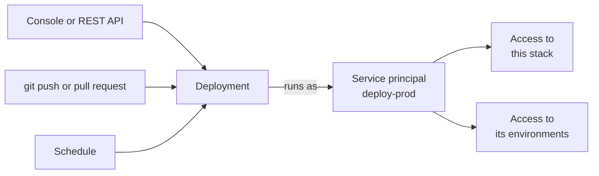

Access control in [Pulumi Cloud](/docs/administration/concepts/rbac/) now starts from least privilege. Every organization gets three built-in roles, you can share a single stack or environment with a teammate from the page you're already on, and automation gets an identity of its own: a service principal that your deployments run as. New organizations start in a restricted mode, where automation gets only the access you gave it.

<!--more-->

## Why change how access works?

Teams use Pulumi Cloud differently than they did a few years ago. Organizations are larger, more people outside the platform team touch infrastructure, and a growing share of changes comes from pipelines and coding agents instead of someone at a terminal.

That raises two questions more often than before: who should be able to change this, and what is this automation allowed to do? Security works best when the secure choice is also the convenient one, so we set out to make both questions quick to answer and precise access quick to set up. The changes below make the narrow, deliberate choice the default one.

## Three roles every organization starts with

Every organization now has three built-in roles, each including everything the one before it allows:

| Role | What members can do |
|------|---------------------|
| Reader | See the organization's stacks, environments, and cloud accounts. |
| Builder | Everything a Reader can, plus create their own and manage what they create. |
| Maintainer | Everything a Builder can, plus change everyone else's. |

One of them is the organization's [default role](/docs/administration/concepts/rbac/default-roles/), the role members get unless an admin gives them a different one. Change the default, and everyone who follows it moves with it.

New organizations start on Builder: people create and manage their own infrastructure, and get access to everyone else's when someone decides they should. Existing organizations were moved to the built-in role that matches what their members could already do, so nobody gained or lost access.

## Share one stack with one person

Giving one person access to one thing now takes a few seconds. Every stack, environment, and cloud account has **Access** settings: select **Add Principal**, pick a teammate, pick what they can do, and you're done.

Teams are granted access in the same place, so one list shows everyone who can reach a stack. Every organization also has an [Everyone team](/docs/administration/concepts/rbac/teams/#the-everyone-team) that always contains all of its members, for the things the whole organization should see.

## Service principals: an identity for automation

A [service principal](/docs/administration/concepts/rbac/service-principals/) is an identity for work that isn't done by a person. You create it, name it, and give it access the same way you would a teammate. It starts with only what you give it, so it can be as narrow as a single stack.

## Deployments run as who you choose

The first place to use a service principal is [Pulumi Deployments](/docs/deployments/concepts/). A stack's deployment settings now have a **Run as** setting. Select a service principal, or a team, and every deployment of that stack runs with that identity's access, whether a person starts it, a git push triggers it, or a schedule does.



- **Runs are predictable.** A deployment that works when you start it also works when a schedule starts it overnight, because it's the same identity both times.
- **The access is yours to decide.** The deployment can reach what you gave its service principal and nothing else.
- **It's visible.** Each deployment's page shows who it ran as.

## Restricted by default for new organizations

These pieces come together in the organization's [permission mode](/docs/administration/concepts/rbac/permission-modes/):

- In **permissive** mode, automation that runs on behalf of your organization can get broader access than you explicitly gave it. This is how organizations have always worked.
- In **restricted** mode, it gets only the access you explicitly gave it. Every stack's deployments run as a service principal or a team.

New organizations are created in restricted mode. Existing organizations stay permissive until an admin switches them, and the console spells out what the switch changes before you confirm.

## Manage it as code

If you manage your organization with the [Pulumi Service provider](/registry/packages/pulumiservice/), version 1.7.0 covers the new model: you can set the default role, assign the built-in roles, and give a member access to a single stack, environment, or cloud account:

```yaml
resources:
  aliceOnDev:
    type: pulumiservice:OrganizationMemberEntityAccess
    properties:
      organizationName: my-org
      username: alice
      entityType: stack
      entityName: my-project/dev
      permission: stack-write
```

## What changes for existing organizations?

Nothing changes until you choose to change it. Your members kept their access when the built-in roles arrived, your custom roles and teams work as before, and your deployments keep running the way they do today.

When you're ready to tighten things, this order works well:

1. **Pick a default role.** For most organizations, that's Builder.
1. **Give each stack you deploy a service principal** with access to what that stack needs.
1. **Switch to the restricted permission mode** once every deployed stack has one. The [permission modes documentation](/docs/administration/concepts/rbac/permission-modes/#before-you-switch-to-restricted) has a short checklist, and you can switch back if something was missed.

## Next steps

All of this is available today. The documentation notes where a feature depends on your edition.

- Read how [default roles](/docs/administration/concepts/rbac/default-roles/) and [access on individual stacks](/docs/administration/concepts/rbac/entities/#entity-access) work.
- Create a [service principal](/docs/administration/concepts/rbac/service-principals/) and select it under [Run as](/docs/deployments/concepts/settings/pulumi-cloud-role/) in a stack's deployment settings.
- Share feedback in the [Pulumi Community Slack](https://slack.pulumi.com/) or on [GitHub](https://github.com/pulumi/pulumi-cloud-requests/issues).
