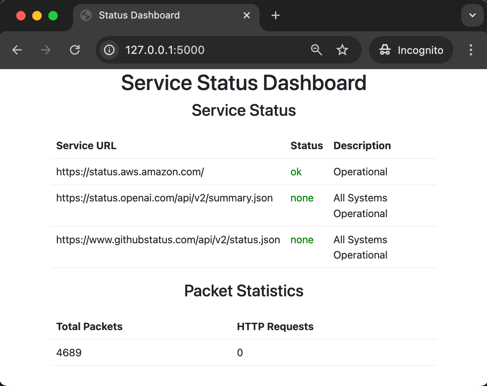
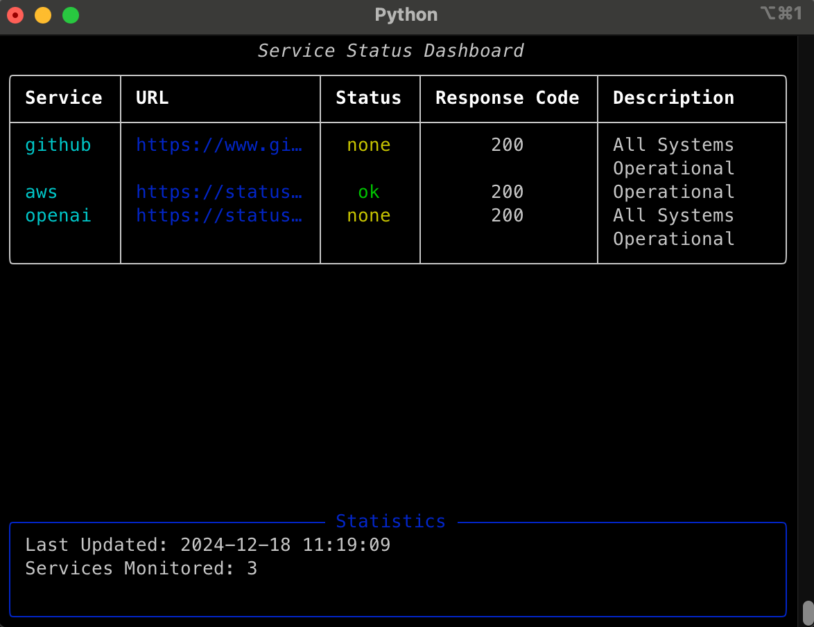
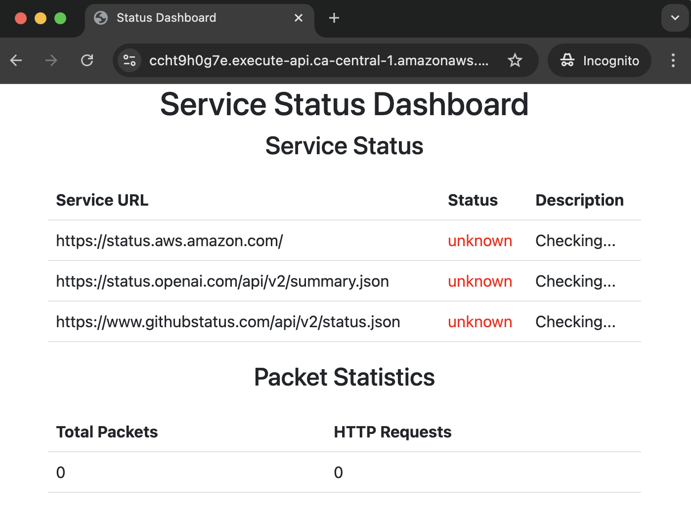

Have you ever had one of those moments: Elasticsearch is crashing, logs are filling up too fast, or a deployment needs data from three different APIs. The big enterprise solutions aren't quite right, and your team estimates six months to build something proper. But you know that with Python and a few choice libraries, you could hack something together by tomorrow.

<!--more-->
<span style="width: 40%; float: left; margin-right: 20px;">
<span style="text-align:center">
    
    <figcaption>
    <i><a href="https://github.com/adamgordonbell/service-status-monitor">Let's build a little web dashboard in Python.</a></i>
    </figcaption>
</span>
</span>

That's where Python really shines. It lets you be the scrappy problem-solver who can travel up and down the stack. But [Python also holds up well beyond quick fixes](/why-is-python-so-popular/). The same language that helps you hack tomorrow's solution can also build your company's long-term infrastructure.

This guide covers both ends of that spectrum. I'll show you python packages for "we need it yesterday" moments, and then move into solutions that can grow with your team. And along the way I'll build [a little example service monitor and package capturer](https://github.com/adamgordonbell/service-status-monitor) to demonstrate the python packages I'm covering. I'll wrap it in a CLI, in a web dashboard and deploy it to AWS, all while staying in Python.

So here's my list of Python libraries for DevOps work, starting from #15 to the most important last at number #1. If you want the conceptual overview first, read [what Python for DevOps means](/what-is/python-for-devops/).

**Updated October 2026.** I re-checked every tool on this list against its latest release. Schedule (no release since May 2024) gave way to APScheduler, the unmaintained `toml` package gave way to the standard library's `tomllib`, the Dagger example uses the current API, and the Airflow entry covers Airflow 3. I also added uv, Ruff, and a short section on exposing your tools to AI agents with MCP. Click, Requests, pytest, Typer, and Dagger now require Python 3.10 or newer, and 3.10 itself reached end of life this month, so target 3.12 or later for new work.

### Dashboards / monitoring

Let's start with building web dashboards. Long-term, it's usually better if there's an off-the-shelf tool for that specific dashboard you need. But if you can create a quick visual on a Django endpoint, you can move on to the next issue.

- **15 and 14. Django and Flask:** ([Django](https://www.djangoproject.com/), [Flask](https://flask.palletsprojects.com/)) While tools like Grafana excel at metrics visualization, sometimes you need custom dashboards that integrate with internal systems. These frameworks let you build dashboards to track and visualize various aspects of your systems. I find Django a great fit here, and its 5.2 long-term support release is a stable base for an internal tool (Django 6.x is current). Flask 3.1 is the lighter choice for a single-endpoint dashboard like the one below.
- **13\. Prometheus:** ([prometheus-client](https://github.com/prometheus/client_python)) This library is a versatile tool for metrics. Want to expose custom metrics to Prometheus? Use the client to create counters, gauges, or histograms. Need to pull data from a weird API and expose it as metrics? Write a quick exporter that fetches from your API every few minutes and translates the responses into Prometheus metrics. It is actively maintained (0.26 as of this writing).

```python
from flask import Flask, render_template_string
import requests

app = Flask(__name__)

@app.route("/")
def index():
    try:
        response = requests.get("https://www.githubstatus.com/api/v2/status.json", timeout=5)
        if response.status_code == 200:
            data = response.json()
            status = data["status"]["indicator"]
            description = data["status"]["description"]
        else:
            status = "critical"
            description = "Unable to reach GitHub API"
    except Exception as e:
        status = "critical"
        description = f"Error: {e}"

    color = {
        "none": "bg-green-500",
        "minor": "bg-yellow-500",
        "major": "bg-red-500",
        "critical": "bg-red-700",
    }.get(status, "bg-gray-500")

    return render_template_string(
        """
            ...
        """,
        color=color,
        description=description,
    )
```

<span style="text-align:center">
    <figcaption>
    <i><a href="https://github.com/adamgordonbell/service-status-monitor">Code</a> for a simple Dashboard</i>
    </figcaption>
</span>



### Task scheduling and orchestration

Sometimes you need to run things on a schedule. And while I love cron, sometimes you need more. Maybe you need to coordinate multiple tasks, handle retries, or manage complex job dependencies. Here's where Python can help:

- **12\. APScheduler:** ([apscheduler](https://apscheduler.readthedocs.io/)) When cron is too heavy but you need more than a bash script. It runs inside your Python process with interval, cron, and one-off triggers, and it can persist jobs in a database job store so they survive restarts. I use it for tasks like "check this API every 30 seconds and alert if something's wrong." This entry used to be the `schedule` library, which has not had a release since May 2024. The examples here use the stable 3.x line (3.11 at the time of writing); the 4.x rewrite is still in alpha.
- **11\. RQ (Redis Queue):** ([rq](https://python-rq.org/)) Perfect for local development queues, and RQ 2.x is actively maintained. Need to prototype a GitHub webhook handler that'll eventually use SQS? With Redis in Docker and RQ, you can have a working queue in minutes. No AWS needed until production.
- **10\. Airflow:** ([airflow](https://airflow.apache.org/)) The big gun of scheduling. Yes, it's complex, but sometimes you need that power. I've seen teams replace entire ETL systems with a few Airflow DAGs. When you need to coordinate multiple steps, handle failures gracefully, and have everything visible in a nice UI, it delivers. Airflow 3 added a Task SDK (`airflow.sdk`) with a stronger security model for task execution, DAG versioning, a new React-based UI, improved backfills, and event-driven scheduling on data assets. If you are still on 2.x, plan the upgrade.

```python
from apscheduler.schedulers.background import BackgroundScheduler

def schedule_url_checks():
    scheduler = BackgroundScheduler()
    for url in urls.values():
        scheduler.add_job(check_url_status, "interval", seconds=30, args=[url])
    scheduler.start()

if __name__ == "__main__":
    schedule_url_checks()
```

<span style="text-align:center">
    <figcaption>
    <i>Adding APScheduler to a status checker so URLs are requested in the background (adapted from the <a href="https://github.com/adamgordonbell/service-status-monitor">example service monitor</a>).</i>
    </figcaption>
</span>

### Network analysis and security

When your network issues go beyond what tcpdump can tell you, or when you need to automate security checks, Python is here to help:

- **9\. Scapy:** ([scapy](https://scapy.net/)) The Python alternative to Wireshark for programmatic network traffic analysis. Need to figure out why your microservices aren't talking to each other? Want to check your load balancer? Use it to capture and analyze packets with a few lines of code. Scapy 2.8 is current; HTTP parsing is an optional layer you load explicitly, as in the sample below.
- **8\. Bandit:** ([bandit](https://github.com/PyCQA/bandit)) Security scanning for your CI pipeline. Point it at your Python codebase and it'll flag common issues like hardcoded credentials or unsafe deserialization. Bandit is still actively maintained, and [Ruff](https://docs.astral.sh/ruff/) can also run a subset of the same checks as its `S` rules.

```python
from scapy.all import sniff, load_layer

load_layer("http")  # enables the HTTPRequest layer

def packet_callback(packet):
    global packet_stats
    packet_stats["total_packets"] += 1
    if packet.haslayer("HTTPRequest"):
        packet_stats["http_requests"] += 1

def start_packet_sniffer():
    sniff(prn=packet_callback, store=False, timeout=60)  # Capture packets every 60 seconds

if __name__ == "__main__":
    threading.Thread(target=start_packet_sniffer, daemon=True).start()
```

<span style="text-align:center">
    <figcaption>
    <i>Adding packet sniffing to our <a href="https://github.com/adamgordonbell/service-status-monitor">code, mainly just because we can.</a></i>
    </figcaption>
</span>

### Containerization and cloud interaction

Sometimes you need more control over your containers than Dockerfiles can provide. Maybe you need to dynamically build images based on environment variables, or automate container management:

- **7\. Docker SDK for Python:** ([docker-py](https://docker-py.readthedocs.io/)) When you need to automate Docker operations programmatically. I use it to clean up old containers and images, check container health, and build images dynamically from configuration files. More powerful than chaining Docker CLI commands. Version 7.2, the first release in over two years, makes `docker.from_env()` honor your active Docker CLI context and adds `docker.from_context()`, which helps with remote hosts and Docker Desktop alternatives.
- **6\. Dagger:** ([dagger-io](https://dagger.io/)) Write container build logic in Python instead of Dockerfiles. Need to build multiple similar containers with slight variations? Want to pull in files from different sources based on environment? It lets you programmatically define container contents and build steps. (Bonus: this same code can later be used in CI/CD pipelines.) The SDK now uses `dag` and `dagger.connection()`; the older `dagger.Connection()` client pattern is now considered legacy.

```python
import anyio
import dagger
from dagger import dag

async def main():
    # Connect to the Dagger Engine
    async with dagger.connection():
        output = await (
            dag.container()
            .from_("python:3.13-slim")
            .with_exec(["python", "-c", "print('Hello from Dagger!')"])
            .stdout()
        )
        print(output)

if __name__ == "__main__":
    anyio.run(main)
```

<span style="text-align:center">
    <figcaption>
    <i>Using Dagger makes it easy to stay in Python while building containers.</i>
    </figcaption>
</span>

### Building command-line tools

<span style="width: 50%; float: right; margin-left: 20px;">
<span style="text-align:center">
    
    <figcaption>
    <i><a href="https://github.com/adamgordonbell/service-status-monitor">Let's build a CLI version of our service status dashboard in Python.</a></i>
    </figcaption>
</span>
</span>

Every useful script eventually needs to become a proper tool. When your team starts asking "can I use that script too?" it's time to enhance your CLI skills:

- **5/4. Click/Typer:** ([Click](https://click.palletsprojects.com/), [Typer](https://typer.tiangolo.com/)) Turn your quick scripts into proper CLI tools. Instead of remembering `python cleanup.py --older-than 7 --dry-run`, you get tab completion, help text, and proper argument handling. Typer is particularly nice if you're using modern Python - it uses type hints to build the CLI interface. Both are actively maintained (Typer now lives under the FastAPI organization on GitHub).
- **3\. Rich:** ([rich](https://rich.readthedocs.io/)) Make your terminal output actually readable. Need to display tables of data? Want progress bars for long-running tasks? Rich makes it easy to build user-friendly CLIs. I use it to turn wall-of-text logs into colored, formatted output that helps spot problems quickly. Rich is at version 15.

### 2. The essential toolkit

The foundation of any DevOps tooling consists of these essential libraries:

- **Requests** ([requests](https://requests.readthedocs.io/)) - For making HTTP requests
- **Pytest** ([pytest](https://docs.pytest.org/)) - For testing your code
- **logging** ([Python logging](https://docs.python.org/3/library/logging.html)) - For structured logging
- **YAML/JSON/TOML parsers** ([PyYAML](https://pyyaml.org/), [json](https://docs.python.org/3/library/json.html), [tomllib](https://docs.python.org/3/library/tomllib.html)) - For config file handling. `tomllib` has been in the standard library since Python 3.11 and reads TOML; for writing, use [tomli-w](https://github.com/hukkin/tomli-w). The older third-party `toml` package has not been released since 2020.
- **uv** ([uv](https://docs.astral.sh/uv/)) - A fast package and project manager that replaces pip, virtualenv, and pyenv for most DevOps scripts. With [inline script metadata](https://docs.astral.sh/uv/guides/scripts/), a single file can declare its own dependencies and run anywhere uv is installed with `uv run`.
- **Ruff** ([ruff](https://docs.astral.sh/ruff/)) - A linter and formatter in one tool, fast enough to run on every save and in every CI job.

While not flashy, these libraries form the backbone of every tool I build. And so I update my little tool to have some tests, some logging and store the api status urls in a toml file.

```python
# /// script
# requires-python = ">=3.11"
# dependencies = ["requests", "rich"]
# ///
import tomllib

import requests
from rich import print

with open("urls.toml", "rb") as f:
    urls = tomllib.load(f)

for name, url in urls.items():
    print(name, requests.get(url, timeout=5).status_code)
```

<span style="text-align:center">
    <figcaption>
    <i>Run it with <code>uv run check.py</code>; uv installs the declared dependencies into a throwaway environment.</i>
    </figcaption>
</span>

Now, #1 and it’s IaC time. I can get my dashboard onto AWS in a lambda using Pulumi.

<span style="width: 50%; float: left; margin-right: 20px;">
<span style="text-align:center">

```python
# Build and push the Docker image to ECR
image = awsx.ecr.Image("app-server-image",
    repository_url=repository.repository_url,
    context="..",  
    dockerfile="Dockerfile",
    platform="linux/amd64"
)
```

  <figcaption>
   <i>Push my Image to ECR</i>
  </figcaption>
</span>
</span>

### 1. Pulumi

While most tools in this list excel at quick solutions, infrastructure demands a more robust approach. This is where **Pulumi** fits. It is an infrastructure as code platform that runs your Python directly, so the language you already use for scripts also defines your cloud resources.

With support for real Python code instead of configuration languages (see [how Pulumi compares to Terraform](/docs/iac/comparisons/terraform/)), you can define, deploy, and manage your cloud resources using familiar programming concepts and practices.

With Pulumi, you get:

- [Complete programming language support](/docs/iac/concepts/) for using loops, functions, and classes in your infrastructure code

- [Infrastructure testing capabilities](/docs/iac/guides/testing/) to validate your deployments before they go live

- [Container image builds](/registry/packages/awsx/) with the AWS Pulumi package for building and pushing Docker images to ECR, as in the snippet above

- [uv, pip, or Poetry support](/docs/iac/languages-sdks/python/) as the Python toolchain, selected in `Pulumi.yaml`

- [Policy as code](/docs/discovery-governance/concepts/policy-as-code/) written in Python to enforce rules before deployment

- [Reusable components](/docs/iac/concepts/components/) written once in Python and consumable from other languages

- [Rich AWS integration](/registry/packages/aws/) for comprehensive cloud resource management

- [Automation API](/docs/iac/concepts/automation-api/) for running deployments from inside your own Python programs

[Pulumi Neo](/docs/ai/neo/), the infrastructure agent in Pulumi Cloud, can also draft and preview changes to code like this for you to review.

```python
# Create a Lambda function
lambda_function = aws.lambda_.Function("custom-lambda",
    name="custom-lambda",
    package_type="Image",
    image_uri=image.image_uri,
    role=lambda_role.arn,
    timeout=30,
    memory_size=512,
    environment={
        "variables": {
            "FLASK_ENV": "production"
        }
    }
)
```

<span style="text-align:center">
  <figcaption>
    <i>Start it up in a Lambda</i>
  </figcaption>
</span>


Define AWS Lambda, ECR, and the rest of your infrastructure with real Python instead of YAML, and reuse the same loops, functions, and tests you already know.


## Bonus: exposing your tools to AI agents

AI coding agents are now part of many DevOps workflows, and the Model Context Protocol (MCP) is the common way to give them tools. The official [MCP Python SDK](https://github.com/modelcontextprotocol/python-sdk) and [FastMCP](https://gofastmcp.com/) let you wrap a function you already wrote, like our status check, so an agent can call it:

```python
import requests
from fastmcp import FastMCP

mcp = FastMCP("Service status")

@mcp.tool
def github_status() -> str:
    """Return the current GitHub status description."""
    r = requests.get("https://www.githubstatus.com/api/v2/status.json", timeout=5)
    return r.json()["status"]["description"]

if __name__ == "__main__":
    mcp.run()
```

Keep these tools read-only until you trust the agent calling them, and put destructive actions behind the same review process as any other change.

## Bringing it all together

<span style="width: 50%; float: right; margin-left: 20px;">
<span style="text-align:center">
    
    <figcaption>
    <i>Dashboard is still pretty basic, but now it's on AWS with a little Python infrastructure code.</i>
    </figcaption>
</span>
</span>

Here's where Python excels - combining these tools to solve real problems. For example:

- Need a dashboard for infrastructure costs? Combine Flask with the AWS SDK and Pulumi's [Discovery and governance](/docs/discovery-governance/) features for an inventory of your cloud resources.
- Want to automate container cleanup? Mix Docker SDK with APScheduler for regular maintenance.
- Building a custom GitHub webhook processor? Use Flask to receive webhooks, RQ for asynchronous handling, and Rich for readable logs.

Start simple (maybe just a script with Requests and PyYAML), then gradually add more tools as needed. That's the beauty of Python in DevOps - you can start small and grow your solution naturally.

## The art of getting things done

The tools I've covered span the full spectrum of DevOps needs—from quick scripts to enterprise-grade solutions. Python's versatility makes it uniquely suited for both ends of this spectrum:

- For urgent needs, tools like uv, Rich, and Click let you rapidly prototype solutions.
- For long-term infrastructure, Pulumi and Airflow provide the robustness needed for production systems.
- For everything in between, Python's extensive library ecosystem helps you gradually evolve quick fixes into mature tools.

The key is knowing when to use each tool.
