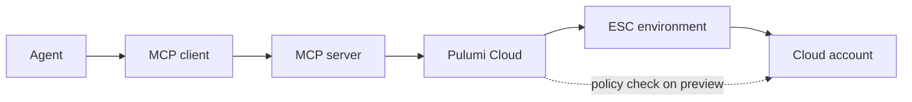

An AI agent can do whatever its credentials allow, so scoping those credentials beats instructing the model. A system prompt is input the model weighs against everything else it reads. A token, a role, and a policy check are limits the model cannot talk its way past. MCP lengthens the credential chain, and each link needs its own scope.

<!--more-->

This post follows that chain from the agent to your cloud account, shows where a limit belongs at each hop, and uses Pulumi Neo, the Pulumi MCP server, Pulumi ESC, and policy as code as the concrete implementation.

## Why can't a system prompt act as an authorization boundary?

A system prompt is text the model reads, and the model decides how much weight to give it. Tool output, a README, a ticket, or a web page can add competing text to the same context. Nothing in that arrangement enforces anything. The model can misread an instruction, lose it as the context grows, or follow a more persuasive instruction that arrived later.

Authorization works the other way around. The check happens outside the model, at the point where a credential is presented, and the answer is yes or no regardless of what the model intended.

Pulumi's own documentation for Neo draws the same line: [instructions and integration selections do not reduce the permissions of the credentials the agent holds](/docs/ai/agents/permissions/). If you want an agent to be unable to do something, remove the ability from the credential. Use the prompt to shape behavior inside the space the credentials allow.

## What does "the prompt told it not to" look like next to "the credentials couldn't reach it"?

Take a routine request sent through an MCP client: clean up stale development stacks and the cloud resources behind them. The prompt says to leave production alone. Here is how the same request plays out under two setups.

| | The prompt told it not to | The credentials couldn't reach it |
| --- | --- | --- |
| Token behind the MCP server | A personal access token, which acts with your permissions in every organization you belong to | An organization or team token with a custom role limited to the development project |
| Cloud credentials | One long-lived key with broad rights | A short-lived session from an ESC environment that only grants access to the development account |
| What stands between the agent and a production stack | The model's judgment about which stack is which | A permission error from Pulumi Cloud before any cloud API call is made |
| If the model picks the wrong stack | The delete runs | The request fails and the agent reports it cannot see that stack |
| What you review afterward | A transcript | An audit entry for a denied request |

The two setups give identical results on a good day. They differ on the day the agent misreads a stack name, follows an instruction embedded in a resource tag, or gets pointed at the wrong organization. In the first setup the outcome depends on the model. In the second it depends on a role definition you wrote and reviewed.

## What does MCP authorization control, and what does it leave to you?

MCP authorization answers one question: may this client call this server? The [current MCP specification](https://modelcontextprotocol.io/specification/2025-11-25/basic/authorization) builds it on OAuth 2.1. Servers publish Protected Resource Metadata so clients can discover the authorization server. Clients send a `resource` parameter so the token is bound to one server. Servers must validate that a token was issued for them as the audience. The [security best practices guide](https://modelcontextprotocol.io/specification/2025-11-25/basic/security_best_practices) forbids token passthrough, where a server accepts a token meant for another service and forwards it. The specification also says authorization servers should issue short-lived access tokens and that clients should request only the scopes they need.

Those rules protect the first hop. They say nothing about what the server can reach once the client is in. Downstream reach is whatever credential the server holds or forwards. An agent with a perfectly valid OAuth flow to a server that holds an administrator credential is an administrator.

The Pulumi MCP server shows the pattern. It authenticates Pulumi Cloud API requests with [the access token you provide](/docs/ai/guides/set-up-mcp-server/), and Pulumi Cloud checks access to each requested resource. So the scope of the agent equals the scope of that token:

1. A personal access token acts as you, with your permissions in every organization you belong to.
2. An [organization access token](/docs/administration/concepts/access-tokens/) acts as the organization with whatever role you assign it. Give it a [custom role](/docs/administration/concepts/rbac/roles/) with only the scopes the agent needs, and a leaked or misused token has a small blast radius.
3. For headless setups, send the `X-Pulumi-Org` header. If the header is missing or wrong, the server falls back to the first organization the token can access, which may not be the one you meant.

Use a separate token for MCP rather than reusing the one in your shell profile, and set an expiry.

## How do you scope an agent's cloud credentials per environment and per task?

Pulumi Cloud permissions decide which stacks and configuration an agent can see. The cloud account is the next hop, and that is where [Pulumi ESC](/docs/esc/) comes in. Define one ESC environment per target (development, staging, production) and give each agent role `environment:open` only on the environments its task needs. Reading an environment's definition does not grant that permission, so an agent can know an environment exists without being able to use it.

Inside the environment, use OIDC instead of stored keys, so each session gets short-lived credentials from an IAM role. The [`aws-login` provider](/docs/esc/providers/login/aws-login/) takes three inputs that matter here: `duration` to cap the session, `policyArns` to attach managed policies (the effective permissions are the intersection of the role and those policies), and `subjectAttributes` to put the environment name into the OIDC subject so the role's trust policy can restrict which environments may assume it.

```yaml
# environment: agents/dev-cleanup
values:
  aws:
    login:
      fn::open::aws-login:
        oidc:
          duration: 1h
          roleArn: arn:aws:iam::012345678912:role/agent-dev-cleanup
          sessionName: neo-dev-cleanup
          subjectAttributes:
            - currentEnvironment.name
          policyArns:
            - arn:aws:iam::aws:policy/PowerUserAccess
  environmentVariables:
    AWS_ACCESS_KEY_ID: ${aws.login.accessKeyId}
    AWS_SECRET_ACCESS_KEY: ${aws.login.secretAccessKey}
    AWS_SESSION_TOKEN: ${aws.login.sessionToken}
```

The trust policy on `agent-dev-cleanup` accepts only the subject for this environment and the role lives in the development account, so a production stack has nothing to authenticate against. For access that needs a second pair of eyes, [ESC open approvals](/docs/esc/concepts/approvals/) require review before an environment can be opened at all.

For the broader pattern, see [ESC OIDC tokens for any service](/blog/esc-oidc-tokens-for-any-service/).

## How does policy as code stop an agent's action before it runs?

Scoped credentials limit which systems the agent can reach. Policy as code limits what it can do inside the systems it can reach. Pulumi evaluates [policies](/docs/discovery-governance/concepts/policy-as-code/) against the resources a program declares during `pulumi preview` and `pulumi up`, before anything changes in your cloud provider, and a violation of a mandatory policy stops the deployment.

That timing suits agents. The agent proposes a change, the preview resolves it into concrete resource operations, and the policy engine judges those operations. It does not matter whether a person, a CI job, or an agent wrote the code, and it does not matter what the prompt said. Policy groups let you attach stricter packs to production stacks than to development ones.

Here is a policy that a cleanup agent cannot argue with. It refuses any plan in which a database lacks deletion protection:

```typescript
import * as aws from "@pulumi/aws";
import { PolicyPack, validateResourceOfType } from "@pulumi/policy";

new PolicyPack("agent-guardrails", {
    policies: [
        {
            name: "rds-deletion-protection",
            description: "Databases must keep deletion protection enabled.",
            enforcementLevel: "mandatory",
            validateResource: validateResourceOfType(aws.rds.Instance, (instance, _, reportViolation) => {
                if (instance.deletionProtection !== true) {
                    reportViolation("RDS instances must set deletionProtection to true.");
                }
            }),
        },
    ],
});
```

Apply the pack to your production policy group in the preventative mode and the preview fails before the update starts. For more on pairing policy with deployments, see [deployment guardrails with policy as code](/blog/deployment-guardrails-with-policy-as-code/).

## Where should the approval gate sit between proposal and execution?

Between the agent's proposal and its execution, put a preview a person can read. Neo's approval modes control when it stops to ask: Manual waits on every approval, Balanced auto-approves routine steps and waits for `pulumi up`, state-modifying imports, and destructive changes, and Auto approves automatically. Administrators set the organization default.

Two details change how you should design around this.

First, an approval does not grant access. The permissions documentation says approval modes determine when Neo asks for confirmation, and an approval does not grant additional access. It also warns that approval modes do not check every shell command or integration call, so a write allowed by connected credentials can occur without a separate approval request, including in Manual mode. The approval gate is a review step. The credentials are still the boundary, so restrict operations such as `pulumi destroy` and cloud CLI writes through roles and credentials. The [read-only mode](/blog/neo-read-only-mode/) is a good default for tasks that should only investigate and propose, and the same documentation notes it does not restrict the credentials used by connected tools.

Second, watch for self-approval. The Pulumi MCP server includes a `neo-bridge` tool that can create a Neo task, send follow-up messages, and approve or reject the task's requests. If the MCP client that asked for the work can also approve it, the gate has one person-shaped hole in it. For query-only use, deny that tool in the client's permission settings, and keep the `agent_task:approve` permission with humans.

## What five questions should you ask about any agent's authorization?

Walk each hop and ask who holds the credential, what it reaches, and what checks the action before it runs.

| Hop | Question | Control |
| --- | --- | --- |
| Agent to MCP client | Which tools may the client call at all? | Client permission settings, such as denying `neo-bridge` |
| MCP client to MCP server | Is the token bound to this server and short-lived? | OAuth audience binding, token expiry |
| MCP server to Pulumi Cloud | What does the token's role allow? | Organization or team token with a custom role |
| Pulumi Cloud to cloud account | Does the agent get only this environment's credentials? | ESC environments with `environment:open`, OIDC, short `duration` |
| Proposal to execution | Does something check the plan before it runs? | Policy as code on preview, then a human approval |

If you cannot name the control for a row, the model's judgment is standing in for it.



## Frequently asked questions

### Does MCP OAuth make an agent least-privilege?

No. OAuth governs whether a client may call an MCP server and how tokens are bound to that server. What the server can do afterward depends on the credential behind it, so scope that credential with a custom role and short-lived cloud sessions.

### Should an agent use my personal access token?

Avoid it. A personal token gives the agent your access in every organization you belong to. Use an organization or team token with a custom role scoped to the task, and set an expiry.

### Do approval modes replace scoped credentials?

No. Approvals decide when an agent asks for confirmation, and an approval does not grant additional access. Connected credentials can still perform writes that the approval flow never sees, so the credentials must carry the restrictions.
