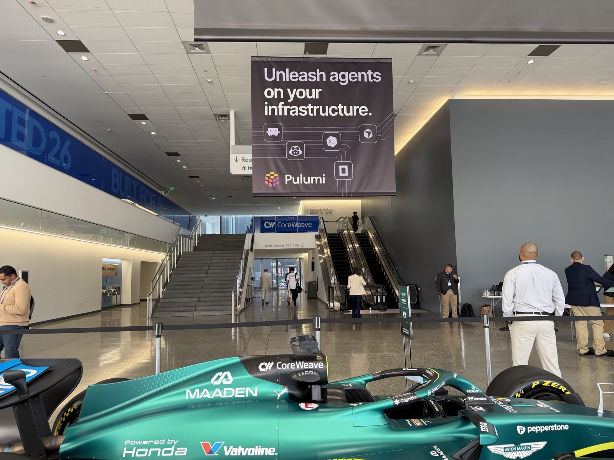

Recently, some members of the Pulumi team spent time in San Francisco attending the CoreWeave: Fully Connected 2026 conference, where we had a chance to talk to everyone from solo developers to engineering leaders at Fortune 500 organizations and learn more about how they are building with AI.



A frequent topic of conversation was open weight models and self-hosted inference. Whether AI is integrated into your platform, your product, or your productivity pipelines, rising token costs have decision makers everywhere taking a closer look at open weight models, in exchange for the promise of tighter control over spend and greater domain expertise.

If you are actively exploring the space or building with AI yourself, you may already have seen the challenges that come with serving inference at scale:

- Model stability and reliability can differ (sometimes dramatically) across hardware architectures and at different traffic volumes.
- Model performance and throughput can change depending on your workload type or model configuration.
- Cost differences and commitments across providers can make tracking spend challenging.
- Supply constraints and capacity shortages mean teams can't source hardware when they need it most.

Many teams naturally gravitate toward multicloud strategies that combine hyperscalers with specialized GPU clouds as a way of balancing spend, performance, and reliability. One thing we've seen is that developers everywhere are choosing Pulumi to help them navigate the fragmented hardware ecosystem and maintain consistent environments, even when the provider is different.

As part of our commitment to giving builders better tools, [we're sharing our AICR demo project from the Pulumi Labs GitHub organization](https://github.com/pulumi-labs/aicr-chatbot-demo). It shows how you can use Pulumi to spin up inference endpoints configured with the NVIDIA AI Cluster Runtime (AICR) SDK and deploy them across a number of cloud providers.

## AI performance engineering team as code

Deploying a cluster of GPU nodes as a production AI platform is a complex and time-consuming exercise that often requires specialized expertise. NVIDIA's AICR offers a collection of validated GPU infrastructure recipes for various cloud providers. By building a provider around AICR, Pulumi offers an efficient and reliable way to manage your GPU clusters, dramatically shortening time to first token.

In addition to bundling a complex technology stack, Pulumi makes it simple to deploy with minimal verbosity. `pulumi preview` shows every component the recipe expands into (namespaces, operators, schedulers, metrics, training runtime) before anything is applied. `pulumi up` then deploys them as children of a single resource, with a full day-2 lifecycle: diff, update, drift detection, and destroy.

This short Python snippet shows how little it takes to deploy a simple, intent-based inference endpoint that is prevalidated by AICR, so you aren't wasting time or resources on configuration and can start serving immediately.

```python
import pulumi
import pulumi_labs_nvidia_aicr as aicr

config = pulumi.Config()
service = config.get("service") or "lke"
accelerator = config.get("accelerator") or "rtx-pro-6000"

# The CKS kubeconfig is a plain token config downloaded from the CoreWeave
# console and placed in the same directory as this script (gitignored).
with open("kubeconfig.yaml") as f:
    kubeconfig = f.read()

gpu_stack = aicr.ClusterStack("nvidia-aicr",
    kubeconfig=pulumi.Output.secret(kubeconfig),
    accelerator=accelerator,
    service=service,
    intent="inference",
    nodes=2,
    skip_components=[
        "gpu-operator",
        "nfd",
        "nvidia-dra-driver-gpu",
    ],
    skip_await=True,
)
```

Behind the scenes, the recipe resolves that into the full list of Kubernetes components, version-pinned and wired together in dependency order. Recipes are tested and validated by NVIDIA across a broad matrix (EKS, GKE, and AKS; A100 through GB200; Ubuntu, RHEL, COS, and Talos; Kubeflow, NIM, Dynamo, Slurm, and Run:ai). Because AICR is open source, the SDK lends itself to configuration by new providers, giving you a future-forward inference solution that performs in all of the areas that count:

- **Deployment:** does the running cluster match the recipe? Operator health, GPU visibility via `nvidia-smi`, and metrics flowing.
- **Conformance:** dynamic resource allocation, gang scheduling, and job-level networking behave as required.
- **Performance:** NCCL all-reduce bandwidth for training; model throughput and latency for inference.

Interested in learning more about how Pulumi can help you scale your AI infrastructure? [Join the Pulumi Community Slack](https://slack.pulumi.com/) and the hundreds of builders there, and get help crafting your dream infrastructure today.
