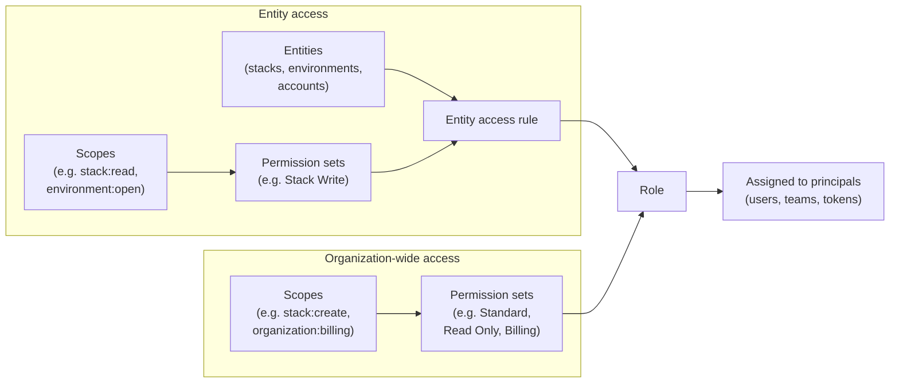

A role in Pulumi Cloud is the primary way to define what resources a principal (user, team, or machine token) can access and what they can do with them. Roles allow you to apply [permission sets](/docs/administration/concepts/rbac/permission-sets) to a set of [entities](/docs/administration/concepts/rbac/entities) and assign this access to a principal.

A role combines two kinds of access, both built from [scopes](/docs/administration/concepts/rbac/scopes) bundled into [permission sets](/docs/administration/concepts/rbac/permission-sets): **entity access** — permission sets applied to specific [entities](/docs/administration/concepts/rbac/entities) (stacks, environments, and accounts) to form entity access rules — and an **organization access level** built from org-wide permission sets (such as Standard, Read Only, or Billing) for [org-wide operations](/docs/administration/concepts/rbac/entities#organization-level-access). The completed role is then assigned to principals.

## Built-in roles {#pulumi-defined-roles}

Pulumi Cloud provides several roles that you can use to quickly get started:

| 
Role
| Description |
|------|-------------|
| `Reader` | Read the organization's stacks, environments, and cloud accounts. |
| `Builder` | Everything Reader allows, plus create stacks, environments, cloud accounts, services, and Pulumi Neo tasks. Members manage what they create. |
| `Maintainer` | Everything Builder allows, plus change every stack, environment, cloud account, and service, and work with deployments, integrations, and Neo automations. |
| `Admin` | Full access to all organization resources and settings. Can manage members, roles, and organization-wide configurations. |
| `Billing Manager` | Access to view and manage billing information. Cannot modify other organization settings or resources. |

Reader, Builder, and Maintainer are designed to be the organization's [default role](/docs/administration/concepts/rbac/default-roles/), which members follow unless an admin assigns them another one. Some organizations also have a read-only `Member (legacy)` role; see [Member (legacy)](/docs/administration/concepts/rbac/default-roles/#member-legacy).

## Custom roles



{}
The Pro edition allows up to 25 custom roles; the Enterprise edition allows unlimited custom roles.

Members who don't have a role picked for them get the organization's [default role](/docs/administration/concepts/rbac/default-roles/).
{}

You can create and manage custom roles to define more granular access controls for your organization. Custom roles combine entity access rules (direct, global, or tag-based) with an organization access level.

### Creating custom roles

To create a custom role, you must be an organization admin.

Navigate to **Settings** > **Access management** and select the **Roles** tab to see your organization's roles.

To create a new role, select **Create custom role**. Provide a unique name and, optionally, a description to contextualize the role's purpose.

A custom role can include any combination of the following entity access rule types, plus an organization access level.

#### Rule types

##### Direct entity access

Direct rules grant a permission set to individually selected entities. Choose the entity type (stack, environment, or cloud account), select **Select specific [type]**, then select **Choose [type]** to open a searchable list.

A dialog lists the entities in your organization. You can search by name to filter the list.

Check the entities to include in the rule, then select **Confirm selection**.

After confirming, select **Save rule**. The **Entity Access** section displays a table of all configured rules, and you can add more with **Add rule**.

##### Global entity access

Global rules apply a permission set to all entities of a given type within the organization. Choose the entity type and select **Apply to all [type]** to grant the chosen permission set across all current and future entities of that type.

##### Tag-based rules (ABAC) {#tag-based-abac-rules}

Tag-based rules (also called ABAC — attribute-based access control) grant a permission set when a resource's tags match defined conditions. Each rule has:

- **Entity type** — Stack, environment, or cloud account.
- **Tag conditions** — One or more conditions on resource tags (e.g. tag `env` equals `production`, or tag `team` exists).
- **Permission set** — The permission set to grant when the conditions match a resource.

**Why use them:** Grant access to many resources at once by tag (e.g. all stacks with `team=platform`) without listing each resource individually. Useful for large organizations.

**How it works:** When evaluating access, Pulumi Cloud checks the user's roles (and the roles of the teams they belong to). For each tag rule in those roles, it evaluates the resource's tags against the rule's conditions. If they match, the rule's permission set is applied to that resource.

{}
Tag-based rules only **grant** access. Like every other rule, they cannot revoke access that a principal already holds through another grant, so a tag rule is not a way to confine a principal to the resources that match it. In particular, a machine token that creates a stack holds a [creator grant](/docs/administration/concepts/rbac/#creator-grants) of Stack Admin on that stack, and can keep operating on it even though the stack's tags do not match any rule in the token's role.
{}

To configure a tag-based rule, choose the entity type and select **Set conditions**, then enter one or more tag key/value conditions and choose a permission set.

In the Pulumi Cloud console and API, these rules may be labeled "tag rules" or "tag-based access control rules"; ABAC (attribute-based access control) is the general industry term.

**Organization access** sets the permission level for organization-level operations (e.g. creating stacks, managing billing, audit logs). This applies to the organization as a whole and is separate from the entity-based rules above.

When done, select **Create role**.

You can now assign this role to principals in your organization.

## Role assignment

Roles can be assigned to organization access tokens, users, and teams. Effective permissions are the **union** of the user's organization role and all roles assigned to the teams they belong to (composability).

### Organization access tokens

[Organization access tokens](/docs/administration/concepts/access-tokens/#creating-an-organization-access-token) can be assigned exactly **one** role (default or custom) that defines the token's permissions across the organization.

Follow the process to [create an organization token](/docs/administration/concepts/access-tokens/#creating-an-organization-access-token), then choose a default or custom role to assign to the token. The token's access is limited to the permissions of that role within your organization.

### Users

Each organization member has exactly **one** organization role. Members follow the organization's [default role](/docs/administration/concepts/rbac/default-roles/) unless an admin assigns them another one. In editions with custom roles, an admin can assign any built-in or custom role; in other editions, members follow the default role or are admins or billing managers.

### Teams

When your organization has custom roles enabled, [teams can have role assignments](/docs/administration/concepts/rbac/teams#role-assignments): **one or more** roles (default or custom). Team members receive the **union** of their own user role and all roles assigned to the teams they belong to. So team role assignments add on top of each member's baseline role.

## Best practices

When working with roles in Pulumi Cloud, consider these best practices:

1. **Principle of least privilege**: Assign only the scopes necessary for users to perform their tasks.
1. **Role reusability**: Design custom roles and permission sets in a way that maps to real-world concepts within your org, allowing for easy reuse.
1. **Tag-based rules**: Use tag-based rules to grant access to many resources by tag (e.g. `team=platform`) without listing each resource.
1. **Stack ownership in automation**: When automation creates stacks with a machine token, have the run transfer stack ownership to a break-glass user or team, or remove the automatic [creator grant](/docs/administration/concepts/rbac/#creator-grants), so a long-lived token does not accumulate Stack Admin on every stack it has created.
1. **Regular review**: Periodically schedule reviews of role assignments and scopes.
1. **Documentation**: Document the purpose and scopes of custom roles both internally and within the role's metadata.

## Learn more

- [Scopes](/docs/administration/concepts/rbac/scopes): The most granular access rights in Pulumi Cloud, written as `object:action`. Each scope belongs to one entity type and is the building block of permission sets.
- [Permission sets](/docs/administration/concepts/rbac/permission-sets): Reusable bundles of related scopes for a single entity type. You grant them on entities or use them to set a role's organization access level.
- [Entities and organization-level access](/docs/administration/concepts/rbac/entities): The objects that permission sets are granted on (stacks, environments, and cloud accounts), plus the organization-level access that governs org-wide operations.
- [Teams](/docs/administration/concepts/rbac/teams): Groups of users that can be assigned roles and entity access. Each member inherits the union of the team's roles on top of their own role.
