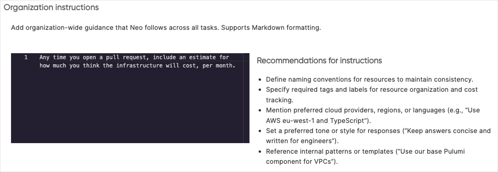

Neo follows two kinds of standing instructions, so you don't have to repeat context in every task: custom instructions that apply across your organization, and repository instructions that apply when Neo works in a particular codebase.

## Custom instructions

Custom Instructions teach Neo your organization's standards, preferences, and requirements so they're applied automatically to every task. Instead of repeating context in each task, you define it once from a central location.

### What to include

Custom Instructions can define many things, including:

- **Naming conventions**: How resources, stacks, and projects should be named
- **Compliance requirements**: Required tags, labels, or configurations
- **Technology preferences**: Preferred languages, frameworks, or cloud services
- **Cost guidelines**: Budget considerations or cost optimization preferences
- **Automatic actions**: Behaviors Neo should apply automatically, like including cost estimates

### Example

```text
All AWS resources must follow these standards:
- Naming convention: {service}-{environment}-{region}
- Required tags: environment and owner
- Use encryption at rest for all storage resources
- Always include estimated monthly costs in pull requests when proposing new infrastructure
```

When you ask Neo to create resources, it automatically applies your organization's standards without you needing to repeat them in every conversation.

### Configuring custom instructions

1. Navigate to Neo Settings in Pulumi Cloud
1. Select the "Organization instructions" tab
1. Enter your organization's standards and preferences
1. Save changes



### Custom instructions best practices

- Keep instructions concise and focused on standards that apply across all tasks
- Update instructions as your team's practices evolve
- Test instructions in individual prompts before rolling out broadly

### Bootstrapping repository instructions

Neo reads `AGENTS.md` files when it enters a repository, but it needs to clone the repository first. To ensure Neo picks up your repository instructions early in every task, add a bootstrapping instruction to your Custom Instructions:

```text
When working on a task, immediately clone the associated repository
(and any additional repositories involved) and look for an AGENTS.md
file. Follow any setup instructions it contains before proceeding
with the task.
```

This ensures that environment setup, git hooks, and coding standards defined in `AGENTS.md` are applied before Neo starts working.

## Configuration precedence

Neo applies configuration in layers, with later layers taking priority:

1. **Custom Instructions** set organization-wide defaults that apply to every task
1. **Repository instructions** (`AGENTS.md`) add project-specific conventions when Neo enters a repository
1. **Conversation instructions** override both when you give Neo direct guidance in a task

This layering means you can set broad standards in Custom Instructions, refine them per-repository in `AGENTS.md`, and override anything for a specific task in the conversation.

## Repository instructions

While Custom Instructions apply to all tasks across your organization, you can also define project-specific instructions that Neo follows when working in a particular repository. This is done through an `AGENTS.md` file placed in your repository.

### How it works

When Neo enters a repository, it reads the `AGENTS.md` file and follows the instructions it contains. This makes project-specific conventions explicit and consistent across all tasks in that codebase.

Common uses for `AGENTS.md` include:

- **Build and test commands**: How to install dependencies, run tests, and lint
- **Environment setup**: Required tool versions, environment variables, and runtime configuration
- **Git hooks**: Hook paths and setup commands that must run before committing
- **Coding standards**: Language preferences, naming conventions, and style requirements

Use `AGENTS.md` to capture conventions that aren't enforced by linters or formatters: coding standards, naming conventions, how to run tests, or any other guidance your team needs.

### Example

```markdown
# Project Instructions

## Environment setup
- Run `git config core.hooksPath .githooks` to enable git hooks
- Tool requirements: Node.js 20+, Python 3.11+

## Build commands
- Install dependencies: `npm install`
- Run tests: `npm test`
- Lint code: `npm run lint`

## Git hooks
Pre-commit and pre-push hooks are located in `.githooks/`.
Always run `git config core.hooksPath .githooks` before committing.

## Coding standards
- Use TypeScript for all new files
- Prefer async/await over callbacks
- All exported functions must have JSDoc comments
```

### Subdirectory support

You can place `AGENTS.md` files in subdirectories for more specific instructions. When Neo works in a subdirectory, it reads the nearest `AGENTS.md` file, with subdirectory files taking precedence over parent files. This lets you define general project-wide conventions at the root while providing specialized guidance for specific areas of your codebase.

### Repository instructions best practices

- Start simple with a few key conventions, then expand as needed
- Focus on conventions that can't be enforced by automated tools
- Keep instructions actionable and specific
- Review and update as your project's practices evolve
