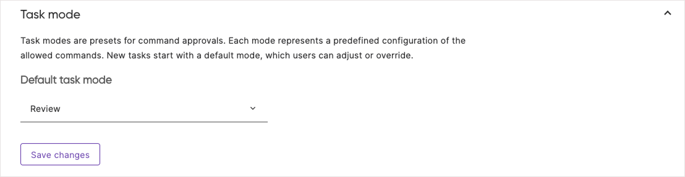

Neo can be configured at the organization, repository, and user level. Organization-level settings control default behaviors and capabilities for your team, repository-level instructions let you define project-specific conventions that Neo follows automatically, and user-level settings let each person tailor their own experience.

## Neo access

Neo and all of its features are enabled by default. You can turn Neo off entirely, or keep it on while disabling individual features.

### Enable Neo for organization

The "Enable Neo for organization" toggle is the master switch. Turning it off disables Neo everywhere, including the Neo agent, natural-language resource search, AI explanations served to the Pulumi CLI, and Neo code reviews.

1. Navigate to Neo Settings from the Pulumi left navigation
1. Select the "General" tab
1. Toggle "Enable Neo for organization" on or off

### Per-feature controls

If you'd rather keep Neo on but disable specific capabilities, use the per-feature controls. Each one is enabled by default and can be turned off independently:

- **Enable Neo agent**: The Neo agent that plans and executes infrastructure tasks
- **Enable Neo CLI explanations**: AI explanations served to the Pulumi CLI
- **Enable natural-language resource search**: Searching your resources with natural-language queries

To disable [Neo code reviews](/docs/ai/concepts/neo/code-reviews/), select the "Code reviews" tab in Neo Settings and turn off "Enable code reviews".

{}
If Neo was previously disabled, it will need to be enabled as outlined above.
{}

To cap what your organization spends on Neo, see [Usage limits](/docs/ai/concepts/neo/usage-limits/).

## Model providers



Use the **Model provider** tab in Neo Settings to run Neo tasks with your own model provider credentials. Neo currently supports Anthropic's Claude models. You can access these models through Anthropic, Azure Foundry, or a custom Anthropic-compatible endpoint.

See [Bring your own model provider](/docs/ai/concepts/neo/model-providers/) for setup steps, billing behavior, and instructions to switch providers.

## Instructions and slash commands

The **Organization instructions** tab and the slash commands section of the **General** tab configure the standing guidance Neo follows. See [Custom and repository instructions](/docs/ai/concepts/neo/instructions/) and [Slash commands](/docs/ai/concepts/neo/slash-commands/).

## Integrations

Neo can connect to third-party services like issue trackers, observability platforms, and incident response tools, giving tasks the ability to query external tools alongside your infrastructure. Integrations are configured in the **Integrations** tab of Neo Settings, where administrators can enable services and provide credentials.

See [Integrations](/docs/ai/integrations/) for the available integrations and how to set them up, and [credential storage](/docs/ai/integrations/external-mcp-servers/#credential-storage) for how Neo stores their credentials.

## Task modes

Task modes are presets that control what actions Neo can take automatically. Each mode represents a predefined configuration of allowed commands. New tasks start with a default mode, which users can adjust or override during the task.

### Available modes

Organization administrators can set the default task mode. The available modes determine how much autonomy Neo has during execution:

- **Review mode** (default): Neo requires approval before running `pulumi preview`, running `pulumi up`, and opening a pull request
- **Balanced mode**: Neo requires approval only before running `pulumi up`
- **Auto mode**: Neo will not request any approvals

### Configuring default task mode

1. Navigate to Neo Settings in Pulumi Cloud
1. Select the "General" tab
1. Locate the "Task mode" section
1. Select the default mode from the dropdown
1. Save changes

### Task mode best practices

- Start with the most restrictive mode -- it's best for most organizations
- Remember, users can override the default for individual tasks when needed

{}
Task modes control approvals during execution. [Plan Mode](/docs/ai/concepts/neo/tasks/#plan-mode) is a separate, opt-in feature that controls what happens before execution. You can use Plan Mode with any task mode.
{}

## Notifications

Notifications are user-level settings: each person configures their own preferences from their account settings, independent of any organization. They alert you when Neo needs your attention on a task while the Pulumi Cloud tab is in the background. Browser and audio notifications are both off by default.

{}
The "Neo settings" panel only appears for users whose organization has Neo enabled.
{}

To configure notifications:

1. Navigate to your account settings in Pulumi Cloud
1. Locate the "Neo settings" panel
1. Turn browser notifications and audio notifications on or off independently

Notifications fire when Neo completes a response or requests your approval before continuing. To avoid interrupting you while you're actively watching a task, Neo suppresses both notification types whenever the Pulumi Cloud tab has focus.

### Browser notifications

When enabled, Neo sends native browser notifications that appear in your operating system's notification area, including when the Pulumi Cloud tab is in the background or your browser is minimized. Clicking a notification brings the browser to the foreground and opens the relevant task.

Enabling this setting prompts your browser for notification permission. If you decline the prompt, or if you have previously blocked notifications for Pulumi Cloud, the toggle reverts to off and an "Enable notifications in your browser settings" message appears. To re-enable after a block, grant the permission in your browser settings and then turn the toggle on again.

Browser notifications also require your operating system to allow notifications for your browser. If you've enabled the toggle and granted browser permission but don't see notifications, check your OS notification settings and confirm they are enabled for your browser.

### Audio notifications

When enabled, Neo plays a short two-note chime when a task needs your attention.
