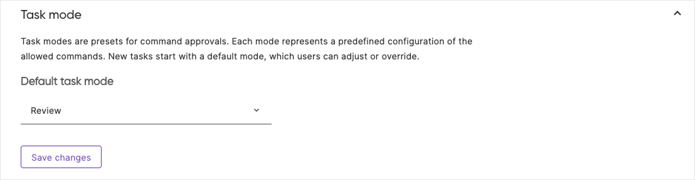

Open your organization's **Agent Settings** in Pulumi Cloud to enable AI features, connect model providers and tools, and set defaults for Neo tasks. Organization administrators manage these settings. Each member manages their own [task notifications](#notifications).

To change one agent's instructions, role, or integrations, [edit its saved configuration](/docs/ai/agents/manage/#change-saved-configuration).

## AI access {#neo-access}

Use the organization switch to enable or disable AI features together. To disable only agent tasks, CLI explanations, or natural-language resource search, use the [per-feature controls](#per-feature-controls).

### Enable organization AI features {#enable-neo-for-organization}

1. Open your organization's **Agent Settings** and select **General**.
1. Set **Enable AI features for this organization** on or off.
1. Select **Save changes**.

Turning this off disables agent tasks, natural-language resource search, CLI explanations, and AI review features for the organization.

### Per-feature controls

On the **General** tab, use these controls when organization AI features are enabled:

- **Enable Pulumi Agents** controls Neo tasks, tasks run by agents your team configures, code reviews, and tasks started through the MCP server. Turning it off also hides the organization's task history.
- **Enable CLI explanations** controls AI explanations requested by the Pulumi CLI.
- **Enable natural-language resource search** controls resource searches written in natural language.

Select **Save changes** after changing these controls. To configure automatic pull-request reviews, follow the [code review settings guide](/docs/ai/concepts/neo/code-reviews/).

For spending controls, see [Agent usage limits](/docs/ai/concepts/neo/usage-limits/).

## Model providers



Use the **Model provider** tab to [connect a model provider](/docs/ai/agents/model-providers/) and set the organization default.

## Instructions and slash commands

Use the **Organization instructions** tab to set requirements for Neo tasks, such as your team's code-review conventions. An agent your team creates uses its **System prompt** instead. See [Instructions and context](/docs/ai/agents/instructions/) for which instructions each task uses.

Configure reusable prompts for Neo tasks in the slash commands section of the **General** tab. See [Slash commands](/docs/ai/concepts/neo/slash-commands/).

## Integrations

Use the **Integrations** tab for external MCP servers and cloud CLI tools. Configure repository access in **Version control** settings. Follow the [integration guides](/docs/ai/agents/integrations/) for connection and access requirements.

## Neo task approval modes {#task-modes}

The organization default applies to new Neo tasks. Users can change the mode for their Neo tasks. Agents your team creates use the **Default mode** saved in the agent's configuration instead.

Choose **Review**, **Balanced**, or **Auto**. See [permission and approval modes](/docs/ai/agents/permissions/#permission-mode-and-approval-mode) for the differences.

### Set the default Neo task mode {#configuring-default-task-mode}

1. Open your organization's **Agent Settings** and select **General**.
1. Find the **Task mode** section.
1. Choose a **Default task mode**.
1. Select **Save changes**.

## Notifications

Each member can enable browser or audio notifications for tasks in each organization. These preferences apply in the browser where you configure them. Notifications alert you when a task completes or needs attention while the Pulumi Cloud tab is in the background.

1. Open your account settings in Pulumi Cloud.
1. In the organization's notification preferences, find **Agent tasks** and choose **Browser**, **Audio**, or both.
1. If you enable browser notifications, allow them when your browser prompts you.

### Browser notifications

Browser notifications appear in your operating system's notification area. Selecting one opens the relevant task. They are suppressed while the Pulumi Cloud tab has focus.

If notifications do not appear, check that your browser allows notifications from Pulumi Cloud and that your operating system allows notifications from your browser. Blocking notifications for the site affects every organization, even if you enabled notifications for an individual organization.

### Audio notifications

Audio notifications play a chime when a task needs attention while the Pulumi Cloud tab is in the background. Enable or disable them independently of browser notifications.
