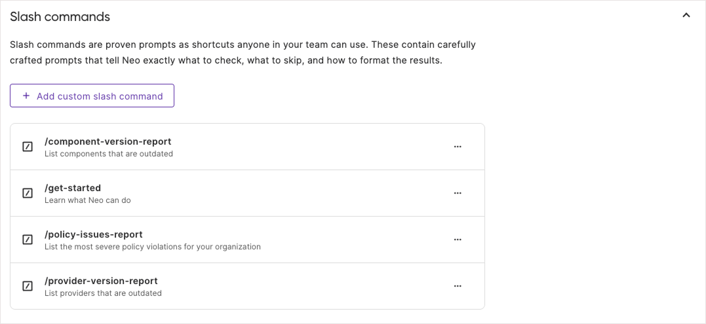

Type `/` in a task with Neo to select a saved prompt. Add the details for this assignment, then send the message. Create custom commands to share prompts across your organization.

## Built-in commands

Built-in commands include:

| Command | Description |
|---------|-------------|
| `/get-started` | Learn what Neo can do and how to request work |
| `/policy-issues-report` | List your most severe policy violations |
| `/component-version-report` | Find stacks using component versions at least one minor version behind the latest version in your private registry |
| `/provider-version-report` | Find stacks using provider versions at least one minor version behind the latest release |

## Creating custom commands

Creating commands requires `organization:update`, which the Admin role includes.

1. In Pulumi Cloud, open your organization's **Agent Settings**.
1. Select **General**, then find **Slash commands** and select **Add custom slash command**.
1. Enter a **Slash command slug**, such as `checkout-investigation`. Teammates use this name after `/`.
1. Enter a **Description** that explains when to use the command.
1. In **Instructions**, write the prompt the command should send. Include the information to check and the result to produce.
1. Select **Add command**.

Once saved, the command is immediately available to all team members.

## Viewing slash command instructions

Select a highlighted slash command in the task to read the prompt it sends.
