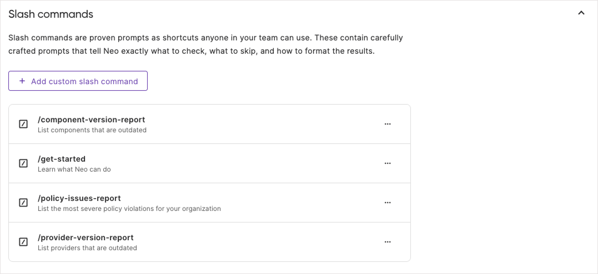

Slash Commands capture proven prompts as shortcuts that anyone on your team can use. When you type `/` in a Neo conversation, you'll see available commands. Selecting a command sends the full prompt to Neo.

## Built-in commands

Neo includes several built-in commands for common infrastructure tasks:

| Command | Description |
|---------|-------------|
| `/get-started` | Learn what Neo can do and how to structure effective requests |
| `/policy-issues-report` | Lists your most severe policy violations |
| `/component-version-report` | Lists components that are outdated in your private registry |
| `/provider-version-report` | Lists providers that are outdated |

## Creating custom commands

You can create organization-specific commands to capture your team's proven prompts:

1. Navigate to Neo Settings in Pulumi Cloud
1. Select the "General" tab
1. Scroll to the "Slash commands" section
1. Click "Add custom slash command"
1. Enter a name and description
1. Define the prompt
1. Save the command

Once saved, the command is immediately available to all team members.

## Viewing slash command instructions

When you have selected a slash command in a new or existing Neo task, click on the highlighted command name to view the actual prompt.

## Slash command best practices

- Create commands for frequently-used prompts that have proven effective
- Use clear, descriptive names that indicate what the command does
