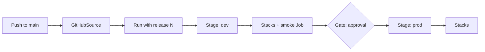

<!-- TODO(launch): Add `pulumi_cloud_feature: delivery` to the front matter once pulumi/marketing-web adds a hidden `delivery` feature (min_edition: essentials) and its sync PR updates data/pulumi_editions.yaml. Then drop the hand-written edition sentence. -->

<!-- TODO(launch): Product owner to confirm positioning paragraph against the final launch and messaging brief (MA-849). -->

Most teams with more than a handful of stacks end up writing release orchestration by hand: a CI job that runs `pulumi up` on the network stack, waits, runs the app stacks, pauses for someone to look at staging, and then does it all again for production. Pulumi Delivery replaces that glue with a Pulumi program. You declare your sources, stages, stacks, jobs, and gates in TypeScript, Python, Go, C#, or Java, and Pulumi Cloud runs each release through the stages in order.

Because the pipeline is a Pulumi program, it's versioned with your code and reviewed like any other change. You can use loops, functions, and conditionals to build it, and it gets previews and a history like any other stack.

{}
Pulumi Delivery is in public preview. Behavior, the SDK, and the REST API routes under `/api/preview/` can change before general availability.
{}

## The pipeline program and the pipeline stack

The pipeline lives in a repository as a Pulumi project. It declares exactly one `Pipeline` resource, which names the source and directory of the program itself. You register the pipeline by running `pulumi up` on its stack, called the _pipeline stack_.

## Runs

A _run_ takes one release through the stages. Each run gets its own _run stack_, named `<pipeline stack>-r<run number>`, where Pulumi Cloud executes the pipeline program. Run stacks don't show up in stack lists or search; open one from the page of its run. You can't run `pulumi up` on a run stack yourself.

A run moves forward in _passes_. A pass is one execution of the pipeline program on the run stack, and each pass makes as much progress as the stages and gates allow.

## Stages

A _stage_ is a phase of the pipeline, usually one environment. A stage waits for its upstream stages, listed in `from`, and for its gate, set in `when`. A stage deploys one run at a time. If a newer run arrives while an older one is still waiting for the stage or its gate, the newer run takes its place. A run the stage has already admitted is never replaced.

See [Stages and gates](/docs/delivery/concepts/stages-and-gates/).

### Artifacts

An _artifact_ is part of a release: a named value that a stage publishes once the release reaches it, such as a cluster endpoint or an image tag. Other pipelines read a stage's artifacts with a `PipelineSource`, which is how one pipeline hands values to the next. See [Artifacts](/docs/delivery/concepts/stages-and-gates/#artifacts).

## Stacks

A `Stacks` resource updates one or more existing stacks in a stage. Each entry runs `pulumi up` on one target stack at the run's locked commit. The entries in one `Stacks` resource deploy together and can read each other's new outputs, so stacks that depend on each other belong in the same one. See [Stacks](/docs/delivery/concepts/stacks-and-jobs/#stacks).

## Jobs

A `Job` runs a shell command in a stage, such as a smoke test against the stack the stage just updated. A job can publish outputs for other resources in the same stage to read. See [Jobs](/docs/delivery/concepts/stacks-and-jobs/#jobs).

Stacks and jobs are the _members_ of a stage: the resources that do its work.

## Sources and releases

A _source_ is a repository and branch. A source locks its commit when the run first creates it, so every stage of a run works from the same code. The sources you declare together make up the _release_, which has a release number. Read it from `pipeline.releaseNumber`, and read a source's commit from `source.commit`. Both are unknown during registration and preview and known during a run.

Declare every source at the top level of the program. A source created from a member's output after the first pass can't lock a commit, and the run fails.

A _trigger_ on a source decides whether a change starts a run. See [Sources and triggers](/docs/delivery/concepts/sources-and-triggers/).

## How the pieces fit together

<!-- TODO(launch): Replace with a design-approved diagram or console screenshot if design provides one. -->

## Next steps

- [Get started](/docs/delivery/get-started/) with a two-stage pipeline.
- Read about [sources and triggers](/docs/delivery/concepts/sources-and-triggers/).
