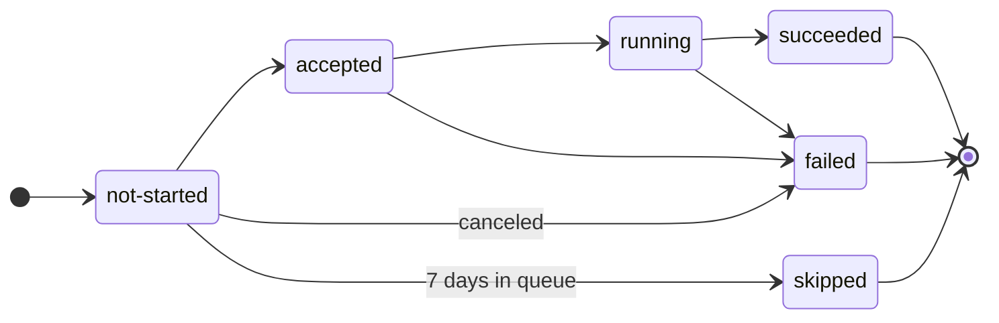

Every deployment reports a status that tracks it from the moment it's queued until it finishes.
This page explains what each status means, how a deployment moves between them, and why the same deployment can show a different status name in the REST API, in a webhook payload, and in the Pulumi Cloud console.

A deployment runs as a sequence of steps, shown as collapsible log sections on the deployment's page in the Pulumi Cloud console and listed in `jobs[0].steps` in the REST API.
This page covers the deployment's status.
For the status of individual steps, and the definition of each field, see the [Deployments REST API reference](/docs/reference/cloud-rest-api/deployments/).

## Deployment statuses

| Status | Meaning |
|---|---|
| `not-started` | The deployment is in the [deployment queue](/docs/deployments/operations/deployment-queue/), waiting for its turn or for deployments to be resumed. |
| `accepted` | A runner has picked up the deployment, but it hasn't started running yet. |
| `running` | The deployment is executing. |
| `succeeded` | The deployment completed successfully. |
| `failed` | The deployment didn't complete successfully. This includes deployments that errored, timed out, or were canceled. |
| `skipped` | The deployment never ran, because it stayed in the queue for longer than 7 days. |

`succeeded`, `failed`, and `skipped` are terminal: a deployment in one of them doesn't change status again.

{}
There is no canceled status.
Canceling a deployment, whether it's still queued or already running, sets its status to `failed`.
A deployment that times out is also reported as `failed`.
{}

## Status transitions

The deployment queue, not the runner, sets `skipped`, when it removes a deployment that hasn't started within 7 days.
For the rules that govern how long a deployment waits, see [Deployment queue](/docs/deployments/operations/deployment-queue/).

## Status names across Pulumi Cloud

The REST API reports the full set of statuses.
Deployment webhooks and the Pulumi Cloud console each collapse some of them, so the same deployment can appear under different names:

| REST API `status` | Deployment webhook `status` | Pulumi Cloud console |
|---|---|---|
| `not-started` | `queued` | Queued, or Paused when deployments are paused |
| `accepted` | `queued` | Running |
| `running` | `running` | Running |
| `succeeded` | `succeeded` | Succeeded |
| `failed` | `failed` | Failed |
| `skipped` | No event is delivered | Skipped |

The `queued` value appears only in [deployment webhook](/docs/deployments/concepts/webhooks/) payloads, which use the generic JSON format.
It covers both `not-started` and `accepted`, and is the status sent with the `deployment_queued` event.
None of the deployment webhook events match a skipped deployment, so a webhook consumer isn't notified when a deployment is skipped.

Drift detection and drift remediation webhooks don't collapse statuses this way.
Their `status` field can report any of the REST API values, including `not-started` and `accepted`.

## Deployment status and update result

A deployment that runs a Pulumi operation creates an update, and the REST API returns each related update alongside the deployment.
The update's `result` is a separate value from the deployment's `status`, with its own set of values:

| Update `result` | Meaning |
|---|---|
| `not-started` | The update hasn't started. |
| `in-progress` | The update is running. |
| `succeeded` | The update completed successfully. |
| `failed` | The update failed. |

Where the deployment distinguishes `accepted` from `running`, the update reports a single `in-progress` value, and the update has no equivalent of `skipped`.
The update's `result` describes only the Pulumi operation, so check the deployment's `status` to know whether the deployment as a whole succeeded.
