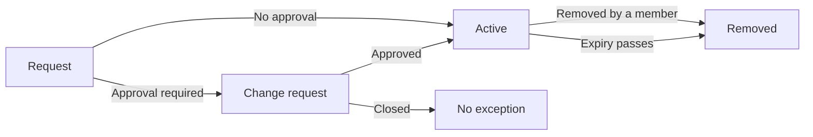

{}
Policy exceptions are in public preview.
{}

A policy exception exempts specific policy violations on designated resources. Other tools call these exemptions or waivers. Each exception is associated with a single [policy pack](/docs/discovery-governance/concepts/policy-as-code/policy-packs/) and includes:

- **A reason** that explains why the violations are exempted.
- **Match entries**, each listing one or more policies and one or more [resource URNs](/docs/iac/concepts/resources/names/#urns). A violation is exempted when its policy and its resource URN both appear in the same entry.

An exempted violation does not block the operation, even if the policy is mandatory. It's still reported and marked as exempted, along with the exception that allowed it.

An exception does not alter a policy's enforcement level. The policy continues to apply to all resources not named in the exception, and all other policies still apply to the resources listed in the exception.

You can define exceptions in two places:

- **In a local policy pack config file**, for policy packs you pass to the CLI with `--policy-pack`. This works with the Pulumi CLI and any backend.
- **In Pulumi Cloud**, for the policy packs your organization applies with [policy groups](/docs/discovery-governance/concepts/policy-as-code/policy-groups/). Pulumi Cloud adds approvals, expiry, and a record of every exception.

## How exceptions apply

Pulumi checks each policy violation against the exceptions for its policy pack:

- **Matching is exact.** The policy name and the resource URN must both match an entry exactly. Entries don't support wildcards, and an entry can't match every policy in a pack.
- **Stack-level violations** that aren't tied to a resource are matched against the URN of the stack's root resource, which has the form `urn:pulumi:<stack>::<project>::pulumi:pulumi:Stack::<project>-<stack>`.
- **One violation can match several exceptions.** Pulumi records every exception that matches.
- **Enforcement levels.** An exempted mandatory violation no longer blocks the operation. Advisory violations can match exceptions too, and are summarized with the other exempted violations.

During `pulumi preview` and `pulumi up`, exempted violations are summarized under `Policies:` with one line per policy and a count of exempted violations. They appear after other violations and do not affect the policy pack's status icon:

```output
Policies:
    ⚠️ aws-guard@v1.0.0
        - [advisory]  bucket-versioning  (aws:s3:Bucket: logs-bucket)
          Buckets should enable versioning
        · [exempted]  s3-no-public-read  (1 violation)
        · [exempted]  vpc-flow-logs  (1 violation)
```

To list each exempted violation, use `--show-policy-exceptions` with `pulumi preview` or `pulumi up`. Each violation is tagged `[exempted]` before its enforcement level, and its message includes the ID and reason for each exception. `pulumi policy analyze` always displays violations in this format:

```output
Policies:
    ⚠️ aws-guard@v1.0.0
        - [advisory]  bucket-versioning  (aws:s3:Bucket: logs-bucket)
          Buckets should enable versioning
        · [exempted] [mandatory]  s3-no-public-read  (aws:s3:Bucket: logs-bucket)
          Buckets must not be publicly readable
          EXC-42: Log target bucket
          EXC-50: Legacy ACL
        · [exempted] [mandatory]  vpc-flow-logs  (pulumi:pulumi:Stack: policyproject-dev)
          A stack with a VPC must also have VPC flow logs
          EXC-7: Flow logs are only required in prod
```

## Exceptions in a local policy pack config file

Exceptions for local policy packs live in the JSON file you pass with `--policy-pack-config`, alongside the pack's configuration. They need version 2 of the file format:

```json
{
    "version": 2,
    "policies": {
        "all": "mandatory"
    },
    "exceptions": {
        "log-buckets": {
            "reason": "Log target buckets must allow the log delivery group (LOG-31)",
            "match": [
                {
                    "policies": ["s3-no-public-read", "s3-block-public-acls"],
                    "targets": ["urn:pulumi:prod::web::aws:s3/bucket:Bucket::logs"]
                }
            ]
        },
        "flow-logs": {
            "reason": "VPC flow logs are only required in production",
            "match": [
                {
                    "policies": ["vpc-flow-logs"],
                    "targets": ["urn:pulumi:dev::web::pulumi:pulumi:Stack::web-dev"]
                }
            ]
        }
    }
}
```

```bash
pulumi preview --policy-pack ./aws-guard --policy-pack-config ./aws-guard-config.json
```

The top-level keys of a version 2 file are:

| Key | Description |
|:----|:------------|
| `version` | Required. The number `2`. |
| `policies` | The pack's configuration, in the same shape as an unversioned config file: `all` sets the enforcement level of every policy, and each other key configures one policy. |
| `exceptions` | An object that maps exception IDs to exceptions. An ID can contain letters, digits, `-`, `.`, and `_`. |
| `environments` | Optional. [Pulumi ESC](/docs/esc/) environments to read configuration from. |

Each exception requires a `reason` and a `match` list with at least one entry. Each entry includes a `policies` list of policy names and a `targets` list of resource URNs, and both must be non-empty. The file applies to the policy pack specified by the `--policy-pack` flag it's paired with, so exceptions don't specify a pack.

A few things to keep in mind:

- In an unversioned file, an `exceptions` key is read as the configuration of a policy named `exceptions`, and no exceptions apply. Add `"version": 2` and move the configuration under `policies`.
- CLI versions without exception support reject a version 2 file with an error such as `parsing "version": 2 is not a valid value; must be a string or object`.
- Exceptions in a file passed to `pulumi policy enable --config` are ignored. To exempt violations of a policy pack your organization enforces, create the exception in Pulumi Cloud.
- A local file has no approvals, expiry, or audit record. Review changes to it the same way you review the rest of your code.

To find the URN of a resource, run `pulumi stack --show-urns`.

## Exceptions in Pulumi Cloud



In Pulumi Cloud, exceptions belong to your organization. Pulumi Cloud sends the active exceptions for a stack's required policy packs to the CLI when `pulumi preview` or `pulumi up` starts, so they apply to [preventative policy groups](/docs/discovery-governance/concepts/policy-as-code/policy-groups/#preventative-policy-groups) without local configuration. This requires Pulumi CLI v3.274.1 or later.

Each exception gets an ID such as `EXC-42` and names a policy pack that appears in at least one of your organization's policy groups. Its entries can reference resources across any number of stacks.

An exception is either **Active** or **Removed**. When your organization requires approval, a request becomes an exception only once it's approved:



Exceptions are listed on the **Applied exceptions** tab of the **Policy configuration** page (under **Governance** > **Policy configuration**).

### Configure exceptions for your organization

Exceptions are on for every organization that has the feature, and need no approval until an admin requires it. To change either, select **Configure Exceptions for this organization** on the **Applied exceptions** tab.

#### Turn exceptions on or off

Select **Disable Exceptions for this organization** to prevent anyone from creating or requesting exceptions via the console, CLI, or API. Existing exceptions continue to apply until they're removed or expire. Requests already in the queue remain listed, but approving one doesn't create an exception while exceptions are off. Select **Enable Exceptions for this organization** to turn them back on. Enabling or disabling exceptions requires the `organization:update` permission.

#### Require approval



Under **Approvals**, choose:

- **No approval**, the default. An exception is created as soon as someone with permission requests it.
- **Approval required**. Each request opens a change request, and the exception is created when the request is approved.

With **Approval required**, one approval rule applies to every exception in the organization. It has these settings:

| Setting | Description | Default for a new rule |
|:--------|:------------|:-----------------------|
| **Roles** | Members who hold a permission can approve: **Organization admins** (`organization:update`) or **Policy managers** (`policy_groups:create`). | **Organization admins** |
| **Teams** | Members of these teams can approve. | None |
| **Users** | These members can approve. | None |
| **Number of approvals required** | How many approvals each request needs, from 1 to 10. | 1 |
| **Allow self-approval** | Whether members can approve their own requests. | Off |

Changing the approval rule requires the `change_gate:create`, `change_gate:update`, and `change_gate:delete` permissions. Without them, or while exceptions are off, the **Approvals** section isn't shown.

Switching from **Approval required** to **No approval** applies only to new requests. Requests already waiting still require approval.

### Request an exception

To request an exception from the Pulumi Cloud console:

1. Open the stack, and on its **Overview** page find the **Policy exceptions** card. The card appears once the stack has an exception or a request, or when its latest run has a violation you can exempt.
1. Select **Request exception**.
1. Select the findings to exempt from the stack's latest run. They must all come from one policy pack.
1. Enter the exception reason. When approval is required, you can also add a note to the approver. The note starts the request's comments and isn't kept with the exception.
1. Optionally, select **Expires** and enter the number of days, from 1 to 3650. See [Expiry](#expiry).
1. Select **Request exception**.

You need write access to the stack to request an exception. When your organization requires approval, Pulumi Cloud opens a change request, and the exception is created once the request is approved. Otherwise, the exception is created immediately. Either way, it applies from the stack's next run.

You can also create exceptions from the CLI with the [`pulumi policy exception new`](/docs/iac/cli/commands/pulumi_policy_exception_new/) command, available in Pulumi CLI v3.274.1 or later.


The `pulumi policy exception` commands are listed in the CLI's help only when the `PULUMI_EXPERIMENTAL` environment variable is set to `true`.


The command reads the policy violations from the stack's latest update or preview, so you don't have to rerun it or copy URNs. In a terminal, you select the violations to exempt and enter a reason. When your organization requires approval, the command requests the exception and prints a link to the request:

```bash
export PULUMI_EXPERIMENTAL=true
pulumi policy exception new aws-guard --stack prod --policy s3-no-public-read \
    --reason "Log target buckets must allow the log delivery group" --expires-in 30d
```

`--policy`, `--target`, and `--level` narrow the set of violations to choose from, and only mandatory violations are read unless `--level` specifies otherwise. `--expires-in` sets an expiry in days or hours, such as `30d` or `12h`. `--dry-run --output json` prints the violations and the exception the command would create, without creating it.

For every command and flag, see the [`pulumi policy exception`](/docs/iac/cli/commands/pulumi_policy_exception/) reference.

### Approve or close a request



When approval is required, requests awaiting approval are listed on the **Approvals** page with the type **Policy exception** and the request type **New exception**. They also appear on the **Policy exceptions** card of each stack they name. While any are waiting, the **Applied exceptions** tab displays a notice with a **Go to Approvals** button.

A request shows the findings it would exempt, the reason, the expiry, and its comments, which start with the note that accompanied the request. An approver then either:

- **Approves it.** Once the request has the required number of approvals, the exception is created and takes effect at the stack's next run.
- **Closes it.** Closing a request declines it, and no exception is created.

A request can't be changed after it's submitted. To change its findings, reason, or expiry, close it, and the requester asks again.

The approval rule specifies who can approve. There's no separate permission to approve, but to view a request, approvers need `policy_exceptions:read` and read access to every stack the request names. They don't need write access to those stacks.

### Expiry

An exception can have an expiry. It's optional: an exception without one remains in effect until someone removes it.

- **Setting an expiry.** The requester sets it with the request: in the console, select **Expires** and enter the number of days, from 1 to 3650; in the CLI, pass `--expires-in` with days or hours, such as `30d` or `12h`.
- **When the time starts.** An expiry counts from the moment the exception is created. When approval is required, the time starts when the request is approved, so the time a request waits for approval doesn't count.
- **Changing an expiry.** An expiry can't be changed once the request is submitted, and an exception can't be extended. To continue exempting the violations, request a new exception.
- **When an exception expires.** It moves to the **Removed** status, with its expiry as the removal time and no member recorded as removing it. In the next preview or update, the violations it exempted are reported again, and mandatory ones block.

### Review and remove exceptions

The **Applied exceptions** tab lists your organization's exceptions, including their status, policy pack, policies, number of resources, reason, creator, and expiry. It shows active exceptions by default; filter by status to see removed ones. Select an exception to view its stacks, who created it, the change request that approved it, and where it applied: for each policy and resource, when the exception last exempted a violation during a stack update. Only updates count, not previews.

From the CLI, `pulumi policy exception list` lists exceptions. Use `--status` to include removed ones, and `pulumi policy exception get <id>` shows one.

Findings that an exception exempts show the exception's ID in the **Exception** column of [policy findings](/docs/discovery-governance/operations/policy-findings/), and **Allowed by EXC-n** in the finding's details and on the stack update page.

To remove an exception, open it and select **Remove exception**, or run `pulumi policy exception remove <id>`. In the next preview or update, the violations it exempted are reported again, and mandatory violations block the update. A removed exception remains in the list with the **Removed** status.

Exceptions can't be edited. To change an exception, remove it and create a new one.

### Audit trail

Each exception records:

- **Its reason**, in the requester’s words.
- **Who created it and when.** If it came from an approved request, it records the requester and links to the change request, including its approvals and comments.
- **Its expiry**, if any.
- **Who removed it and when.** If it expired, the expiry date is recorded, with no member listed.
- **Where it applied:** each policy and resource where it last exempted a violation, and the related stack update.

### Permissions

| Permission | Allows | Granted by default to |
|:-----------|:-------|:----------------------|
| `policy_exceptions:read` | View policy exceptions and requests | Reader, Builder, Maintainer, Admin |
| `policy_exceptions:create` | Create policy exceptions, or request them when approval is required | Builder, Maintainer, Admin |
| `policy_exceptions:delete` | Remove policy exceptions | Admin |

Each permission also needs access to every stack that the exception's resources belong to: read access to view or remove an exception, and write access to create or request one. This means a Builder can request exceptions only for stacks they can update. There's no separate permission to approve: the approval rule specifies the approvers.

Custom roles and the `Member (legacy)` role don't receive these permissions automatically. Add them to grant those members access. For custom roles, see [RBAC scopes](/docs/administration/reference/rbac-scopes/org-settings/#pulumi-policies).

## Exceptions in a policy rollout

Exceptions let a policy become mandatory before every existing violation is fixed: teams create exceptions for violations they can't fix yet, either with or without approval, depending on how many exceptions the policy is expected to need and how sensitive the policy is. For the stages, see [Adopting policy across an organization](/docs/discovery-governance/concepts/policy-as-code/policy-groups/#adopting-policy-across-an-organization).

## Next steps

- [Set up policy groups](/docs/discovery-governance/concepts/policy-as-code/policy-groups/)
- [Review policy findings](/docs/discovery-governance/operations/policy-findings/)
- [Configure policy packs](/docs/discovery-governance/guides/write-a-policy-pack/#configuring-policy-packs)
