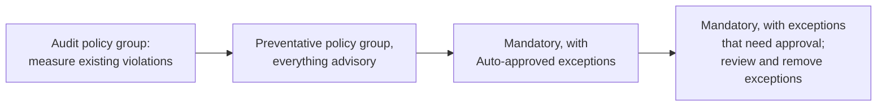

{}
Policy exceptions are in public preview.
{}

<!-- TODO(decision): minimum Pulumi CLI version. The service sends exceptions to CLI v3.268.0 or later (policyExceptionsMinCLIVersion), but the CLI changes target v3.271.0 or later. State the released version here and in "Limitations in the public preview". -->

A policy exception exempts the violations of specific policies on specific resources. Each exception belongs to one policy pack and has:

- **A reason** that explains why it's safe to exempt the violations. Reviewers and auditors read it.
- **Match entries**, each listing one or more policies and one or more resource URNs. A violation is exempted when its policy and its resource URN both appear in the same entry.

An exempted violation is still reported, but it doesn't fail the operation, even when its policy is mandatory. The finding stays visible, marked with the exception that exempted it, so nothing is hidden.

Exceptions let you make a policy mandatory before every existing violation is fixed. Teams that hit a violation with a legitimate reason, such as a bucket that has to be public, can unblock themselves with an exception instead of waiting for the policy to be relaxed.

You can define exceptions in two places:

- **In a local policy pack config file**, for policy packs you pass to the CLI with `--policy-pack`. This works with the open source CLI and any backend.
- **In Pulumi Cloud**, for the policy packs your organization applies with [policy groups](/docs/discovery-governance/concepts/policy-as-code/policy-groups/). Pulumi Cloud adds requests, approvals, and an auditable list of every exception.

## How exceptions apply

Pulumi checks each policy violation against the exceptions for its policy pack:

- **Matching is exact.** The policy name and the resource URN must both match an entry exactly. Entries don't support wildcards, and an entry can't match every policy in a pack.
- **Stack-level violations** that aren't tied to a resource are matched against the URN of the stack's root resource, which has the form `urn:pulumi:<stack>::<project>::pulumi:pulumi:Stack::<project>-<stack>`.
- **One violation can match several exceptions.** Pulumi records every exception that matches. Where a single exception is shown, it's the first by ID, with numbers compared by value, so `EXC-2` comes before `EXC-10`.
- **Enforcement levels.** An exempted mandatory violation no longer blocks the operation. Advisory violations can match exceptions too, and are summarized with the other exempted violations. A `remediate` policy that still reports a violation can be exempted like a mandatory one.

During `pulumi preview` and `pulumi up`, exempted violations are summarized under `Policies:` with one line per policy and a count of its exempted violations. They're listed after the other violations, and they don't count toward the policy pack's status icon:

<!-- TODO(cli): matches pulumi/pulumi#25290 at f10021d267; recheck when it merges -->

```output
Policies:
    ⚠️ aws-guard@v1.0.0
        - [advisory]  bucket-versioning  (aws:s3:Bucket: logs-bucket)
          Buckets should enable versioning
        · [exempted]  no-public-read  (1 violation)
        · [exempted]  vpc-flow-logs  (1 violation)
```

To list each exempted violation instead, pass `--show-policy-exceptions` to `pulumi preview` or `pulumi up`. Each violation is tagged `[exempted]` before its enforcement level, and its message is followed by the ID and reason of every exception that exempts it. `pulumi policy analyze` always lists violations this way:

```output
Policies:
    ⚠️ aws-guard@v1.0.0
        - [advisory]  bucket-versioning  (aws:s3:Bucket: logs-bucket)
          Buckets should enable versioning
        · [exempted] [mandatory]  no-public-read  (aws:s3:Bucket: logs-bucket)
          Buckets must not be publicly readable
          EXC-42: Log target bucket
          EXC-50: Legacy ACL
        · [exempted] [mandatory]  vpc-flow-logs  (pulumi:pulumi:Stack: policyproject-dev)
          A stack with a VPC must also have VPC flow logs
          EXC-7: Flow logs are only required in prod
```

The `--show-policy-exceptions` flag isn't supported with `--remote`.

## Exceptions in a local policy pack config file

Exceptions for local policy packs live in the JSON file you pass with `--policy-pack-config`, alongside the pack's configuration. They need version 2 of the file format:

```json
{
    "version": 2,
    "policies": {
        "all": "mandatory"
    },
    "exceptions": {
        "log-buckets": {
            "reason": "Log target buckets must allow the log delivery group (LOG-31)",
            "match": [
                {
                    "policies": ["s3-no-public-read", "s3-block-public-acls"],
                    "targets": ["urn:pulumi:prod::web::aws:s3/bucket:Bucket::logs"]
                }
            ]
        },
        "flow-logs": {
            "reason": "VPC flow logs are only required in production",
            "match": [
                {
                    "policies": ["vpc-flow-logs"],
                    "targets": ["urn:pulumi:dev::web::pulumi:pulumi:Stack::web-dev"]
                }
            ]
        }
    }
}
```

```bash
pulumi preview --policy-pack ./aws-guard --policy-pack-config ./aws-guard-config.json
```

The top-level keys of a version 2 file are:

| Key | Description |
|:----|:------------|
| `version` | Required. The number `2`. A higher number is an error that asks you to upgrade the Pulumi CLI. A `version` that isn't a number is read as the configuration of a policy named `version`, as in an unversioned file. |
| `policies` | The pack's configuration, in the same shape as an unversioned config file: `all` sets the enforcement level of every policy, and each other key configures one policy. |
| `exceptions` | An object that maps exception IDs to exceptions. An ID can contain letters, digits, `-`, `.`, and `_`. |
| `environments` | Optional. [Pulumi ESC](/docs/esc/) environments to read configuration from. |

Each exception has a required `reason` and a required `match` list with at least one entry. Each entry has a `policies` list of policy names and a `targets` list of resource URNs, and both must be non-empty. The file applies to the policy pack of the `--policy-pack` flag it's paired with, so exceptions don't name a pack.

Pulumi validates the file before the operation runs:

- An empty reason, an empty list, or an invalid URN is an error, and the operation doesn't run. Unknown keys and fields are ignored.
- A policy name that isn't in the pack is a warning, so a file keeps working when a pack version drops a policy.
- A policy pack that doesn't accept configuration still accepts a file with only `version` and `exceptions`.

A few things to keep in mind:

- In an unversioned file, an `exceptions` key is read as the configuration of a policy named `exceptions`, and no exceptions apply. Add `"version": 2` and move the configuration under `policies`.
- CLI versions without exception support reject a version 2 file with an error such as `parsing "version": 2 is not a valid value; must be a string or object`.
- Exceptions in a file passed to `pulumi policy enable --config` are ignored. To exempt violations of a policy pack your organization enforces, create the exception in Pulumi Cloud.

To find the URN of a resource, run `pulumi stack --show-urns`.

## Exceptions in Pulumi Cloud

<!-- TODO(edition): put the pulumi-cloud callout for the "policy-exceptions" feature id on the line right after this heading (and after each Cloud-only heading below) once that feature is added to marketing-web's features.yaml and synced into data/pulumi_editions.yaml. Until then the id fails make lint. -->

In Pulumi Cloud, exceptions belong to your organization. Pulumi Cloud sends the active exceptions for a stack's required policy packs to the CLI when `pulumi preview` or `pulumi up` starts, so they apply to [preventative policy groups](/docs/discovery-governance/concepts/policy-as-code/policy-groups/#preventative-policy-groups) without any local configuration.

Each exception gets an ID such as `EXC-42`, and names one policy pack that is in at least one of your organization's policy groups. Its entries can name resources in any number of stacks.

Exceptions are listed on the **Exceptions** tab of the **Policy configuration** page (**Governance** > **Policy configuration**).

<!-- TODO(screenshot): the Exceptions tab, with the Exceptions and Requests sub-tabs and the mode switch. -->

### Request an exception

<!-- TODO(edition): pulumi-cloud "policy-exceptions" callout goes on the line after this heading. -->

To request an exception from the Pulumi Cloud console:

1. Open the stack, and on its **Overview** page find the **Policy exceptions** card.
1. Select **Request exception**. When your organization doesn't require approval, the button reads **Create exception**.
1. Select the findings to exempt from the stack's latest run. They must all come from one policy pack.
1. Enter the exception reason. When approval is required, you can also add a note to the approver. The note starts the request's comments and isn't kept with the exception.
1. Select **Request exception** or **Create exception**.

<!-- TODO(screenshot): the Request policy exception panel on the stack Overview page. -->

When approval is required, Pulumi Cloud opens a change request, and the exception is created once the request is approved. Otherwise, the exception is created right away. Either way, it applies from the stack's next run.

You can also create exceptions from the CLI with the `pulumi policy exception new` command.


The `pulumi policy exception` commands are listed in the CLI's help only when the `PULUMI_EXPERIMENTAL` environment variable is set to `true`.


The command reads the policy violations of the stack's latest update or preview, so you don't have to rerun it or copy URNs, and it requests approval when your organization requires it:

```bash
export PULUMI_EXPERIMENTAL=true
pulumi policy exception new aws-guard --stack prod --policy s3-no-public-read \
    --reason "Log target buckets must allow the log delivery group"
```

<!-- TODO(decision): the pulumi policy exception commands aren't in a released CLI yet. Confirm the command names and flags (--policy, --target, --file, --reason, --note, --force/--yes) against the release, and link to the generated CLI reference pages once they exist. -->

An exception records a known violation. Where you can, change the program to follow the policy instead.

### Approval modes

<!-- TODO(edition): pulumi-cloud "policy-exceptions" callout goes on the line after this heading. -->

An organization admin chooses how exceptions are created with the mode switch on the **Exceptions** tab:

| Mode | Behavior |
|:-----|:---------|
| **Disabled** | No exceptions can be created or requested, and existing exceptions don't apply to updates. They're kept, and apply again when you turn exceptions back on. |
| **With approval** | Each request opens a change request. One approval from a user with the `policy_exceptions:approve` permission creates the exception. |
| **Auto-approved** | Anyone with the `policy_exceptions:create` permission creates exceptions directly. |

<!-- TODO(decision): the default approval mode. Today an organization with no approval rule is in Auto-approved mode. -->

Requests waiting for approval are listed on the **Requests** sub-tab of the **Exceptions** tab, where approvers review the findings and the reason.

<!-- TODO(decision): self-approval default. The With approval rule the console creates allows requesters to approve their own requests (allowSelfApproval: true). -->

A rollout can start with **Auto-approved**, so teams unblock themselves while a new policy becomes mandatory, and switch to **With approval** once the backlog is under control. See [A rollout that ends at mandatory](#a-rollout-that-ends-at-mandatory).

### Review and remove exceptions

<!-- TODO(edition): pulumi-cloud "policy-exceptions" callout goes on the line after this heading. -->

The **Exceptions** tab lists every exception in your organization, with its status, policy pack, stacks, and reason. Select an exception to see who requested it, whether it needed approval, and where it applied: for each policy and resource, when the exception last exempted a violation in a stack update. Only updates count, not previews.

Findings that an exception exempted show the exception's ID in the **Exception** column of policy findings, and **Allowed by EXC-n** in the finding's details and on the stack update page.

<!-- TODO(console): the console still says "Allowed by"; update when it says "Exempted by" -->

To remove an exception, open it and select **Remove exception**. From the next preview or update, the violations it exempted are reported again, and mandatory ones block the update. A removed exception stays in the list with the **Removed** status. To remove one from the CLI, run `pulumi policy exception remove <id>`.

Exceptions can't be edited. To change one, remove it and create a new one.

Creating and removing exceptions is recorded in the [audit logs](/docs/administration/concepts/audit-logs/) as `policy-exception-created` and `policy-exception-removed` events.

### Permissions

<!-- TODO(edition): pulumi-cloud "policy-exceptions" callout goes on the line after this heading. -->

| Permission | Allows | Granted by default to |
|:-----------|:-------|:----------------------|
| `policy_exceptions:read` | View policy exceptions | Member, Admin |
| `policy_exceptions:create` | Create policy exceptions, or request them when approval is required | Member, Admin |
| `policy_exceptions:delete` | Remove policy exceptions | Admin |
| `policy_exceptions:approve` | Approve policy exception requests | Admin |

Changing the approval mode requires an organization admin. For custom roles, see [RBAC scopes](/docs/administration/reference/rbac-scopes/org-settings/#pulumi-policies).

<!-- TODO(decision): default permissions. Confirm Member should get policy_exceptions:create by default, and whether changing the approval mode should need its own permission rather than organization admin. -->

## A rollout that ends at mandatory

Exceptions let a policy rollout end with mandatory enforcement instead of stopping at advisory:



1. **Measure.** Add the policy pack to an audit policy group and review the findings.
1. **Make the policies advisory in a preventative policy group.** Developers see violations at deployment time, and you learn which policies are noisy, without anyone being blocked.
1. **Make the policies mandatory, with self-service exceptions.** Set the policies to mandatory in a preventative policy group, with exceptions in **Auto-approved** mode. Teams that hit a violation they can't fix yet create an exception with a reason, and keep deploying.
1. **Require approval.** Once the backlog is under control, switch to **With approval**. New exceptions need a reviewer, and you can remove existing ones as teams fix their resources.

For more on staging a rollout, see [Adopting policy across an organization](/docs/discovery-governance/concepts/policy-as-code/policy-groups/#adopting-policy-across-an-organization).

## Exceptions instead of ignoring findings

[Policy findings](/docs/discovery-governance/operations/policy-findings/) can't be set to an Ignored status. To accept a known violation, create an exception for it instead.

An exception changes enforcement rather than only how a finding is tracked. The finding stays visible, the violation no longer blocks updates, and the exception records why, who created it, and where it applied, until someone removes it.

<!-- TODO(decision): this assumes the service change that rejects the Ignored status ("issues can't be ignored; request a policy exception instead") ships with policy exceptions. If it ships separately, keep this section and the policy-findings.md status list in step with it. -->

## Limitations in the public preview

- Matches name exact resource URNs, without wildcards or resource type selectors.
- Exceptions don't expire. Remove them when they're no longer needed.
- Exceptions can't be edited. Remove one and create another instead.
- Exceptions apply to preventative policy groups only. Audit policy groups don't apply them, so their findings for the same resources stay open.
- Older CLI versions don't apply Pulumi Cloud exceptions. They print a warning that the exceptions won't apply to the run.

<!-- TODO(decision): whether audit policy groups apply exceptions at launch, and whether exempted findings count in the compliance scores. Today exempted findings are still counted. -->

## Next steps

- [Set up policy groups](/docs/discovery-governance/concepts/policy-as-code/policy-groups/)
- [Review policy findings](/docs/discovery-governance/operations/policy-findings/)
- [Configure policy packs](/docs/discovery-governance/guides/write-a-policy-pack/#configuring-policy-packs)
